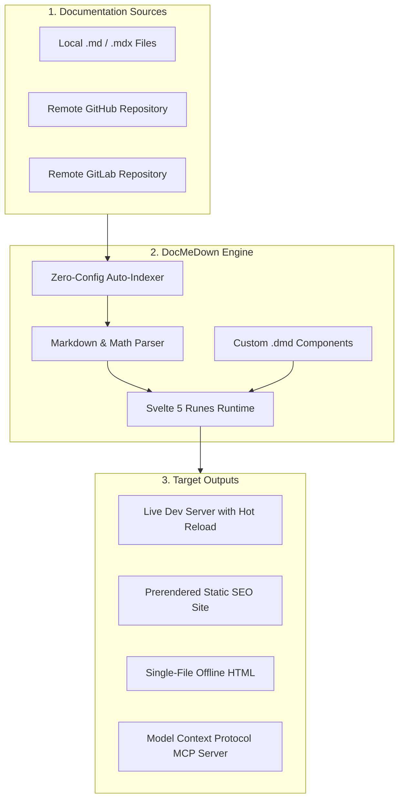

# Welcome to DocMeDown ⚡
### *The simplest MarkDown documenter yet!*

**DocMeDown** eliminates documentation friction completely. It gives developers the aesthetic polish and interactive power of modern documentation platforms like **Docusaurus**, **VitePress**, or **Mintlify** — without the complex configuration files, heavy build pipelines, or static routing boilerplate.

Write standard Markdown files, and DocMeDown handles auto-indexing, interactive component mounting, syntax highlighting, fuzzy search (<Kbd>⌘K</Kbd>), theme switching, static SEO prerendering, and air-gapped single-file distribution automatically.

---

## ⚡ 30-Second Quick Start

Get a modern documentation site running in three steps:

<Tabs type="pills">
  <Tab label="1. Scaffold Docs" icon="🚀">
```bash
npx docmedown
```
Automatically detects root markdown files (`README.md`, `CONTRIBUTING.md`, `ROADMAP.md`, etc.), links both root and `./docs/` at top level without an artificial `./docs/` subdivision, and initializes configuration.
  </Tab>
  <Tab label="2. Live Preview" icon="🔥">
```bash
npx docmedown serve ./docs
```
Launches an ultra-fast dev server at `http://localhost:3000` with WebSocket-backed in-place hot live-reloading.
  </Tab>
  <Tab label="3. Production Build" icon="📦">
```bash
npx docmedown build ./docs
```
Prerenders static SEO pages, emits AI context (`llms.txt`), and generates a 100% offline single-file `.dist/index.html`.
  </Tab>
</Tabs>

---

## 🎨 Interactive Multi-Framework Components

DocMeDown acts as a universal component orchestration layer. You can author interactive widgets using **native Svelte 5 (runes)**, **React with TypeScript (TSX)**, or standard **Web Elements (Lit)** — and use them directly in Markdown without imports:

### 1. Native Svelte 5 (`.dmd/CounterWidget.svelte`)
<CounterWidget title="Live Svelte 5 Widget in Markdown" />

### 2. React TSX (`.dmd/ReactMetricCard.tsx`)
<ReactMetricCard label="Query Throughput" initial={1200} unit="req/s" />

### 3. Web Element / Lit (`.dmd/LitStatusBadge.ts`)
<LitStatusBadge label="Production Cluster" status="operational" />

### 4. Live Theme & Appearance Controller (`.dmd/InteractiveThemeDemo.svelte`)
<InteractiveThemeDemo />

---

## 🏛️ The Four Pillars of DocMeDown

<CardGrid cols={2}>
  <Card
    title="1. Zero-Friction Local Docs"
    description="Drop index.html and write Markdown. No bundlers, no config files, instant client-side fuzzy search (⌘K)."
    href="#/getting-started"
    badge="Zero Config"
    badgeType="success"
    color="blue"
  />
  <Card
    title="2. Dynamic Remote Git Sources"
    description="Point directly to any GitHub or GitLab repository. Readers see live updates as soon as commits are merged."
    href="#/guides/remote-github"
    badge="Cloud Git"
    badgeType="info"
    color="violet"
  />
  <Card
    title="3. 100% Offline Single-File HTML"
    description="Double-click file:/// HTML bundles. Zero web server, zero CORS errors, perfect for air-gapped systems."
    href="#/guides/offline-mode"
    badge="Air-Gapped"
    badgeType="warning"
    color="amber"
  />
  <Card
    title="4. AI-Native with MCP & llms.txt"
    description="Built-in Model Context Protocol server connects docs directly to Claude Desktop, Cursor, and Windsurf."
    href="#/guides/mcp-server"
    badge="AI Ready"
    badgeType="new"
    color="green"
  />
</CardGrid>

---

## 🏗️ Architecture Pipeline



---

## ⚡ Feature Comparison Matrix

| Feature | **DocMeDown** | Docusaurus | Docsify | VitePress | Mintlify |
| :--- | :---: | :---: | :---: | :---: | :---: |
| **Setup Time** | **< 10 seconds** ⚡ | ~5-10 mins | ~2 mins | ~3 mins | ~5 mins |
| **Zero-Config Mode** | **Yes** ✅ | No ❌ | Partial ⚠️ | No ❌ | No ❌ |
| **Dynamic Remote Git Sync** | **Yes (GitHub/GitLab)** 🌐 | No ❌ | Partial ⚠️ | No ❌ | No ❌ |
| **Air-Gapped Single-File HTML** | **Yes (Double-Clickable)** 📦 | No ❌ | No ❌ | No ❌ | No ❌ |
| **Multi-Framework Custom Components** | **Yes (Svelte, React, Lit)** 🧩 | React MDX only | Plugins | Vue 3 only | React MDX only |
| **Built-in Fuzzy Search (<Kbd>⌘K</Kbd>)** | **Yes (Zero Setup)** 🔍 | Plugin required | Plugin required | Built-in | Cloud-hosted |
| **In-Browser 2-Way Editor (<Kbd>Ctrl+E</Kbd>)** | **Yes (Built-in)** ✏️ | No ❌ | No ❌ | No ❌ | Web only |
| **Staged Previews (`--preview`)** | **Yes (Built-in)** 🎭 | No ❌ | No ❌ | No ❌ | No ❌ |
| **Interactive Mermaid & KaTeX** | **Built-in** 📊 | Plugins | Plugins | Built-in | Built-in |
| **Native AI Model Context Protocol (MCP)** | **Built-in (Stdio & SSE)** 🤖 | No ❌ | No ❌ | No ❌ | No ❌ |
| **Automated `llms.txt` & `SKILL.md`** | **Built-in** 🧠 | No ❌ | No ❌ | No ❌ | No ❌ |

---

## 🗺️ Guided Documentation Journey

Follow the linear curriculum below or jump directly to your topic of interest:

<CardGrid cols={3}>
  <Card
    title="1. Getting Started"
    description="Step-by-step setup tutorial, package scripts, and your first documentation site."
    href="#/getting-started"
    icon="🚀"
    badge="Tutorial"
    badgeType="success"
  />
  <Card
    title="2. Project Structure"
    description="Directory layout, frontmatter options, auto-indexing rules, and custom sidebars."
    href="#/guides/project-structure"
    icon="📁"
    badge="Guide"
    badgeType="info"
  />
  <Card
    title="3. Engine Architecture"
    description="Under the hood: Svelte 5 runes runtime, virtual loader, and offline compression."
    href="#/guides/architecture"
    icon="🏛️"
    badge="Deep Dive"
    badgeType="info"
  />
  <Card
    title="4. Markdown & Math"
    description="GitHub alerts, syntax highlighting with line-level focus, and LaTeX math formulas."
    href="#/guides/markdown-features"
    icon="📝"
    badge="Authoring"
    badgeType="info"
  />
  <Card
    title="5. Mermaid Diagrams"
    description="Interactive flowcharts, sequence diagrams, and auto theme synchronization."
    href="#/guides/mermaid-diagrams"
    icon="📊"
    badge="Visuals"
    badgeType="info"
  />
  <Card
    title="6. Built-in UI Primitives"
    description="Reference for all 20 elements: CardGrid, Tabs, Badges, Callouts, Media, and Buttons."
    href="#/guides/built-in-components"
    icon="🧩"
    badge="20 Elements"
    badgeType="info"
  />
  <Card
    title="7. Custom Components"
    description="Author interactive components in Svelte 5, React TSX, or Web Elements in .dmd/."
    href="#/guides/custom-components"
    icon="⚡"
    badge="Multi-FW"
    badgeType="new"
  />
  <Card
    title="8. Next-Gen DX & Editor"
    description="True in-place HMR, split-view in-browser editor (Ctrl+E), and staged previews."
    href="#/guides/developer-experience"
    icon="🔥"
    badge="v0.9.0"
    badgeType="new"
  />
  <Card
    title="9. Static Site & SEO"
    description="Prerendered SSG, pushState hydration, sitemaps, robots.txt, and hosting tutorials."
    href="#/guides/static-site"
    icon="🌐"
    badge="Deployment"
    badgeType="info"
  />
  <Card
    title="10. Offline Single-File"
    description="Air-gapped self-extracting single-file HTML bundles with zero CORS errors."
    href="#/guides/offline-mode"
    icon="📦"
    badge="Air-Gapped"
    badgeType="warning"
  />
  <Card
    title="11. Dynamic Remote Git"
    description="Live zero-hosting documentation directly streaming from GitHub or GitLab."
    href="#/guides/remote-github"
    icon="☁️"
    badge="Cloud Git"
    badgeType="info"
  />
  <Card
    title="12. AI-Native MCP Server"
    description="Connect Cursor, Claude Desktop, and Windsurf to your documentation knowledge."
    href="#/guides/mcp-server"
    icon="🤖"
    badge="AI Ready"
    badgeType="success"
  />
  <Card
    title="13. Configuration Reference"
    description="Complete cookbook and schema reference for docs.json, theme families, and branding."
    href="#/configuration"
    icon="⚙️"
    badge="Reference"
    badgeType="info"
  />
  <Card
    title="14. CLI Command Matrix"
    description="Comprehensive flag guide for init, serve, build, validate, doctor, and mcp."
    href="#/guides/cli-reference"
    icon="💻"
    badge="CLI"
    badgeType="info"
  />
  <Card
    title="15. Migration Guides"
    description="Step-by-step recipes to migrate from Docusaurus, VitePress, Docsify, or MkDocs."
    href="#/guides/migrations"
    icon="🔄"
    badge="Migration"
    badgeType="info"
  />
</CardGrid>

---

## 🗺️ Begin the Journey

Ready to get started? Head directly into the step-by-step tutorial:

<CardGrid cols={1}>
  <Card
    title="Step 1: Getting Started Tutorial"
    description="From zero to production-grade documentation in seconds. Real-world walkthrough for local projects, components, and builds."
    href="#/getting-started"
    icon="🚀"
    badge="Start Here"
    badgeType="success"
  />
</CardGrid>
