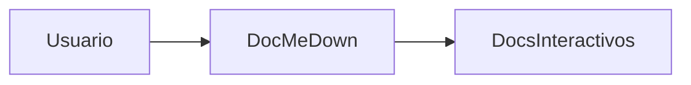

# Tutorial de Inicio Rápido 🚀

¡Bienvenido a DocMeDown! Este tutorial te guía paso a paso desde un directorio vacío hasta un portal de documentación completo y de nivel de producción con widgets interactivos, búsqueda instantánea y distribución en archivo único para entornos aislados (air-gapped).

---

## 📋 Requisitos Previos

DocMeDown está construido sobre JavaScript moderno y estándares web:
- **Node.js**: `v20.19.0` o superior (se recomienda Node 22+).
- **Gestor de Paquetes**: `npm`, `pnpm` o `bun`.

Verifica tu versión actual de Node:
```bash
node --version
```

---

## ⚡ Opciones de Instalación

Puedes ejecutar DocMeDown sin instalación previa usando `npx`, instalarlo globalmente para mayor comodidad, o añadirlo como dependencia del proyecto:

<Tabs type="pills">
  <Tab label="1. npx (Sin Instalación)" icon="⚡">
```bash
npx docmedown init ./docs
npx docmedown serve ./docs
```
Ejecuta la versión más reciente directamente desde npm sin alterar tu entorno global.
  </Tab>

  <Tab label="2. CLI Global (npm / pnpm / bun)" icon="🌍">
```bash
# Usando npm:
npm install -g docmedown

# Usando pnpm:
pnpm add -g docmedown

# Usando bun:
bun add -g docmedown

# Ahora ejecuta los comandos directamente:
docmedown init ./docs
```
  </Tab>

  <Tab label="3. Dependencia de Desarrollo en el Proyecto" icon="📦">
```bash
# Añade a tu proyecto existente:
npm install --save-dev docmedown

# Añade scripts a tu package.json:
{
  "scripts": {
    "docs:dev": "docmedown serve ./docs",
    "docs:build": "docmedown build ./docs",
    "docs:check": "docmedown validate ./docs && docmedown doctor ./docs"
  }
}
```
  </Tab>
</Tabs>

---

## 🛠️ Guía Paso a Paso

Sigue estos 6 pasos para crear y publicar tu sitio de documentación:

### Paso 1: Estructurar el directorio de documentación

Ejecuta `docmedown init` en la raíz de tu proyecto:

```bash
npx docmedown init ./docs
```

Esto genera una estructura de directorios limpia y lista para producción con configuraciones por defecto razonables:

```
mi-proyecto/
├── README.md                 # El readme de la raíz del proyecto (detectado y preservado)
├── CONTRIBUTING.md           # Guía de la raíz (vinculada automáticamente a docs)
├── CHANGELOG.md              # Changelog de la raíz (vinculado automáticamente a docs)
└── docs/                     # Raíz de la documentación: SOLO fuentes + symlink index.html
    ├── index.html            # Symlink → .dmd/index.html (sitio SEO para servir)
    ├── getting-started.md    # Guía inicial (#/getting-started)
    ├── guides/
    │   └── custom-components.md  # Documento de categoría
    └── .dmd/
        ├── .config/docs.json         # Marca, familia de tema y navegación del sitio
        └── .components/
            └── CounterWidget.svelte  # Componente Svelte 5 con runes interactivo
```

> [!NOTE]
> **Lectura Unificada de la Raíz y `./docs/`**: DocMeDown detecta automáticamente archivos Markdown en la raíz (`README.md`, `CONTRIBUTING.md`, `CHANGELOG.md`, `ROADMAP.md`, etc.) y los vincula a `./docs/` de forma predeterminada. Aparecen como documentos de primer nivel junto a las páginas de `./docs/` en el nivel superior de navegación, sin una subdivisión artificial de `./docs/`.

---

### Paso 2: Iniciar el servidor de desarrollo en vivo

Inicia el servidor de desarrollo:

```bash
npx docmedown serve ./docs
```

La CLI muestra:
```
⚡ DocMeDown Dev Server
  Local:    http://localhost:3000
  Root:     ./docs
  Mode:     Production Preview (WebSocket HMR Active)
```

DocMeDown abre tu navegador web predeterminado automáticamente.

### Lo que hace especial a este servidor de desarrollo:
- **Cero Espera de Empaquetador**: ¡Inicia en menos de **10 milisegundos**!
- **HMR Auténtico In Situ**: Los cambios se actualizan vía WebSocket al instante sin recargar la pestaña del navegador ni perder la posición de lectura.
- **Búsqueda Aproximada Instantánea (<Kbd>⌘K</Kbd>)**: El índice de búsqueda se actualiza dinámicamente según escribes.

---

### Paso 3: Escribir tu primer documento

Crea un nuevo archivo en `docs/guides/first-guide.md`:

```markdown title="docs/guides/first-guide.md"
---
title: Mi Primera Guía
description: Una introducción a la redacción de documentación con DocMeDown.
order: 1
icon: 🚀
tags: [tutorial, principiante]
---

# Mi Primera Guía 🚀

¡Escribir documentación con DocMeDown es sumamente sencillo!

> [!TIP]
> Este es un callout de alerta estilo GitHub. ¡Se adapta automáticamente a los modos claro y oscuro!

## Ejemplo de Código

```javascript title="src/index.js" {2}
const app = require("express")();
app.get("/", (req, res) => res.send("Hello World!"));
app.listen(3000);
```

## Diagrama de Arquitectura


```

Guarda el archivo. ¡Verás que tu navegador se actualiza **instantáneamente sin recargar la página**!

---

### Paso 4: Añadir un widget interactivo Svelte 5

DocMeDown permite incrustar microcomponentes reactivos directamente en Markdown. Solo coloca cualquier archivo `.svelte`, `.tsx` o `.ts` en `docs/.dmd/`.

Crea `docs/.dmd/ApiTester.svelte`:

```svelte title="docs/.dmd/ApiTester.svelte"
<svelte:options customElement="dmd-api-tester" />

<script lang="ts">
  let endpoint = $state("https://api.github.com/zen");
  let response = $state<string | null>(null);
  let loading = $state(false);

  async function fetchZen() {
    loading = true;
    try {
      const res = await fetch(endpoint);
      response = await res.text();
    } catch {
      response = "Error al obtener respuesta.";
    } finally {
      loading = false;
    }
  }
</script>

<div class="api-tester-card">
  <div class="input-row">
    <code>{endpoint}</code>
    <button onclick={fetchZen} disabled={loading}>
      {loading ? "Obteniendo..." : "Probar Endpoint"}
    </button>
  </div>
  {#if response}
    <div class="result-box">
      <strong>Respuesta:</strong> <em>"{response}"</em>
    </div>
  {/if}
</div>

<style>
  .api-tester-card {
    padding: 1rem 1.25rem;
    border-radius: 8px;
    background: var(--dmd-bg-card, #1e1e2e);
    border: 1px solid var(--dmd-border-color, #333);
    margin: 1.5rem 0;
  }
  .input-row {
    display: flex;
    justify-content: space-between;
    align-items: center;
    gap: 12px;
  }
  button {
    padding: 6px 14px;
    background: var(--dmd-primary, #6366f1);
    color: white;
    border: none;
    border-radius: 6px;
    cursor: pointer;
    font-weight: 500;
  }
  .result-box {
    margin-top: 12px;
    padding-top: 12px;
    border-top: 1px dashed var(--dmd-border-color, #444);
    color: var(--dmd-text-primary, #fff);
  }
</style>
```

Ahora, simplemente usa `<ApiTester />` en cualquier parte de tu Markdown:

```markdown
Prueba nuestra API en vivo directamente aquí en el manual:

<ApiTester />
```

<ApiTester />

---

### Paso 5: Validar y ejecutar comprobaciones de salud

Antes de publicar, verifica que tus enlaces, anclas y esquemas estén correctos:

```bash
# Valida enlaces rotos, anclas faltantes y esquemas de frontmatter:
npx docmedown validate ./docs

# Ejecuta diagnósticos de entorno y componentes personalizados:
npx docmedown doctor ./docs
```

---

### Paso 6: Compilar para producción

Cuando estés listo para desplegar, ejecuta:

```bash
npx docmedown build ./docs
```

DocMeDown genera:
1. **Sitio Estático Prerenderizado**: HTML estático puro con etiquetas `<head>` para SEO, tarjetas Open Graph, `sitemap.xml` y `robots.txt`.
2. **Archivos de Contexto para IA**: `llms.txt`, `llms-full.txt` y `SKILL.md` para agentes de programación con IA.
3. **HTML de Archivo Único 100% Offline**: `.dmd/.singlefile/index.html` — ejecutable con doble clic sin necesidad de servidor web ni errores de CORS. (El symlink `docs/index.html` apunta al sitio SEO listo para servir en su lugar).

---

## 🗺️ Próximos Pasos

Continúa a lo largo del recorrido lineal de la documentación:

<CardGrid cols={2}>
  <Card
    title="Estructura del Proyecto"
    description="Comprende la distribución de directorios, metadatos de frontmatter y árboles de navegación."
    href="#/guides/project-structure"
    badge="Siguiente"
    badgeType="info"
  />
  <Card
    title="Bienvenida y Visión General"
    description="Revisa la filosofía central y la matriz comparativa de características."
    href="#/README"
    badge="Anterior"
    badgeType="success"
  />
</CardGrid>
