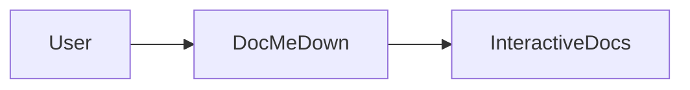

# Getting Started Tutorial 🚀

Welcome to DocMeDown! This tutorial guides you step-by-step from an empty directory to a fully fledged, production-grade documentation portal with interactive widgets, instant search, and air-gapped offline distribution.

---

## 📋 Prerequisites

DocMeDown is built on modern JavaScript and web standards:
- **Node.js**: `v20.19.0` or higher (Node 22+ recommended).
- **Package Manager**: `npm`, `pnpm`, or `bun`.

Check your current Node version:
```bash
node --version
```

---

## ⚡ Installation Options

You can run DocMeDown with zero prior installation using `npx`, install it globally for convenience, or add it as a project dependency:

<Tabs type="pills">
  <Tab label="1. npx (Zero Install)" icon="⚡">
```bash
npx docmedown init ./docs
npx docmedown serve ./docs
```
Runs the latest release directly from npm without polluting your global environment.
  </Tab>

  <Tab label="2. Global CLI (npm / pnpm / bun)" icon="🌍">
```bash
# Using npm:
npm install -g docmedown

# Using pnpm:
pnpm add -g docmedown

# Using bun:
bun add -g docmedown

# Now run commands directly:
docmedown init ./docs
```
  </Tab>

  <Tab label="3. Project Dev Dependency" icon="📦">
```bash
# Add to your existing project:
npm install --save-dev docmedown

# Add scripts to your package.json:
{
  "scripts": {
    "docs:dev": "docmedown serve ./docs",
    "docs:build": "docmedown build ./docs",
    "docs:check": "docmedown validate ./docs && docmedown doctor ./docs"
  }
}
```
  </Tab>
</Tabs>

---

## 🛠️ Step-by-Step Walkthrough

Follow these 6 steps to create and publish your documentation site:

### Step 1: Scaffold your documentation directory

Run `docmedown init` in your project root:

```bash
npx docmedown init ./docs
```

This generates a clean, production-ready directory structure with sensible defaults:

```
my-project/
└── docs/
    ├── docs.json                 # Site branding, theme family & navigation
    ├── README.md                 # Home page document (serves at #/README)
    ├── getting-started.md        # Starter guide (#/getting-started)
    ├── guides/
    │   ├── installation.md       # Category document
    │   └── configuration.md      # Category document
    └── .dmd/
        └── CounterWidget.svelte  # Svelte 5 interactive runes component
```

---

### Step 2: Start the live development server

Launch the dev server:

```bash
npx docmedown serve ./docs
```

The CLI prints:
```
⚡ DocMeDown Dev Server
  Local:    http://localhost:3000
  Root:     ./docs
  Mode:     Production Preview (WebSocket HMR Active)
```

DocMeDown opens your default web browser automatically.

### What makes this dev server special:
- **Zero Bundler Delay**: Boots in under **10 milliseconds**!
- **True In-Place HMR**: Edits update via WebSocket instantly without reloading the browser tab or resetting your reading scroll position.
- **Instant Fuzzy Search (<Kbd>⌘K</Kbd>)**: Search index updates dynamically as you type.

---

### Step 3: Write your first document

Create a new file at `docs/guides/first-guide.md`:

```markdown title="docs/guides/first-guide.md"
---
title: My First Guide
description: An introduction to writing documentation with DocMeDown.
order: 1
icon: 🚀
tags: [tutorial, beginner]
---

# My First Guide 🚀

Writing documentation with DocMeDown is effortless!

> [!TIP]
> This is a GitHub-style alert callout. It adapts automatically to dark and light modes!

## Code Example

```javascript title="src/index.js" {2}
const app = require("express")();
app.get("/", (req, res) => res.send("Hello World!"));
app.listen(3000);
```

## Architecture Diagram


```

Save the file. Notice that your browser updates **instantly without reloading the page**!

---

### Step 4: Add an interactive Svelte 5 widget

DocMeDown lets you embed reactive micro-components directly into Markdown. Drop any `.svelte`, `.tsx`, or `.ts` file into `docs/.dmd/`.

Create `docs/.dmd/ApiTester.svelte`:

```svelte title="docs/.dmd/ApiTester.svelte"
<svelte:options customElement="dmd-api-tester" />

<script lang="ts">
  let endpoint = $state("https://api.github.com/zen");
  let response = $state<string | null>(null);
  let loading = $state(false);

  async function fetchZen() {
    loading = true;
    try {
      const res = await fetch(endpoint);
      response = await res.text();
    } catch {
      response = "Failed to fetch response.";
    } finally {
      loading = false;
    }
  }
</script>

<div class="api-tester-card">
  <div class="input-row">
    <code>{endpoint}</code>
    <button onclick={fetchZen} disabled={loading}>
      {loading ? "Fetching..." : "Test Endpoint"}
    </button>
  </div>
  {#if response}
    <div class="result-box">
      <strong>Response:</strong> <em>"{response}"</em>
    </div>
  {/if}
</div>

<style>
  .api-tester-card {
    padding: 1rem 1.25rem;
    border-radius: 8px;
    background: var(--dmd-bg-card, #1e1e2e);
    border: 1px solid var(--dmd-border-color, #333);
    margin: 1.5rem 0;
  }
  .input-row {
    display: flex;
    justify-content: space-between;
    align-items: center;
    gap: 12px;
  }
  button {
    padding: 6px 14px;
    background: var(--dmd-primary, #6366f1);
    color: white;
    border: none;
    border-radius: 6px;
    cursor: pointer;
    font-weight: 500;
  }
  .result-box {
    margin-top: 12px;
    padding-top: 12px;
    border-top: 1px dashed var(--dmd-border-color, #444);
    color: var(--dmd-text-primary, #fff);
  }
</style>
```

Now, simply use `<ApiTester />` anywhere in your Markdown:

```markdown
Test our live API right here in the manual:

<ApiTester />
```

<ApiTester />

---

### Step 5: Validate and run health checks

Before publishing, verify that your links, anchors, and schemas are healthy:

```bash
# Validate broken links, missing anchors, and frontmatter schemas:
npx docmedown validate ./docs

# Run environment and custom component diagnostics:
npx docmedown doctor ./docs
```

---

### Step 6: Build for production

When you're ready to ship, run:

```bash
npx docmedown build ./docs
```

DocMeDown generates:
1. **Prerendered Static Site**: Pure static HTML with SEO `<head>` tags, Open Graph cards, `sitemap.xml`, and `robots.txt`.
2. **AI Context Files**: `llms.txt`, `llms-full.txt`, and `SKILL.md` for AI coding agents.
3. **100% Offline Single-File HTML**: `.dist/index.html` — double-clickable without a web server or CORS errors.

---

## 🗺️ Next Steps

Continue along the linear documentation journey:

<CardGrid cols={2}>
  <Card
    title="Project Structure"
    description="Understand directory layout, frontmatter metadata, and navigation trees."
    href="#/guides/project-structure"
    badge="Next Up"
    badgeType="info"
  />
  <Card
    title="Welcome & Overview"
    description="Review the core philosophy and feature comparison matrix."
    href="#/README"
    badge="Previous"
    badgeType="success"
  />
</CardGrid>
