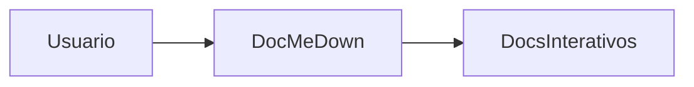

# Tutorial de Início Rápido 🚀

Bem-vindo ao DocMeDown! Este tutorial guia você passo a passo desde um diretório vazio até um portal de documentação completo e de nível de produção com widgets interativos, busca instantânea e distribuição em arquivo único para ambientes isolados (air-gapped).

---

## 📋 Pré-requisitos

O DocMeDown é construído sobre JavaScript moderno e padrões da web:
- **Node.js**: `v20.19.0` ou superior (Node 22+ recomendado).
- **Gerenciador de Pacotes**: `npm`, `pnpm` ou `bun`.

Verifique sua versão atual do Node:
```bash
node --version
```

---

## ⚡ Opções de Instalação

Você pode executar o DocMeDown sem instalação prévia usando `npx`, instalá-lo globalmente para conveniência, ou adicioná-lo como dependência do projeto:

<Tabs type="pills">
  <Tab label="1. npx (Zero Instalação)" icon="⚡">
```bash
npx docmedown init ./docs
npx docmedown serve ./docs
```
Executa a versão mais recente diretamente do npm sem poluir seu ambiente global.
  </Tab>

  <Tab label="2. CLI Global (npm / pnpm / bun)" icon="🌍">
```bash
# Usando npm:
npm install -g docmedown

# Usando pnpm:
pnpm add -g docmedown

# Usando bun:
bun add -g docmedown

# Agora execute os comandos diretamente:
docmedown init ./docs
```
  </Tab>

  <Tab label="3. Dependência de Desenvolvimento no Projeto" icon="📦">
```bash
# Adicione ao seu projeto existente:
npm install --save-dev docmedown

# Adicione scripts ao seu package.json:
{
  "scripts": {
    "docs:dev": "docmedown serve ./docs",
    "docs:build": "docmedown build ./docs",
    "docs:check": "docmedown validate ./docs && docmedown doctor ./docs"
  }
}
```
  </Tab>
</Tabs>

---

## 🛠️ Passo a Passo Prático

Siga estes 6 passos para criar e publicar seu site de documentação:

### Passo 1: Estruturar o diretório de documentação

Execute `docmedown init` na raiz do seu projeto:

```bash
npx docmedown init ./docs
```

Isso gera uma estrutura de diretórios limpa e pronta para produção com padrões sensatos:

```
meu-projeto/
├── README.md                 # O readme da raiz do projeto (detectado e preservado)
├── CONTRIBUTING.md           # Guia da raiz (vinculado aos docs automaticamente)
├── CHANGELOG.md              # Changelog da raiz (vinculado aos docs automaticamente)
└── docs/                     # Raiz da documentação: APENAS fontes + symlink index.html
    ├── index.html            # Symlink → .dmd/index.html (site SEO para servir)
    ├── getting-started.md    # Guia inicial (#/getting-started)
    ├── guides/
    │   └── custom-components.md  # Documento de categoria
    └── .dmd/
        ├── .config/docs.json         # Marca, família de tema e navegação do site
        └── .components/
            └── CounterWidget.svelte  # Componente Svelte 5 com runes interativo
```

> [!NOTE]
> **Leitura Unificada da Raiz & `./docs/`**: O DocMeDown detecta automaticamente arquivos Markdown na raiz (`README.md`, `CONTRIBUTING.md`, `CHANGELOG.md`, `ROADMAP.md`, etc.) e os vincula a `./docs/` por padrão. Eles aparecem como documentos de primeira classe junto com as páginas de `./docs/` no nível superior da navegação, sem uma subdivisão artificial de `./docs/`.

---

### Passo 2: Iniciar o servidor de desenvolvimento ao vivo

Inicie o servidor de desenvolvimento:

```bash
npx docmedown serve ./docs
```

A CLI exibe:
```
⚡ DocMeDown Dev Server
  Local:    http://localhost:3000
  Root:     ./docs
  Mode:     Production Preview (WebSocket HMR Active)
```

O DocMeDown abre seu navegador padrão automaticamente.

### O que torna este servidor de desenvolvimento especial:
- **Zero Espera de Bundler**: Inicializa em menos de **10 milissegundos**!
- **HMR Autêntico no Local**: Alterações são atualizadas via WebSocket instantaneamente sem recarregar a aba ou perder a posição de rolagem.
- **Busca Aproximada Instantânea (<Kbd>⌘K</Kbd>)**: O índice de busca se atualiza dinamicamente conforme você digita.

---

### Passo 3: Escrever seu primeiro documento

Crie um novo arquivo em `docs/guides/first-guide.md`:

```markdown title="docs/guides/first-guide.md"
---
title: Meu Primeiro Guia
description: Uma introdução à escrita de documentação com DocMeDown.
order: 1
icon: 🚀
tags: [tutorial, iniciante]
---

# Meu Primeiro Guia 🚀

Escrever documentação com DocMeDown não exige esforço!

> [!TIP]
> Este é um callout de alerta estilo GitHub. Ele se adapta automaticamente aos modos claro e escuro!

## Exemplo de Código

```javascript title="src/index.js" {2}
const app = require("express")();
app.get("/", (req, res) => res.send("Hello World!"));
app.listen(3000);
```

## Diagrama de Arquitetura


```

Salve o arquivo. Observe que seu navegador é atualizado **instantaneamente sem recarregar a página**!

---

### Passo 4: Adicionar um widget interativo Svelte 5

O DocMeDown permite incorporar microcomponentes reativos diretamente no Markdown. Basta colocar qualquer arquivo `.svelte`, `.tsx` ou `.ts` em `docs/.dmd/`.

Crie `docs/.dmd/ApiTester.svelte`:

```svelte title="docs/.dmd/ApiTester.svelte"
<svelte:options customElement="dmd-api-tester" />

<script lang="ts">
  let endpoint = $state("https://api.github.com/zen");
  let response = $state<string | null>(null);
  let loading = $state(false);

  async function fetchZen() {
    loading = true;
    try {
      const res = await fetch(endpoint);
      response = await res.text();
    } catch {
      response = "Falha ao obter resposta.";
    } finally {
      loading = false;
    }
  }
</script>

<div class="api-tester-card">
  <div class="input-row">
    <code>{endpoint}</code>
    <button onclick={fetchZen} disabled={loading}>
      {loading ? "Buscando..." : "Testar Endpoint"}
    </button>
  </div>
  {#if response}
    <div class="result-box">
      <strong>Resposta:</strong> <em>"{response}"</em>
    </div>
  {/if}
</div>

<style>
  .api-tester-card {
    padding: 1rem 1.25rem;
    border-radius: 8px;
    background: var(--dmd-bg-card, #1e1e2e);
    border: 1px solid var(--dmd-border-color, #333);
    margin: 1.5rem 0;
  }
  .input-row {
    display: flex;
    justify-content: space-between;
    align-items: center;
    gap: 12px;
  }
  button {
    padding: 6px 14px;
    background: var(--dmd-primary, #6366f1);
    color: white;
    border: none;
    border-radius: 6px;
    cursor: pointer;
    font-weight: 500;
  }
  .result-box {
    margin-top: 12px;
    padding-top: 12px;
    border-top: 1px dashed var(--dmd-border-color, #444);
    color: var(--dmd-text-primary, #fff);
  }
</style>
```

Agora, basta usar `<ApiTester />` em qualquer lugar do seu Markdown:

```markdown
Teste nossa API ao vivo diretamente aqui no manual:

<ApiTester />
```

<ApiTester />

---

### Passo 5: Validar e executar diagnósticos de integridade

Antes de publicar, verifique se seus links, âncoras e esquemas estão consistentes:

```bash
# Valida links quebrados, âncoras faltantes e esquemas de frontmatter:
npx docmedown validate ./docs

# Executa diagnósticos de ambiente e componentes customizados:
npx docmedown doctor ./docs
```

---

### Passo 6: Compilar para produção

Quando estiver pronto para distribuir, execute:

```bash
npx docmedown build ./docs
```

O DocMeDown gera:
1. **Site Estático Pré-renderizado**: HTML estático puro com tags `<head>` de SEO, cards Open Graph, `sitemap.xml` e `robots.txt`.
2. **Arquivos de Contexto para IA**: `llms.txt`, `llms-full.txt` e `SKILL.md` para agentes de codificação com IA.
3. **HTML de Arquivo Único 100% Offline**: `.dmd/.singlefile/index.html` — executável por clique duplo sem necessidade de servidor web ou problemas de CORS. (O link simbólico `docs/index.html` aponta para o site de SEO pronto para servidor).

---

## 🗺️ Próximos Passos

Continue a jornada linear de documentação:

<CardGrid cols={2}>
  <Card
    title="Estrutura do Projeto"
    description="Entenda o layout de diretórios, metadados de frontmatter e árvores de navegação."
    href="#/guides/project-structure"
    badge="A Seguir"
    badgeType="info"
  />
  <Card
    title="Bem-vindo e Visão Geral"
    description="Revise a filosofia central e a matriz de comparação de recursos."
    href="#/README"
    badge="Anterior"
    badgeType="success"
  />
</CardGrid>
