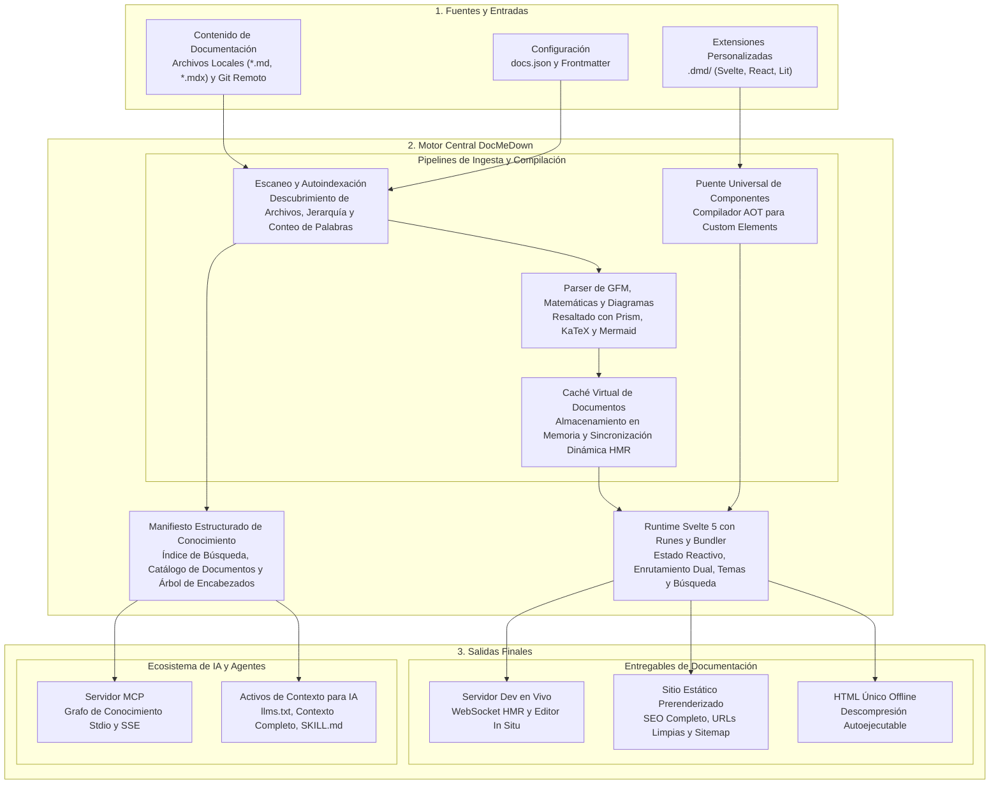
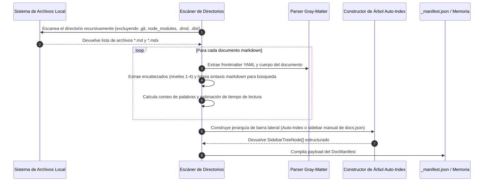
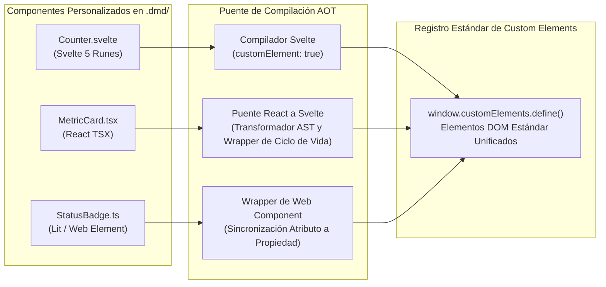

# Arquitectura del Motor y Cómo Funciona 🏛️

DocMeDown se diseñó desde primeros principios a partir de una premisa sencilla: **la documentación no debería requerir un stack de aplicación web pesado solo para leer unos pocos archivos Markdown**, y al mismo tiempo los desarrolladores merecen un acabado estético de primer nivel, búsqueda aproximada instantánea, widgets interactivos y distribución para entornos aislados (air-gapped).

Este documento explica la arquitectura interna de DocMeDown, trazando cómo se descubren, transforman, renderizan y empaquetan los documentos Markdown en todos los modos de ejecución.

---

## 🏗️ Arquitectura del Sistema de Alto Nivel

DocMeDown opera a través de tres etapas unificadas: **Fuentes**, el **Motor Central DocMeDown** y las **Salidas Finales**.



---

## ⚙️ Principios Arquitectónicos Centrales

### 1. Cero Fricción Primero
No se requieren archivos de configuración de webpack, vite, babel ni esquemas complejos de enrutamiento por directorios. Añadir un archivo Markdown a `./docs` lo incorpora inmediatamente al índice de búsqueda y a la barra lateral.

### 2. Runtime Nativo con Runes de Svelte 5
La interfaz de usuario de DocMeDown está construida exclusivamente en **Svelte 5**. Mediante reactividad granular (`$state`, `$derived`, `$props`, `$effect`):
- Las actualizaciones del DOM se ejecutan con precisión milimétrica sin la sobrecarga de un bucle pesado de reconciliación de DOM virtual.
- El uso de memoria en el cliente es notablemente ligero (< 15 MB de heap).
- La huella del paquete se mantiene compacta (< 500 KB de runtime servido).

### 3. Pipeline de Enrutamiento en Modo Dual
DocMeDown admite sin fisuras dos estrategias de enrutamiento según cómo se distribuya la documentación:

| Modo de Enrutamiento | Transporte | Mecanismo | Beneficio |
| :--- | :--- | :--- | :--- |
| **Enrutador Estático** | Servidores Web en Producción (GitHub Pages, Vercel, Netlify) | HTML5 History API (`pushState`) | URLs canónicas limpias (`/guides/architecture/`), primera pintura sin JavaScript, indexación SEO óptima. |
| **Enrutador Hash** | Sistema de Archivos Local y SPA (`file:///`, fallback de servidor dev) | Fragmento de URL (`#/guides/architecture`) | Funciona en cualquier parte sin reglas de reescritura en servidor, inmune a sandboxes de seguridad de `file:///`. |

Al acceder a una página estática prerenderizada, el enrutador estático detecta el entorno automáticamente e hidrata la ruta activa preservando el historial de navegación.

---

## 🔍 El Subsistema de Escaneo y Autoindexación

Cuando DocMeDown se inicializa (durante `serve`, `build`, `validate` o `mcp`), el escáner examina el directorio de destino:



### Normalización de Frontmatter
Cada documento se somete a normalización de frontmatter. Los slugs se derivan de las rutas relativas de archivo (por ejemplo, `guides/architecture.md` se convierte en el slug `guides/architecture`), mientras que `README.md` e `index.md` se normalizan a `README`.

---

## 📦 La Arquitectura de Archivo Único 100% Offline

Los generadores tradicionales de sitios estáticos producen cientos de archivos `.html`, `.js` y `.css` distintos. Abrir el `index.html` raíz directamente mediante `file:///C:/ruta/a/docs/index.html` falla en todos los navegadores modernos porque:
1. Los navegadores restringen las peticiones `fetch()` en orígenes `file:///` por motivos de seguridad (restricción CORS).
2. Las referencias a archivos relativos fallan al navegar entre directorios anidados.

### La Solución de DocMeDown: Envoltorio de Descompresión Autoejecutable

DocMeDown supera esto empaquetando todo el sitio en un **único archivo HTML autoejecutable** (`.dist/index.html`):

```
┌────────────────────────────────────────────────────────────────────────┐
│  Envoltorio en Archivo Único Offline index.html (~1.2 MB Gzip)         │
├────────────────────────────────────────────────────────────────────────┤
│  1. Script Bootstrap de Autoextracción (< 1 KB)                        │
│     - Verifica compatibilidad con window.DecompressionStream           │
│     - Decodifica payload Base64 en flujo binario                       │
│     - Descomprime el flujo Gzip en la memoria del navegador en < 15ms  │
├────────────────────────────────────────────────────────────────────────┤
│  2. Runtime Svelte 5 Incrustado y Tokens de Estilo                     │
│     - docmedown.web.js empaquetado y definiciones de temas             │
│     - Motor de diagramas Mermaid offline                               │
│     - Componentes personalizados de .dmd precompilados                 │
├────────────────────────────────────────────────────────────────────────┤
│  3. Payload del Corpus Comprimido en Base64 Gzip                       │
│     - Texto completo de todos los documentos Markdown                  │
│     - Tokens de búsqueda precalculados y árbol de navegación           │
│     - Subsitios anidados incrustados (si están configurados)           │
└────────────────────────────────────────────────────────────────────────┘
```

Al abrirse directamente mediante doble clic en el Explorador de Windows, Finder de macOS o gestores de archivos de Linux:
1. El ligero script de inicio se ejecuta de inmediato.
2. La API nativa del navegador `DecompressionStream("gzip")` extrae el corpus de documentación directamente en `window.__DOCMEDOWN_DATA__`.
3. El runtime de Svelte 5 se inicializa y monta la aplicación en menos de **25 milisegundos**.
4. **Resultado**: Búsqueda completa (<Kbd>⌘K</Kbd>), navegación integral, diagramas Mermaid interactivos y alternancia de temas funcionan 100% offline, sin servidor web y sin ningún error de CORS.

---

## 🧩 El Puente Universal de Componentes

DocMeDown te permite colocar archivos `.svelte`, `.tsx` o `.ts` dentro de `.dmd/`. ¿Cómo ejecuta DocMeDown componentes de React TSX y Lit dentro de un runtime de Svelte?



1. **Componentes Svelte 5**: Compilados directamente con `compiler.compile(source, { customElement: true })`, produciendo custom elements autónomos nativos con cero sobrecarga externa.
2. **Componentes React TSX**: Procesados con esbuild y envueltos en un puente ligero de ciclo de vida que mapea props y estado de React a atributos y slots estándar de Web Components.
3. **Web Components / Lit**: Registrados directamente en el registro nativo `customElements` del navegador.
4. **En Markdown**: Los autores usan etiquetas tipo HTML estándar (ej.: `<Counter />`, `<MetricCard />`), que el navegador monta y renderiza fluidamente sin requerir empaquetadores adicionales.

---

## 🤖 El Subsistema Model Context Protocol (MCP) para IA

En lugar de tratar a los asistentes de IA como un elemento accesorio, DocMeDown los trata como consumidores de primer nivel:

- **Transporte Stdio**: Permite que asistentes locales de IA (Cursor, Claude Desktop, Windsurf) ejecuten `docmedown mcp ./docs` como un subproceso local.
- **Transporte SSE**: Permite que microservicios en red y enjambres de agentes remotos consulten la documentación a través de Server-Sent Events vía HTTP.
- **Herramientas Estructuradas**:
  - `list_docs`: Devuelve el inventario de documentos con slugs, títulos, categorías y tiempos estimados de lectura.
  - `read_doc`: Devuelve el contenido Markdown limpio y el árbol estructurado de encabezados.
  - `search_docs`: Ejecuta búsqueda por palabras clave con clasificación por relevancia en todo el corpus.
  - `resolve_url`: Calcula URLs públicas canónicas.

---

## 🗺️ Próximos Pasos

Los elementos del puente React admiten ciclos de desconexión y reconexión tanto
en DOM ligero como en Shadow DOM opcional. La reconexión reutiliza la raíz de
sombra y sustituye el contenedor anterior; la desconexión desmonta la raíz React.

Continúa con el recorrido lineal de la documentación:

<CardGrid cols={2}>
  <Card
    title="Estructura del Proyecto"
    description="Comprende la distribución del workspace, reglas de autoindexación y opciones de docs.json."
    href="#/guides/project-structure"
    badge="Siguiente"
    badgeType="info"
  />
  <Card
    title="Primeros Pasos"
    description="Revisa el tutorial de inicio rápido y las guías paso a paso de configuración."
    href="#/getting-started"
    badge="Anterior"
    badgeType="success"
  />
</CardGrid>
