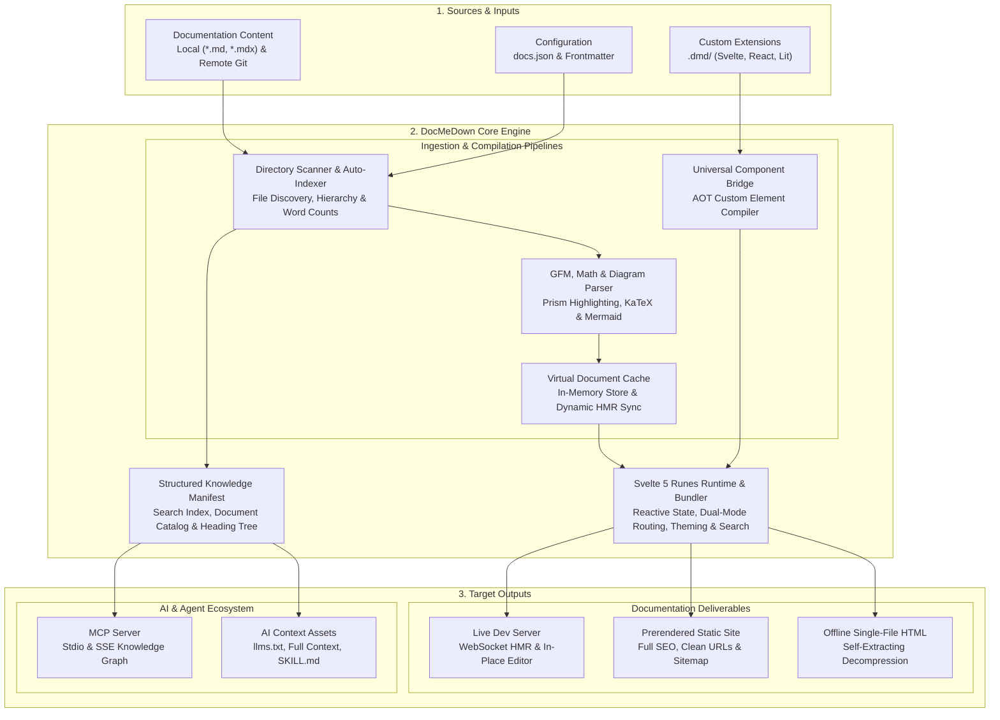
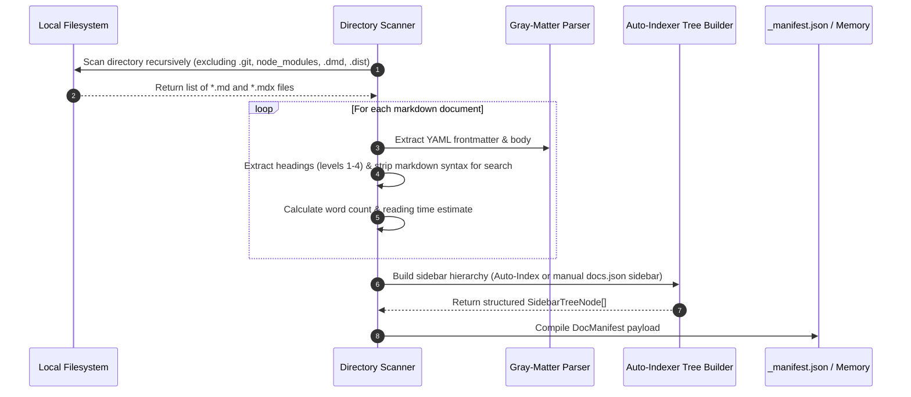
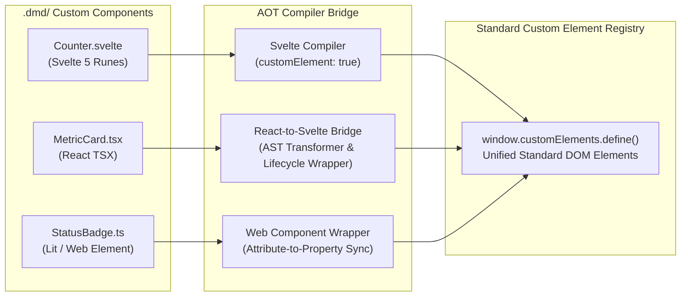

# Engine Architecture & How It Works 🏛️

DocMeDown is designed from first principles around a simple realization: **documentation should not require a heavy web application stack just to read a few Markdown files**, yet developers still deserve top-tier aesthetics, instant fuzzy search, interactive widgets, and air-gapped distribution.

This document explains the internal architecture of DocMeDown, tracing how Markdown documents are discovered, transformed, rendered, and packaged across all execution modes.

---

## 🏗️ High-Level System Architecture

DocMeDown operates across three unified stages: **Sources**, the **DocMeDown Core Engine**, and **Target Outputs**.



---

## ⚙️ Core Architectural Principles

### 1. Zero-Friction First
No webpack, no vite config files, no babel, and no complex directory routing schemas are needed. Dropping a Markdown file into `./docs` immediately adds it to the search index and sidebar navigation.

### 2. Svelte 5 Native Runes Runtime
DocMeDown's user interface is built exclusively on **Svelte 5**. Using fine-grained reactivity (`$state`, `$derived`, `$props`, `$effect`):
- DOM updates execute with surgical precision without a heavy virtual DOM reconciliation loop.
- Client memory usage is exceptionally light (< 15 MB heap).
- Bundle footprint remains compact (< 500 KB served runtime).

### 3. Dual-Mode Routing Pipeline
DocMeDown seamlessly supports two routing strategies depending on how the documentation is delivered:

| Routing Mode | Transport | Mechanism | Benefit |
| :--- | :--- | :--- | :--- |
| **Static Router** | Deployed Web Servers (GitHub Pages, Vercel, Netlify) | HTML5 History API (`pushState`) | Clean canonical URLs (`/guides/architecture/`), zero-JS first paint, optimal SEO indexing. |
| **Hash Router** | Local File System & SPA (`file:///`, dev server fallback) | URL Fragment (`#/guides/architecture`) | Works everywhere without web server rewrite rules, immune to `file:///` security sandboxes. |

When visiting a prerendered static page, the static router automatically detects the environment and hydrates the active route while preserving browser history navigation.

---

## 🔍 The Scanning & Auto-Indexing Subsystem

When DocMeDown initializes (during `serve`, `build`, `validate`, or `mcp`), the scanner scans the target directory:



### Frontmatter Normalization
Every document undergoes frontmatter normalization. Slugs are derived from relative file paths (e.g., `guides/architecture.md` becomes slug `guides/architecture`), while `README.md` and `index.md` normalize to `README`.

---

## 📦 The 100% Offline Single-File Architecture

Traditional static site generators generate hundreds of distinct `.html`, `.js`, and `.css` files. Opening the root `index.html` via `file:///C:/path/to/docs/index.html` fails in all modern browsers because:
1. Browsers restrict `fetch()` requests on `file:///` origins for security (CORS restriction).
2. Relative asset references fail when navigating across nested directory paths.

### The DocMeDown Solution: Self-Extracting Decompression Envelope

DocMeDown overcomes this by packaging the entire site into a **single, self-extracting HTML file** (`.dist/index.html`):

```
┌────────────────────────────────────────────────────────────────────────┐
│  Single-File Offline index.html Envelope (~1.2 MB Gzip)                │
├────────────────────────────────────────────────────────────────────────┤
│  1. Self-Extracting Bootstrap Script (< 1 KB)                          │
│     - Checks for window.DecompressionStream support                    │
│     - Decodes Base64 payload into binary stream                        │
│     - Decompresses Gzip stream in browser memory in < 15ms             │
├────────────────────────────────────────────────────────────────────────┤
│  2. Inlined Svelte 5 Runtime & Stylesheet Tokens                       │
│     - Bundled docmedown.web.js & theme definitions                     │
│     - Offline Mermaid diagram engine                                   │
│     - Precompiled .dmd custom components                               │
├────────────────────────────────────────────────────────────────────────┤
│  3. Base64 Gzip Compressed Corpus Payload                              │
│     - Full text of all Markdown documents                              │
│     - Precomputed search tokens and navigation tree                    │
│     - Embedded nested sub-sites (if configured)                        │
└────────────────────────────────────────────────────────────────────────┘
```

When opened directly via double-click in Windows Explorer, macOS Finder, or Linux file managers:
1. The tiny bootstrap executes immediately.
2. The browser's native `DecompressionStream("gzip")` extracts the documentation corpus directly into `window.__DOCMEDOWN_DATA__`.
3. The Svelte 5 runtime initializes and mounts the application in under **25 milliseconds**.
4. **Result**: Full search (<Kbd>⌘K</Kbd>), full navigation, interactive Mermaid diagrams, and theme toggling work 100% offline with zero web server and zero CORS errors.

---

## 🧩 The Universal Component Bridge

DocMeDown allows you to place `.svelte`, `.tsx`, or `.ts` files inside `.dmd/`. How does DocMeDown run React TSX and Lit components inside a Svelte runtime?



1. **Svelte 5 Components**: Compiled directly with `compiler.compile(source, { customElement: true })`, producing native autonomous custom elements with zero external overhead.
2. **React TSX Components**: Parsed with esbuild and wrapped in a lightweight lifecycle bridge that maps React props and state into standard Web Component attributes and slots.
3. **Web Components / Lit**: Registered directly into the browser's native `customElements` registry.
4. **In Markdown**: Authors use standard HTML-like tags (e.g., `<Counter />`, `<MetricCard />`), which are seamlessly mounted and rendered by the browser without touching a bundler.

---

## 🤖 The AI Model Context Protocol (MCP) Subsystem

Rather than treating AI assistants as an afterthought, DocMeDown treats AI models as first-class consumers:

- **Stdio Transport**: Enables local AI assistants (Cursor, Claude Desktop, Windsurf) to spawn `docmedown mcp ./docs` as a local subprocess.
- **SSE Transport**: Enables networked microservices and remote agent swarms to query documentation over HTTP Server-Sent Events.
- **Structured Tools**:
  - `list_docs`: Returns document inventory with slugs, titles, categories, and estimated reading times.
  - `read_doc`: Returns clean markdown content and structured heading trees.
  - `search_docs`: Executes ranked keyword search across the documentation corpus.
  - `resolve_url`: Computes public canonical URLs.

---

## 🗺️ Next Steps

React bridge elements support disconnect/reconnect cycles in both light DOM and
optional Shadow DOM. Reconnection reuses the shadow root and replaces the old
React host container; disconnect unmounts the previous React root.

Continue along the linear documentation journey:

<CardGrid cols={2}>
  <Card
    title="Project Structure"
    description="Understand the workspace layout, auto-indexing rules, and docs.json options."
    href="#/guides/project-structure"
    badge="Next Up"
    badgeType="info"
  />
  <Card
    title="Getting Started"
    description="Review the quickstart tutorial and step-by-step setup guides."
    href="#/getting-started"
    badge="Previous"
    badgeType="success"
  />
</CardGrid>
