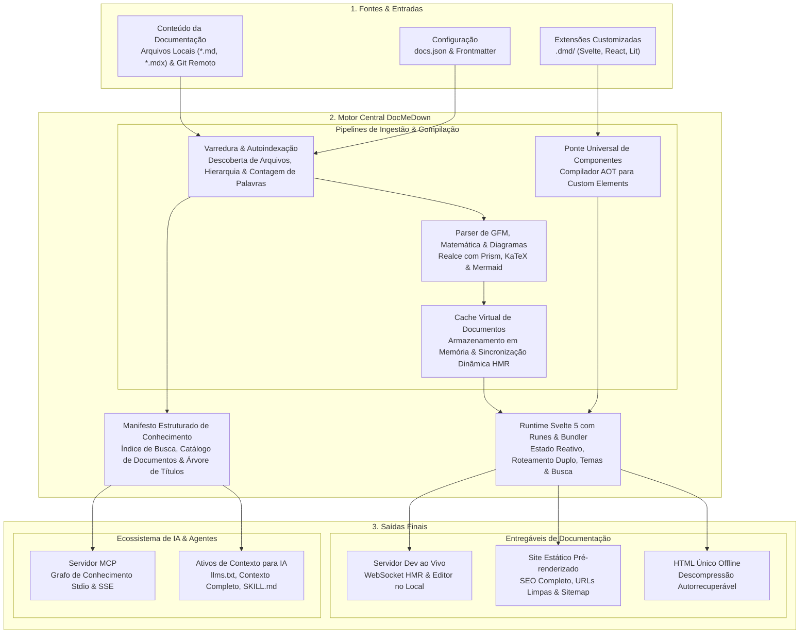
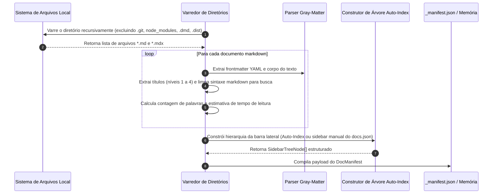
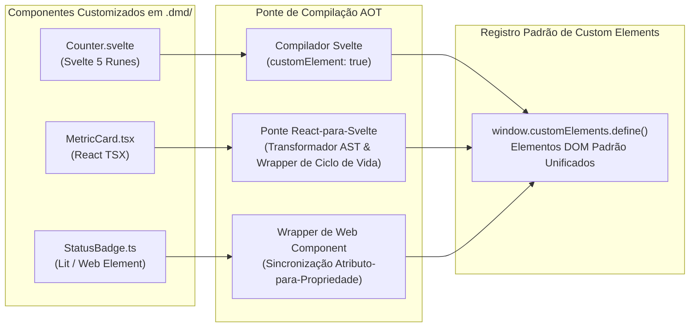

# Arquitetura do Motor e Como Funciona 🏛️

O DocMeDown foi concebido a partir de primeiros princípios em torno de uma constatação simples: **a documentação não deveria exigir uma pilha pesada de aplicação web apenas para ler alguns arquivos Markdown**, mas os desenvolvedores ainda merecem refinamento estético de primeira classe, busca aproximada instantânea, widgets interativos e distribuição para ambientes isolados (air-gapped).

Este documento explica a arquitetura interna do DocMeDown, acompanhando como os documentos Markdown são descobertos, transformados, renderizados e empacotados em todos os modos de execução.

---

## 🏗️ Arquitetura do Sistema em Alto Nível

O DocMeDown opera em três estágios unificados: **Fontes**, o **Motor Central do DocMeDown** e as **Saídas Finais**.



---

## ⚙️ Princípios Arquiteturais Centrais

### 1. Atrito Zero em Primeiro Lugar
Não são necessários arquivos de configuração de webpack, vite, babel ou esquemas complexos de roteamento por diretórios. Adicionar um arquivo Markdown a `./docs` o inclui imediatamente no índice de busca e na barra lateral.

### 2. Runtime Nativo com Runes do Svelte 5
A interface de usuário do DocMeDown é construída exclusivamente em **Svelte 5**. Utilizando reatividade refinada (`$state`, `$derived`, `$props`, `$effect`):
- Atualizações do DOM ocorrem com precisão cirúrgica sem o overhead de um loop pesado de reconciliação de DOM virtual.
- O uso de memória no cliente é excepcionalmente reduzido (< 15 MB de heap).
- O tamanho do bundle permanece enxuto (< 500 KB de runtime servido).

### 3. Pipeline de Roteamento em Modo Duplo
O DocMeDown suporta perfeitamente duas estratégias de roteamento conforme a entrega da documentação:

| Modo de Roteamento | Transporte | Mecanismo | Benefício |
| :--- | :--- | :--- | :--- |
| **Roteador Estático** | Servidores Web em Produção (GitHub Pages, Vercel, Netlify) | HTML5 History API (`pushState`) | URLs canônicas limpas (`/guides/architecture/`), primeira pintura sem JavaScript, indexação ideal para SEO. |
| **Roteador Hash** | Sistema de Arquivos Local & SPA (`file:///`, fallback de servidor dev) | Fragmento de URL (`#/guides/architecture`) | Funciona em qualquer lugar sem regras de reescrita no servidor, imune a sandboxes de segurança do protocolo `file:///`. |

Ao visitar uma página estática pré-renderizada, o roteador estático detecta o ambiente automaticamente e hidrata a rota ativa preservando o histórico do navegador.

---

## 🔍 O Subsistema de Varredura e Autoindexação

Quando o DocMeDown inicializa (durante `serve`, `build`, `validate` ou `mcp`), o scanner analisa o diretório de destino:



### Normalização do Frontmatter
Todo documento passa por normalização de frontmatter. Os slugs são derivados dos caminhos relativos de arquivo (por exemplo, `guides/architecture.md` torna-se o slug `guides/architecture`), enquanto `README.md` e `index.md` normalizam para `README`.

---

## 📦 A Arquitetura de Arquivo Único 100% Offline

Geradores de sites estáticos tradicionais produzem centenas de arquivos `.html`, `.js` e `.css` separados. Abrir o `index.html` da raiz diretamente via `file:///C:/caminho/para/docs/index.html` falha em todos os navegadores modernos porque:
1. Os navegadores restringem requisições `fetch()` na origem `file:///` por segurança (restrição de CORS).
2. Referências a arquivos relativos falham ao navegar entre níveis de diretórios aninhados.

### A Solução do DocMeDown: Envelope de Descompressão Autorrecuperável

O DocMeDown supera esse obstáculo empacotando todo o site em um **único arquivo HTML autorrecuperável** (`.dist/index.html`):

```
┌────────────────────────────────────────────────────────────────────────┐
│  Envelope em Arquivo Único Offline index.html (~1.2 MB Gzip)           │
├────────────────────────────────────────────────────────────────────────┤
│  1. Script Bootstrap de Autoextração (< 1 KB)                          │
│     - Verifica suporte a window.DecompressionStream                    │
│     - Decodifica payload Base64 em fluxo binário                       │
│     - Descomprime o fluxo Gzip na memória do navegador em < 15ms       │
├────────────────────────────────────────────────────────────────────────┤
│  2. Runtime Svelte 5 Injetado & Tokens de Estilo                       │
│     - docmedown.web.js empacotado & definições de tema                 │
│     - Motor de diagramas Mermaid offline                               │
│     - Componentes customizados de .dmd pré-compilados                  │
├────────────────────────────────────────────────────────────────────────┤
│  3. Payload do Corpus Comprimido em Base64 Gzip                        │
│     - Texto completo de todos os documentos Markdown                   │
│     - Tokens de busca pré-calculados e árvore de navegação             │
│     - Sub-sites aninhados embutidos (quando configurados)              │
└────────────────────────────────────────────────────────────────────────┘
```

Quando aberto diretamente por duplo clique no Windows Explorer, macOS Finder ou gerenciadores de arquivo do Linux:
1. O pequeno script de bootstrap executa imediatamente.
2. A API nativa do navegador `DecompressionStream("gzip")` extrai o corpus da documentação diretamente em `window.__DOCMEDOWN_DATA__`.
3. O runtime do Svelte 5 inicializa e monta a aplicação em menos de **25 milissegundos**.
4. **Resultado**: Busca completa (<Kbd>⌘K</Kbd>), navegação integral, diagramas Mermaid interativos e alternância de temas funcionam 100% offline, sem servidor web e sem nenhum erro de CORS.

---

## 🧩 A Ponte Universal de Componentes

O DocMeDown permite que você insira arquivos `.svelte`, `.tsx` ou `.ts` dentro de `.dmd/`. Como o DocMeDown executa componentes React TSX e Lit dentro de um runtime Svelte?



1. **Componentes Svelte 5**: Compilados diretamente com `compiler.compile(source, { customElement: true })`, produzindo custom elements autônomos nativos com zero sobrecarga externa.
2. **Componentes React TSX**: Analisados com esbuild e envolvidos em uma ponte leve de ciclo de vida que mapeia propriedades e estado do React para atributos e slots padrão de Web Components.
3. **Web Components / Lit**: Registrados diretamente no registro nativo `customElements` do navegador.
4. **No Markdown**: Os autores usam tags normais estilo HTML (ex.: `<Counter />`, `<MetricCard />`), que são montadas e renderizadas pelo navegador de forma transparente sem tocar em nenhum empacotador.

---

## 🤖 O Subsistema Model Context Protocol (MCP) para IA

Em vez de tratar os assistentes de IA como um pensamento secundário, o DocMeDown os posiciona como consumidores de primeira classe:

- **Transporte Stdio**: Permite que assistentes locais de IA (Cursor, Claude Desktop, Windsurf) iniciem `docmedown mcp ./docs` como um subprocesso local.
- **Transporte SSE**: Permite que microsserviços em rede e enxames de agentes remotos consultem a documentação por meio de Server-Sent Events via HTTP.
- **Ferramentas Estruturadas**:
  - `list_docs`: Retorna o inventário de documentos com slugs, títulos, categorias e tempo estimado de leitura.
  - `read_doc`: Retorna o conteúdo Markdown limpo e a árvore estruturada de cabeçalhos.
  - `search_docs`: Executa busca por palavras-chave com ranking de relevância em todo o corpus.
  - `resolve_url`: Computa URLs públicas canônicas.

---

## 🗺️ Próximos Passos

Os elementos da ponte React suportam ciclos de desconexão e reconexão tanto
no DOM leve quanto no Shadow DOM opcional. A reconexão reutiliza a raiz de
sombra e substitui o contêiner anterior; a desconexão desmonta a raiz React.

Continue a jornada linear de documentação:

<CardGrid cols={2}>
  <Card
    title="Estrutura do Projeto"
    description="Entenda o layout do workspace, regras de autoindexação e opções do docs.json."
    href="#/guides/project-structure"
    badge="A Seguir"
    badgeType="info"
  />
  <Card
    title="Primeiros Passos"
    description="Revise o tutorial de início rápido e os guias passo a passo de configuração."
    href="#/getting-started"
    badge="Anterior"
    badgeType="success"
  />
</CardGrid>
