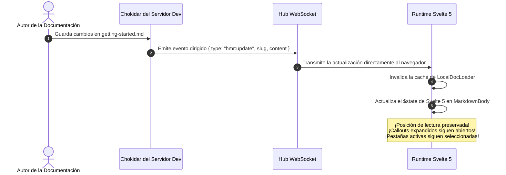
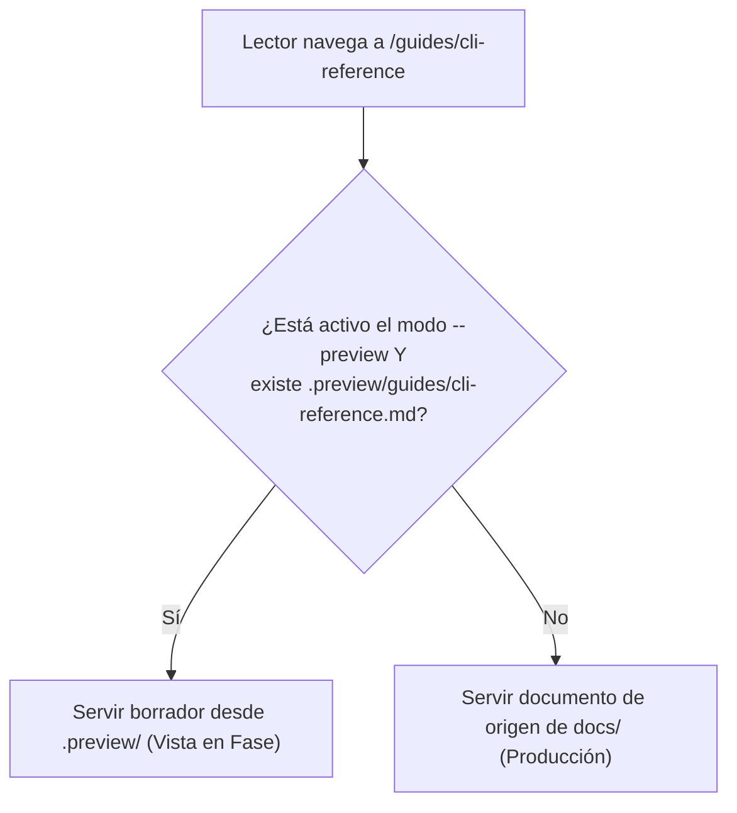

# DX de Última Generación: HMR en Vivo, Editor y Previews ⚡

DocMeDown está diseñado para que la creación de documentación sea tan rápida, interactiva y satisfactoria como la ingeniería de software moderna.

Con la versión **v0.9.0 Next-Gen DX**, DocMeDown introduce tres capacidades destacadas:
1. **Hot Module Replacement (HMR) Auténtico In Situ** vía WebSocket sin perder la posición de lectura ni el estado de las pestañas.
2. Un **Editor de Markdown en Pantalla Dividida en el Navegador** con vista previa instantánea con cada pulsación y atajos de teclado.
3. Un **Sistema de Vistas Previas en Fase** que permite probar ediciones en una capa aislada y segura (`.preview/`) antes de publicarlas.

---

## 🔥 1. Hot-Reload Auténtico In Situ (HMR)

Las herramientas de documentación tradicionales recargan toda la pestaña del navegador cada vez que editas un archivo Markdown. Esto ocasiona perder la posición de lectura, cierra callouts expandidos y reinicia las pestañas activas.

DocMeDown adopta un enfoque completamente diferente:



### Qué sucede cuando editas un archivo:
- **Cero Recargas de Página Completa**: Solo se actualizan el cuerpo del artículo activo y la tabla de contenidos (ToC).
- **Preservación de Posición**: El navegador se mantiene fijo en el punto exacto donde estabas leyendo.
- **Hot-Reload de Configuración**: Modificar `docs.json` actualiza al instante la barra de navegación, el tema y la barra lateral (`hmr:config`) sin recargar la página.

---

## ✏️ 2. Editor de Markdown Bidireccional en el Navegador

No necesitas cambiar constantemente entre VS Code y el navegador para afinar redacción o corregir erratas. ¡DocMeDown incluye un **editor de Markdown completo en pantalla dividida en el propio navegador**!

```
┌────────────────────────────────────────────────────────────────────────┐
│  Editor DocMeDown en Pantalla Dividida en Vivo (Ctrl+E / ⌘E)           │
├──────────────────────────────────┬─────────────────────────────────────┤
│  [Editor Markdown de Origen]     │  [Vista Previa en Tiempo Real]      │
│                                  │                                     │
│  # Primeros Pasos                │  Primeros Pasos                     │
│                                  │                                     │
│  > [!TIP]                        │  ┌─ Consejo Pro ──────────────────┐ │
│  > ¡Prueba el editor en vivo!    │  │ ¡Prueba el editor en vivo!     │ │
│                                  │  └────────────────────────────────┘ │
│                                  │                                     │
├──────────────────────────────────┴─────────────────────────────────────┤
│  [Destino: Fuente | Vista en Fase]     [Guardar: Ctrl+S]  [Cerrar: Esc]│
└────────────────────────────────────────────────────────────────────────┘
```

### Cómo Abrir el Editor
- Pulsa <Kbd>Ctrl+E</Kbd> (Windows/Linux) o <Kbd>⌘E</Kbd> (macOS) en cualquier momento.
- O haz clic en el icono de lápiz **Editar** en la barra superior.

### Características:
- **Vista Previa Instantánea en Pantalla Dividida**: Análisis en tiempo real mientras escribes; la vista previa renderiza código con resaltado de sintaxis, alertas, ecuaciones matemáticas y componentes personalizados con cada pulsación.
- **Atajos de Teclado**:
  - <Kbd>Ctrl+S</Kbd> / <Kbd>⌘S</Kbd>: Guarda los cambios inmediatamente en disco.
  - <Kbd>Esc</Kbd>: Cierra la ventana modal del editor.
  - <Kbd>Tab</Kbd>: Manejo inteligente de indentación de código.
- **Persistencia Directa**: Guarda los cambios directamente en tus archivos Markdown locales mediante la API del servidor de desarrollo (`POST /__dmd_api__/save`).

---

## 🎭 3. Vistas Previas en Fase y Distribución Diferencial

¿Necesitas redactar borradores con cambios importantes, reestructurar varias guías o revisar ediciones con tu equipo antes de publicarlas en producción? ¡Utiliza las **Vistas Previas en Fase**!

```bash
# Inicia el servidor de desarrollo en modo de vista previa:
npx docmedown serve ./docs --preview
```

### Cómo Funciona la Distribución Diferencial:
1. Al editar un documento en el editor del navegador y elegir **Guardar como Vista Previa en Fase**, DocMeDown escribe el archivo en `.preview/` (por ejemplo, `docs/.preview/guides/cli-reference.md`).
2. Al ejecutar en modo `--preview`, el servidor de desarrollo de DocMeDown superpone los archivos de `.preview/` sobre tus archivos de origen.
3. ¡Tus archivos de origen en `docs/` se mantienen **completamente intactos**!
4. Los visitantes de tu servidor de desarrollo ven la versión en fase.



### Gestión de Vistas Previas en el Navegador
Al ejecutar con vistas previas en fase, aparece una barra de control interactiva en la barra superior:
- **Publicar Vista Previa**: Acción en un clic (`POST /__dmd_api__/publish-preview`) que copia todos los documentos en fase de `.preview/` a tus archivos fuente definitivos y vacía la carpeta de fase.
- **Descartar Vista Previa**: Acción en un clic (`POST /__dmd_api__/discard-preview`) que descarta con seguridad los borradores en fase sin afectar tus archivos de producción.

---

## 🖱️ 4. Edición Visual de Bloques Inline

Para ajustes rápidos sin abrir el modal de pantalla dividida completo:
- **Clic para Editar Encabezados y Callouts**: Haz clic en cualquier encabezado o alerta para editar el texto directamente en línea.
- **Editor Visual de Tablas**: Modifica filas, columnas y alineaciones de tablas Markdown con controles visuales tipo hoja de cálculo.
- **Editor de Formularios para Frontmatter**: Edita `title`, `description`, `tags` y `order` con controles validados conformes al esquema de DocMeDown.

---

## 🗺️ Próximos Pasos

Continúa con el recorrido lineal de la documentación:

<CardGrid cols={2}>
  <Card
    title="Sitio Estático (SSG) y SEO"
    description="Aprende cómo se prerenderizan las páginas estáticas con metadatos completos y tarjetas sociales."
    href="#/guides/static-site"
    badge="Siguiente"
    badgeType="info"
  />
  <Card
    title="Componentes Personalizados (.dmd)"
    description="Aprende a crear componentes interactivos en Svelte 5 y React TSX."
    href="#/guides/custom-components"
    badge="Anterior"
    badgeType="success"
  />
</CardGrid>
