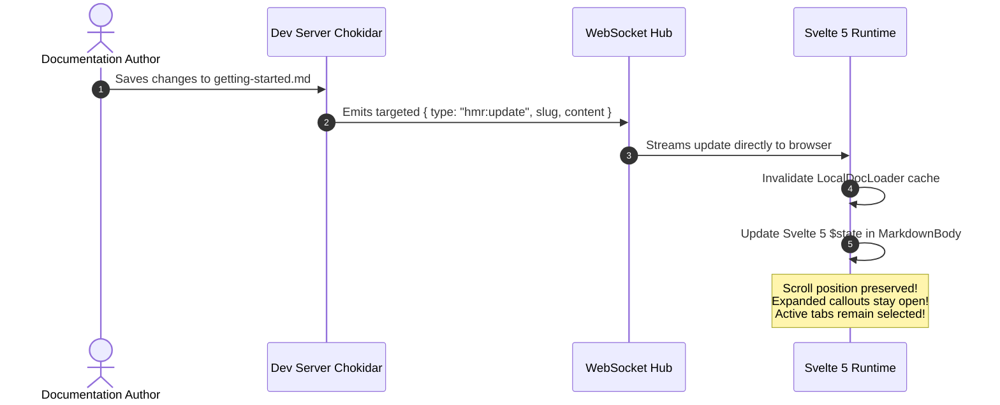
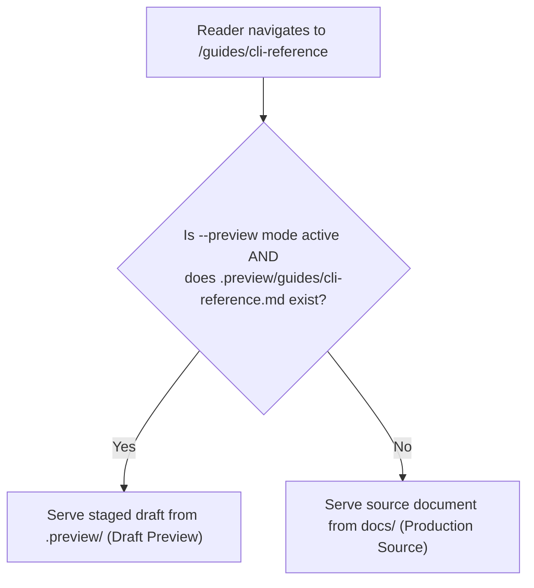

# Next-Gen DX: Live HMR, 2-Way Editor & Previews ⚡

DocMeDown is built to make documentation authoring as fast, interactive, and joyful as modern software engineering.

With the **v0.9.0 Next-Gen DX release**, DocMeDown introduces three powerful capabilities:
1. **True In-Place Hot Module Replacement (HMR)** over WebSocket without losing scroll position or tab state.
2. A **2-Way Split-View In-Browser Markdown Editor** with instant keystroke preview and keyboard shortcuts.
3. A **Staged Previews System** that lets authors test edits in a safe, isolated `.preview/` layer before publishing.

---

## 🔥 1. True In-Place Hot-Reload (HMR)

Traditional documentation tools reload the entire browser tab whenever you edit a Markdown file. This causes you to lose your reading position, closes open callouts, and resets active tabs.

DocMeDown takes a completely different approach:



### What happens when you edit a file:
- **Zero Full Page Reloads**: Only the active article body and Table of Contents update.
- **Scroll Preservation**: The browser stays anchored at your current reading position.
- **Config Hot Reloading**: Editing `docs.json` instantly re-renders the navbar, theme, and sidebar (`hmr:config`) without reloading the page.

---

## ✏️ 2. Two-Way In-Browser Markdown Editor

You don't need to switch back and forth between VS Code and your browser to polish copy or fix typos. DocMeDown includes a full-featured **in-browser split-view Markdown editor**!

```
┌────────────────────────────────────────────────────────────────────────┐
│  DocMeDown Live Split-View Editor (Ctrl+E / ⌘E)                        │
├──────────────────────────────────┬─────────────────────────────────────┤
│  [Source Markdown Editor]        │  [Live Real-Time Preview]           │
│                                  │                                     │
│  # Getting Started               │  Getting Started                    │
│                                  │                                     │
│  > [!TIP]                        │  ┌─ Pro-tip ──────────────────────┐ │
│  > Try out our new live editor!  │  │ Try out our new live editor!   │ │
│                                  │  └────────────────────────────────┘ │
│                                  │                                     │
├──────────────────────────────────┴─────────────────────────────────────┤
│  [Target: Source | Staged Preview]      [Save: Ctrl+S]   [Close: Esc]  │
└────────────────────────────────────────────────────────────────────────┘
```

### Launching the Editor
- Press <Kbd>Ctrl+E</Kbd> (Windows/Linux) or <Kbd>⌘E</Kbd> (macOS) anytime.
- Or click the **Edit** pencil icon in the top navigation bar.

### Features:
- **Instant Split-View Preview**: Live parsing as you type; preview renders syntax-highlighted code, alerts, math, and custom components on every keystroke.
- **Keyboard Shortcuts**:
  - <Kbd>Ctrl+S</Kbd> / <Kbd>⌘S</Kbd>: Save changes immediately to disk.
  - <Kbd>Esc</Kbd>: Close editor modal.
  - <Kbd>Tab</Kbd>: Smart code indentation handling.
- **Direct Persistence**: Saves changes directly to your local Markdown files through the dev server API (`POST /__dmd_api__/save`).

---

## 🎭 3. Staged Previews & Differential Serving

Need to draft major changes, re-architect multiple guides, or review edits with team members before committing them to your production documentation? Use **Staged Previews**!

```bash
# Launch dev server in preview mode:
npx docmedown serve ./docs --preview
```

### How Differential Serving Works:
1. When you edit a document in the in-browser editor and choose **Save as Staged Preview**, DocMeDown writes the file into `.preview/` (e.g. `docs/.preview/guides/cli-reference.md`).
2. When running in `--preview` mode, DocMeDown's dev server overlays files from `.preview/` on top of your source files.
3. Your original source files in `docs/` remain **completely untouched**!
4. Visitors viewing your dev server see the staged preview version.



### Managing Previews in the Browser
When running with staged previews, an interactive control bar appears in the navbar:
- **Publish Preview**: One-click action (`POST /__dmd_api__/publish-preview`) that copies all staged documents from `.preview/` into your live source files and clears the staging folder.
- **Discard Preview**: One-click action (`POST /__dmd_api__/discard-preview`) that safely discards staged drafts without affecting your source files.

---

## 🖱️ 4. Rich In-Line Block Editing

For rapid tweaks without opening the full split-view modal:
- **Click-to-Edit Headings & Callouts**: Click any heading or alert to edit text directly inline.
- **Visual Table Editor**: Edit Markdown table rows, columns, and alignments with visual spreadsheet-like controls.
- **Frontmatter Form Editor**: Edit page `title`, `description`, `tags`, and `order` with validated form controls that conform to the DocMeDown schema.

---

## 🗺️ Next Steps

Continue along the linear documentation journey:

<CardGrid cols={2}>
  <Card
    title="Static Site (SSG) & SEO"
    description="Learn how static pages are prerendered with full SEO tags and social cards."
    href="#/guides/static-site"
    badge="Next Up"
    badgeType="info"
  />
  <Card
    title="Custom Components (.dmd)"
    description="Learn how to author interactive components in Svelte 5 and React TSX."
    href="#/guides/custom-components"
    badge="Previous"
    badgeType="success"
  />
</CardGrid>
