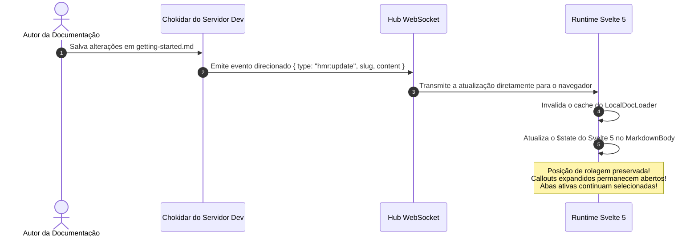
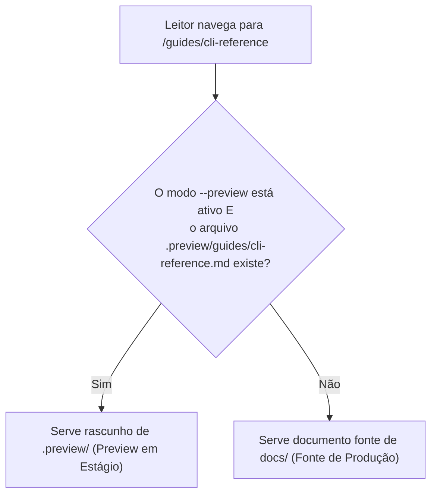

# DX de Última Geração: HMR ao Vivo, Editor & Previews ⚡

O DocMeDown foi projetado para tornar a autoria de documentação tão rápida, interativa e prazerosa quanto a engenharia de software moderna.

Com a versão **v0.9.0 Next-Gen DX**, o DocMeDown introduz três recursos poderosos:
1. **Hot Module Replacement (HMR) Autêntico no Local** via WebSocket sem perder a posição de rolagem ou o estado das abas.
2. Um **Editor de Markdown em Tela Dividida no Navegador** com preview instantâneo a cada tecla e atalhos de teclado.
3. Um **Sistema de Previews em Estágio** que permite testar edições em uma camada isolada e segura (`.preview/`) antes de publicá-las.

---

## 🔥 1. Hot-Reload Autêntico no Local (HMR)

Ferramentas tradicionais de documentação recarregam toda a aba do navegador sempre que você edita um arquivo Markdown. Isso faz você perder sua posição de leitura, fecha callouts expandidos e redefine abas ativas.

O DocMeDown adota uma abordagem completamente diferente:



### O que acontece ao editar um arquivo:
- **Zero Recarregamentos de Página Completa**: Apenas o corpo do artigo ativo e o índice de conteúdo (ToC) se atualizam.
- **Preservação de Rolagem**: O navegador permanece fixado exatamente onde você estava lendo.
- **Hot-Reload de Configuração**: Modificar `docs.json` renderiza instantaneamente barra de navegação, tema e barra lateral (`hmr:config`) sem recarregar a página.

---

## ✏️ 2. Editor de Markdown Bidirecional no Navegador

Você não precisa alternar repetidamente entre o VS Code e o navegador para ajustar textos ou corrigir erros de digitação. O DocMeDown inclui um **editor de Markdown completo em tela dividida no próprio navegador**!

```
┌────────────────────────────────────────────────────────────────────────┐
│  Editor DocMeDown em Tela Dividida ao Vivo (Ctrl+E / ⌘E)               │
├──────────────────────────────────┬─────────────────────────────────────┤
│  [Editor Markdown de Origem]     │  [Visualização em Tempo Real]       │
│                                  │                                     │
│  # Primeiros Passos              │  Primeiros Passos                   │
│                                  │                                     │
│  > [!TIP]                        │  ┌─ Dica Pro ─────────────────────┐ │
│  > Experimente o editor ao vivo! │  │ Experimente o editor ao vivo!  │ │
│                                  │  └────────────────────────────────┘ │
│                                  │                                     │
├──────────────────────────────────┴─────────────────────────────────────┤
│  [Destino: Fonte | Preview em Estágio]  [Salvar: Ctrl+S]  [Fechar: Esc]│
└────────────────────────────────────────────────────────────────────────┘
```

### Como Abrir o Editor
- Pressione <Kbd>Ctrl+E</Kbd> (Windows/Linux) ou <Kbd>⌘E</Kbd> (macOS) a qualquer momento.
- Ou clique no ícone de lápis **Editar** na barra de navegação superior.

### Funcionalidades:
- **Preview Instantâneo em Tela Dividida**: Parser em tempo real enquanto você digita; o preview renderiza código com realce de sintaxe, alertas, equações matemáticas e componentes customizados a cada toque de tecla.
- **Atalhos de Teclado**:
  - <Kbd>Ctrl+S</Kbd> / <Kbd>⌘S</Kbd>: Salva as alterações imediatamente no disco.
  - <Kbd>Esc</Kbd>: Fecha a janela modal do editor.
  - <Kbd>Tab</Kbd>: Tratamento inteligente de indentação de código.
- **Persistência Direta**: Grava as mudanças diretamente nos arquivos Markdown locais através da API do servidor de desenvolvimento (`POST /__dmd_api__/save`).

---

## 🎭 3. Previews em Estágio & Servimento Diferencial

Precisa rascunhar alterações significativas, reestruturar múltiplos guias ou revisar edições com a equipe antes de enviá-las para a documentação de produção? Utilize os **Previews em Estágio**!

```bash
# Inicia o servidor de desenvolvimento em modo de preview:
npx docmedown serve ./docs --preview
```

### Como Opera o Servimento Diferencial:
1. Quando você edita um documento no editor do navegador e escolhe **Salvar como Preview em Estágio**, o DocMeDown grava o arquivo em `.preview/` (por exemplo, `docs/.preview/guides/cli-reference.md`).
2. Ao executar em modo `--preview`, o servidor de desenvolvimento do DocMeDown sobrepõe os arquivos de `.preview/` sobre seus arquivos originais.
3. Seus arquivos de código e fontes originais em `docs/` permanecem **completamente intocados**!
4. Os visitantes do seu servidor de desenvolvimento visualizam a versão em estágio.



### Gerenciamento de Previews no Navegador
Ao executar com previews em estágio, uma barra de controle interativa aparece na barra de navegação:
- **Publicar Preview**: Ação com um clique (`POST /__dmd_api__/publish-preview`) que copia todos os documentos em estágio de `.preview/` para seus arquivos-fonte definitivos e limpa a pasta de estágio.
- **Descartar Preview**: Ação com um clique (`POST /__dmd_api__/discard-preview`) que descarta com segurança os rascunhos em estágio sem tocar nos arquivos de produção.

---

## 🖱️ 4. Edição Visual de Blocos Inline

Para ajustes rápidos sem abrir a janela modal de tela dividida:
- **Clique para Editar Títulos & Callouts**: Clique em qualquer título ou alerta para editar o texto diretamente inline.
- **Editor Visual de Tabelas**: Edite linhas, colunas e alinhamentos de tabelas Markdown com controles visuais estilo planilha.
- **Editor de Formulário de Frontmatter**: Modifique `title`, `description`, `tags` e `order` com controles validados conforme o esquema oficial do DocMeDown.

---

## 🗺️ Próximos Passos

Continue a jornada linear de documentação:

<CardGrid cols={2}>
  <Card
    title="Site Estático (SSG) e SEO"
    description="Saiba como páginas estáticas são pré-renderizadas com tags completas de SEO e cards sociais."
    href="#/guides/static-site"
    badge="A Seguir"
    badgeType="info"
  />
  <Card
    title="Componentes Customizados (.dmd)"
    description="Aprenda a criar componentes interativos em Svelte 5 e React TSX."
    href="#/guides/custom-components"
    badge="Anterior"
    badgeType="success"
  />
</CardGrid>
