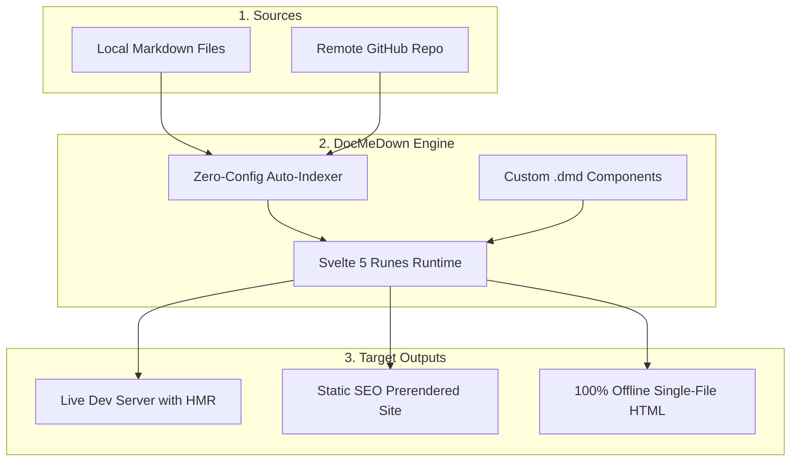

# Markdown, Diagrams & Math Features 📝

DocMeDown natively supports GitHub Flavored Markdown (GFM), intelligent syntax highlighting with line-level focus, LaTeX mathematics via KaTeX, interactive architecture diagrams via Mermaid, and interactive tables with copy controls and CSV/TSV data fences.

---

## 1. GitHub-Style Callout Alerts

Use standard GitHub alert blockquotes to draw attention to important notes, tips, and warnings:

```markdown
> [!NOTE]
> Helpful background context and informative details.

> [!TIP]
> Pro-tips, performance optimizations, and best practices.

> [!IMPORTANT]
> Critical instructions or mandatory configuration steps.

> [!WARNING]
> Warnings regarding common pitfalls, deprecations, or breaking changes.

> [!CAUTION]
> High-risk operations, potential data loss, or security cautions.
```

### Live Rendered Alerts:

> [!NOTE]
> Helpful background context and informative details.

> [!TIP]
> Press <Kbd>Alt+D</Kbd> or open **Appearance** in the navbar to preview the site across Atlas, Blueprint, Terminal, Editorial, Botanical, and Studio theme families.

> [!IMPORTANT]
> Both `.md` and `.mdx` files are automatically discovered and indexed. For interactive components, drop `.svelte`, `.tsx`, or `.ts` files into `.dmd/`.

> [!WARNING]
> Do not commit private API tokens or credentials in public repositories.

> [!CAUTION]
> Overwriting existing files during build will replace their contents.

---

## 2. Advanced Code Blocks & Syntax Highlighting

DocMeDown includes a custom code block renderer supporting titles, line highlighting, and copy controls.

### 2.1 File Titles & Color-Coded Extensions
Prefix your code block with `title="path/to/file.ext"`. Directories are dimmed and the file extension receives distinct language coloring:

````markdown
```typescript title="src/runtime/router.ts"
export class HashRouter {
  constructor(public defaultDoc: string) {}

  public navigate(slug: string) {
    window.location.hash = `#/${slug}`;
  }
}
```
````

```typescript title="src/runtime/router.ts"
export class HashRouter {
  constructor(public defaultDoc: string) {}

  public navigate(slug: string) {
    window.location.hash = `#/${slug}`;
  }
}
```

### 2.2 Line Highlighting `{n, n-m}`
Add line numbers or ranges to highlight specific lines with an accent bar and focused background tint:

````markdown
```javascript {2,4-5} title="pipeline.js"
const input = "Raw Markdown";
const parsed = parseMarkdown(input); // Highlighted!
const tree = buildNavigationTree(parsed);
const staticHtml = prerenderStatic(tree); // Highlighted!
const offlineBundle = buildSingleFile();   // Highlighted!
```
````

```javascript {2,4-5} title="pipeline.js"
const input = "Raw Markdown";
const parsed = parseMarkdown(input);
const tree = buildNavigationTree(parsed);
const staticHtml = prerenderStatic(tree);
const offlineBundle = buildSingleFile();
```

> [!TIP]
> **Focused Copying**: When line highlighting is active, a second copy icon appears in the toolbar, allowing visitors to copy **only the highlighted lines** with a single click!

---

## 3. Interactive Mermaid Architecture Diagrams

Render flowcharts, sequence diagrams, class diagrams, state diagrams, and entity-relationship models natively.

````markdown

````


### Diagram Features:
- **Theme-Aware Styling**: Diagrams automatically adapt their color palette to the active theme family (`atlas`, `blueprint`, `terminal`, `editorial`, `botanical`, `studio`) and light/dark modes.
- **Interactive Camera Controls**: Drag empty space to pan, zoom with mousewheel or pinch, click 1:1 to reset, or click the fullscreen icon to expand.
- **Subgraph Copying**: Hover over subgraphs to copy isolated graph sections directly to your clipboard.
- **Offline Self-Containment**: Works identically from live dev servers and air-gapped `file:///` single-file HTML manuals.

---

## 4. LaTeX Mathematics (KaTeX)

Render inline mathematical formulas with `$ ... $` or block equations with `$$ ... $$`:

### Inline Math:
````markdown
Euler's identity is $e^{i\pi} + 1 = 0$, connecting the fundamental constants.
````
Euler's identity is $e^{i\pi} + 1 = 0$, connecting the fundamental constants.

### Block Math Equations:
````markdown
$$
f(x) = \int_{-\infty}^\infty \hat f(\xi)\,e^{2 \pi i \xi x} \,d\xi
$$
````

$$
f(x) = \int_{-\infty}^\infty \hat f(\xi)\,e^{2 \pi i \xi x} \,d\xi
$$

> [!NOTE]
> Math syntax is never evaluated inside code blocks or inline code spans — expressions like `` `$E = mc^2$` `` remain literal code.

---

## 5. Rich Tables & CSV / TSV Datasets

DocMeDown elevates tables into interactive data blocks. Every table—whether authored as standard GitHub Flavored Markdown (GFM) pipe tables or concise CSV/TSV fences—features clean typography, responsive horizontal scrolling, and a built-in **Copy** dropdown toolbar.

### 5.1 Interactive Table Copy Controls

Hover over or focus any table to reveal the toolbar. The **Copy** menu lets readers export the exact data in one click to their preferred format:

- **Markdown**: GFM pipe table with aligned dividers (`:---`, `:---:`, `---:`).
- **HTML**: Clean, semantic `<table>`, `<thead>`, and `<tbody>` elements with text alignment attributes.
- **CSV**: RFC 4180-compliant comma-separated values with quoted strings where necessary.

| Feature | Pipe Tables | CSV / TSV Fences | HTML Tables |
| :--- | :---: | :---: | :---: |
| Native GFM Syntax | ✅ | ❌ | ❌ |
| Auto Delimiter Detection | ❌ | ✅ (`,`, `;`, `\t`, `\|`) | ❌ |
| Numeric Auto-Alignment | Manual | ✅ (Right-aligned) | Manual |
| Copy Dropdown (MD / HTML / CSV) | ✅ | ✅ | ❌ |

### 5.2 Expressing Tables via CSV and TSV Fences

Instead of painstakingly formatting ASCII pipes, you can express datasets directly using standard ```` ```csv ```` or ```` ```tsv ```` code fences!

````markdown
```csv title="DocMeDown Engine Benchmarks"
Task,Time (ms),Throughput,Status
Cold Manifest Scan,14.2,420 files/s,Verified
Static SEO Prerender,48.6,120 pages/s,Verified
Single-File Pack,82.1,1 bundle/s,Optimal
```
````

```csv title="DocMeDown Engine Benchmarks"
Task,Time (ms),Throughput,Status
Cold Manifest Scan,14.2,420 files/s,Verified
Static SEO Prerender,48.6,120 pages/s,Verified
Single-File Pack,82.1,1 bundle/s,Optimal
```

### 5.3 Fence Options & Delimiters

Customize delimited blocks using optional fence parameters:

- `title="..."`: Displays a caption in the table toolbar.
- `delimiter=";"` or `delimiter=tab` / `delimiter=pipe`: Sets an explicit delimiter. When omitted, DocMeDown automatically detects `,`, `;`, `\t`, or `|`.
- `header=false`: Treats the first line as a regular data row rather than a `<th>` table header.
- `markdown=true`: Parses cell contents through the inline Markdown parser (enabling bold text, code spans, links, and badges inside cells).

````markdown
```csv delimiter=";" title="Semantics & Badges" markdown=true
Component;Type;Default;Description
`<Card />`;Interactive Component;None;Content card container
`<Badge />`;Inline Badge;`info`;Color-coded status pill
`<Callout />`;Alert Block;`note`;GitHub-style alert banner
```
````

```csv delimiter=";" title="Semantics & Badges" markdown=true
Component;Type;Default;Description
`<Card />`;Interactive Component;None;Content card container
`<Badge />`;Inline Badge;`info`;Color-coded status pill
`<Callout />`;Alert Block;`note`;GitHub-style alert banner
`<Media />`;Media Primitive;`center`;Raster, vector, video & audio player
```

---

## 6. Media & Audio/Video Integration (`<Media>`)

While default Markdown syntax supports simple inline images via ``, DocMeDown provides the **`<Media>` component** for advanced media styling, HTML5 video/audio players, format hints, graceful fallbacks, and **lossless offline embedding**.

### 6.1 Comparing Standard Markdown vs `<Media>`

| Capability | Standard Markdown (``) | `<Media />` Component |
| :--- | :---: | :---: |
| Raster Images (PNG, JPG, WebP, GIF) | ✅ | ✅ |
| Vector Graphics (SVG, Inline DOM) | ⚠️ *(limited)* | ✅ |
| Video Players (MP4, WebM, OGG) | ❌ | ✅ *(HTML5 controls, poster)* |
| Audio Players (MP3, WAV, FLAC) | ❌ | ✅ *(HTML5 playback)* |
| Width / Height / Max Constraints | ❌ | ✅ |
| Aspect Ratio & Object Fit | ❌ | ✅ |
| Alignment & Semantic Captions | ❌ | ✅ *(<figcaption>)* |
| Border Radius & Elevation Shadows | ❌ | ✅ |
| Format Detection & Hints | ❌ | ✅ |
| Fallback Asset / Error Recovery Card | ❌ | ✅ |
| Lossless Offline Embedding | ✅ | ✅ *(with `embed` control)* |

### 6.2 Syntax & Usage
```html
<!-- Enhanced raster or vector image with caption and shadow -->
<Media
  src="./assets/architecture.png"
  alt="System Diagram"
  width="100%"
  maxWidth="640px"
  rounded="md"
  shadow="md"
  align="center"
  caption="DocMeDown high-performance rendering pipeline"
/>

<!-- HTML5 Video player with poster and fallback -->
<Media
  src="./assets/demo.mp4"
  type="video/mp4"
  poster="./assets/poster.jpg"
  controls
  maxWidth="720px"
  aspectRatio="16/9"
/>

<!-- Audio player with custom error message -->
<Media
  src="./assets/narrative.mp3"
  format="audio/mpeg"
  controls
  fallbackText="Audio file is not accessible."
/>
```

---

## 7. YAML Frontmatter Reference

Add YAML frontmatter to the top of any `.md` file to customize page title, sidebar sorting, tags, and SEO tags:

```yaml
---
title: Advanced Architecture Guide
sidebar_label: Architecture
order: 1
icon: 🏛️
badge: v0.9.0
badge_type: success
description: Comprehensive deep dive into DocMeDown's compilation pipeline.
tags: [architecture, core, svelte]
hidden: false
noindex: false
---
```

| Field | Type | Description |
| :--- | :--- | :--- |
| `title` | `string` | Document title shown in navbar, breadcrumbs, and browser tab. |
| `sidebar_label` | `string` | Shortened label used in the sidebar navigation tree. |
| `order` | `number` | Ordering position within its category / section (ascending). |
| `icon` | `string` | Emoji or icon displayed next to the page name in the sidebar. |
| `badge` | `string` | Text pill badge shown alongside the page link in the sidebar. |
| `badge_type` | `string` | Badge variant: `info`, `success`, `warning`, or `danger`. |
| `description` | `string` | Page description used for SEO meta tags and social preview cards. |
| `tags` | `string[]` | Keywords indexed in fuzzy search. |
| `hidden` | `boolean` | If `true`, hides the document from navigation and search indexing. |
| `noindex` | `boolean` | If `true`, adds `noindex` robots meta tag and omits from `sitemap.xml`. |

### YAML behavior across build and browser modes

The browser renderer and CLI indexer use the same safe YAML schema for metadata.
Block descriptions, block-style tag lists, inline comments, quoted escapes, and
YAML aliases are supported in both modes:

```yaml
---
title: "Architecture: core engine"
description: >-
  A folded description that stays consistent
  in the reader and generated metadata.
tags:
  - architecture
  - "core: engine"
hidden: false # keep discoverable
---
```

Use a complete `---` delimiter line at the start and end of the metadata block.
Quote values that must remain strings, such as `"true"` or `"2026-10-20"`.
JavaScript-specific YAML tags are not supported.

During live editing, an incomplete block remains visible as Markdown. A complete
block with invalid YAML is omitted from the rendered body and contributes no
metadata until corrected; `docmedown validate` reports the syntax error and CLI
indexing rejects it. Run validation before publishing rather than relying on
the editor's tolerant rendering.

### Heading identity and link validation

Manifest headings and `docmedown validate` reuse the renderer's heading IDs,
including Setext headings, levels 1–6, and collision-safe duplicate suffixes.
Fenced/indented code examples are not indexed as headings. The visible table of
contents still displays only three heading levels. `{#custom-id}` is not a
supported heading-anchor syntax; link to the generated rendered ID instead.

---

## 🗺️ Next Steps

Continue along the linear documentation journey:

<CardGrid cols={2}>
  <Card
    title="Mermaid Diagrams"
    description="Explore interactive architecture diagrams with automatic theme synchronization."
    href="#/guides/mermaid-diagrams"
    badge="Next Up"
    badgeType="info"
  />
  <Card
    title="Engine Architecture"
    description="Understand the virtual loader, Svelte 5 runtime, and dual-mode routing."
    href="#/guides/architecture"
    badge="Previous"
    badgeType="success"
  />
</CardGrid>

