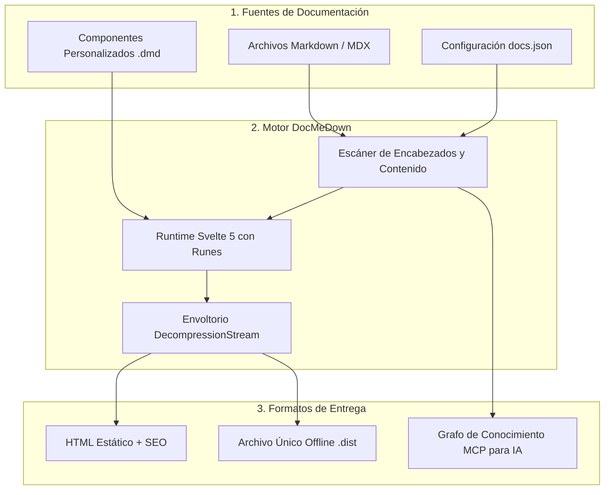
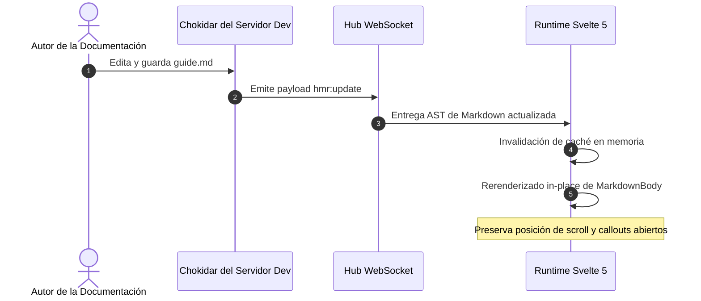
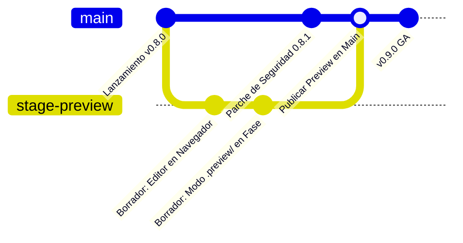
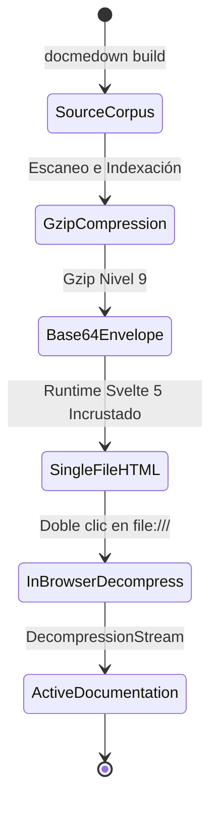

# Diagramas Mermaid Interactivos 📊

DocMeDown incluye un motor de diagramación **Mermaid** profundamente integrado. En lugar de generar imágenes estáticas en PNG o SVG que desentonan con el tema de tu documentación, DocMeDown compila los diagramas Mermaid directamente en el navegador, adaptando su estilo de forma dinámica según la familia de temas y el modo de color activos.

---

## ⚡ 1. Controles Interactivos en Vivo

Todo diagrama Mermaid renderizado en DocMeDown cuenta con controles de cámara integrados:

- **Desplazar y Arrastrar (Pan)**: Haz clic y arrastra dentro del lienzo del diagrama para recorrer topologías de arquitectura extensas.
- **Rueda para Zoom**: Utiliza la rueda del ratón o el gesto de pellizco en el trackpad para acercar y alejar.
- **Ajustar a la Vista (Fit)**: Haz clic en el botón **Ajustar** (<Kbd>⛶</Kbd>) para encuadrar automáticamente el diagrama en el visor sin recortes.
- **Modal a Pantalla Completa**: Pulsa el icono de expandir para abrir un visor inmersivo de diagramas en alta resolución.
- **Copiar Código Fuente del Diagrama**: Pulsa el botón de copia para copiar el código fuente Mermaid directamente al portapapeles.

---

## 🎨 2. Sincronización Automática con el Tema

DocMeDown recalcula e inyecta variables CSS personalizadas de Mermaid automáticamente cada vez que el usuario alterna entre:
- **Modos Claro y Oscuro**
- **Familias de Temas** (`atlas`, `blueprint`, `terminal`, `editorial`, `botanical`, `studio`)

Por ejemplo, en el tema **`terminal`**, los diagramas se renderizan con bordes monoespaciados verdes y matices fosforescentes; en **`blueprint`**, adoptan cuadrículas en cian arquitectónico y esquinas rectas; y en **`editorial`**, incorporan tonos cálidos de tinta sobre papel.

---

## 📐 3. Tipos de Diagramas y Ejemplos en Vivo

### 3.1 Pipeline de Arquitectura (Diagrama de Flujo)

````markdown

````


---

### 3.2 Diagrama de Secuencia (Hot Module Replacement)

````markdown

````


---

### 3.3 Grafo Git (Rama de Función y Vistas Previas en Fase)

````markdown

````


---

### 3.4 Diagrama de Estados (Ciclo de Vida de un Documento Offline)

````markdown

````


---

## 🛠️ Consejos para Escribir Excelentes Diagramas

> [!TIP]
> **Usa Subgrafos para Agrupación**: Agrupa componentes relacionados utilizando `subgraph Nombre ["Etiqueta"]` para estructurar una jerarquía visual limpia y evitar líneas cruzadas.

> [!NOTE]
> **Compatibilidad Completa con Unicode y Emojis**: DocMeDown admite perfectamente caracteres Unicode y emojis en las etiquetas de los nodos (ej.: `A["🚀 Nodos de Borde Ultrarrápidos"]`).

---

## 🗺️ Próximos Pasos

Continúa con el recorrido lineal de la documentación:

<CardGrid cols={2}>
  <Card
    title="Primitivas de UI Nativas"
    description="Explora los 20 elementos nativos: CardGrid, Tabs, Badges, Callouts, Media y más."
    href="#/guides/built-in-components"
    badge="Siguiente"
    badgeType="info"
  />
  <Card
    title="Markdown, Sintaxis y Matemáticas"
    description="Revisa callouts de GitHub, resaltado de código y fórmulas KaTeX."
    href="#/guides/markdown-features"
    badge="Anterior"
    badgeType="success"
  />
</CardGrid>
