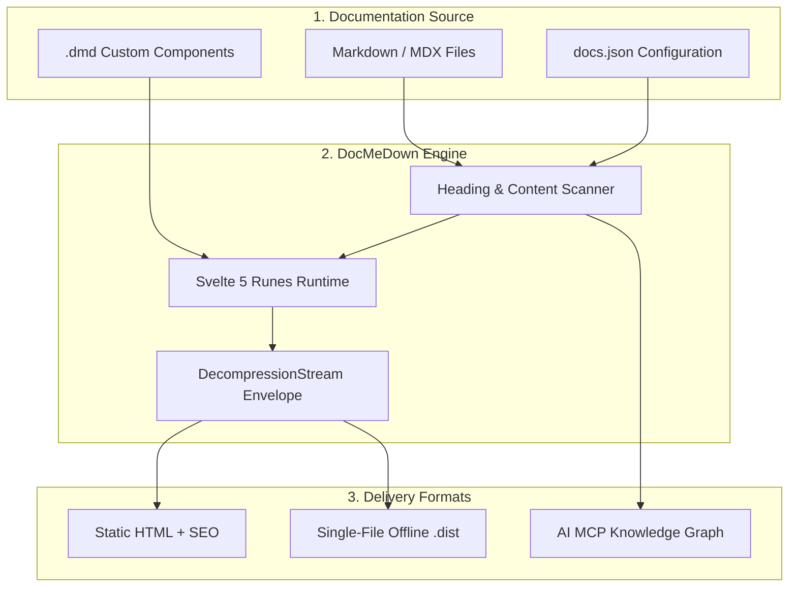
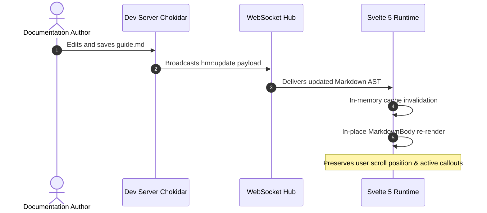
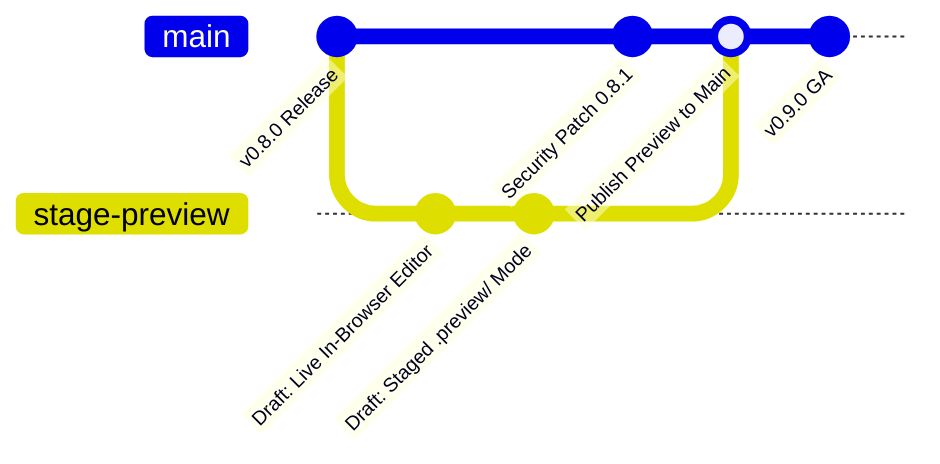
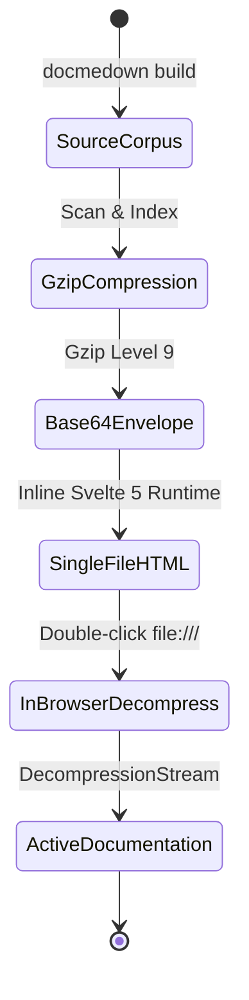

# Interactive Mermaid Diagrams 📊

DocMeDown includes a deeply integrated **Mermaid** diagramming engine. Instead of generating static PNG or SVG images that clash with your documentation theme, DocMeDown compiles Mermaid diagrams directly inside the browser, styling them dynamically according to your active theme family and color mode.

---

## ⚡ 1. Live Interactive Controls

Every Mermaid diagram rendered in DocMeDown comes with built-in interactive camera controls:

- **Pan & Drag**: Click and drag inside the diagram canvas to pan across large architecture topologies.
- **Scroll to Zoom**: Use your mouse wheel or trackpad pinch gesture to zoom in and out.
- **Fit to View**: Click the **Fit** button (<Kbd>⛶</Kbd>) to automatically frame the diagram inside the viewport without clipping.
- **Full-Screen Modal**: Click the expand icon to open an immersive, high-resolution full-screen diagram viewer.
- **Copy Diagram Source**: Click the copy button to copy the portable Mermaid Markdown source directly to your clipboard.

---

## 🎨 2. Automatic Theme Synchronization

DocMeDown automatically recalculates and injects custom Mermaid CSS variables whenever the user switches between:
- **Light & Dark modes**
- **Theme Families** (`atlas`, `blueprint`, `terminal`, `editorial`, `botanical`, `studio`)

For instance, in the **`terminal`** theme, diagrams render with green monospace borders and phosphor tints; in **`blueprint`**, they render with architectural cyan grids and sharp angles; and in **`editorial`**, they adopt classic muted warm ink palettes.

---

## 📐 3. Diagram Types & Live Examples

### 3.1 Architecture Pipeline (Flowchart)

````markdown

````


---

### 3.2 Sequence Diagram (Hot Module Replacement)

````markdown

````


---

### 3.3 Git Graph (Feature Branch & Staged Previews)

````markdown

````


---

### 3.4 State Diagram (Lifecycle of an Offline Document)

````markdown

````


---

## 🛠️ Tips for Writing Great Diagrams

> [!TIP]
> **Use Subgraphs for Scoping**: Group related components using `subgraph Name ["Label"]` to create visual hierarchy and prevent cluttered wiring.

> [!NOTE]
> **Unicode & Emoji Support**: DocMeDown fully supports Unicode characters and emojis within node labels (e.g. `A["🚀 Fast Edge Nodes"]`).

---

## 🗺️ Next Steps

Continue along the linear documentation journey:

<CardGrid cols={2}>
  <Card
    title="Built-in UI Components"
    description="Explore all 20 built-in UI primitives: CardGrid, Tabs, Badges, Callouts, Media, and more."
    href="#/guides/built-in-components"
    badge="Next Up"
    badgeType="info"
  />
  <Card
    title="Markdown, Syntax & Math"
    description="Review GitHub callouts, code block highlighting, and KaTeX formulas."
    href="#/guides/markdown-features"
    badge="Previous"
    badgeType="success"
  />
</CardGrid>
