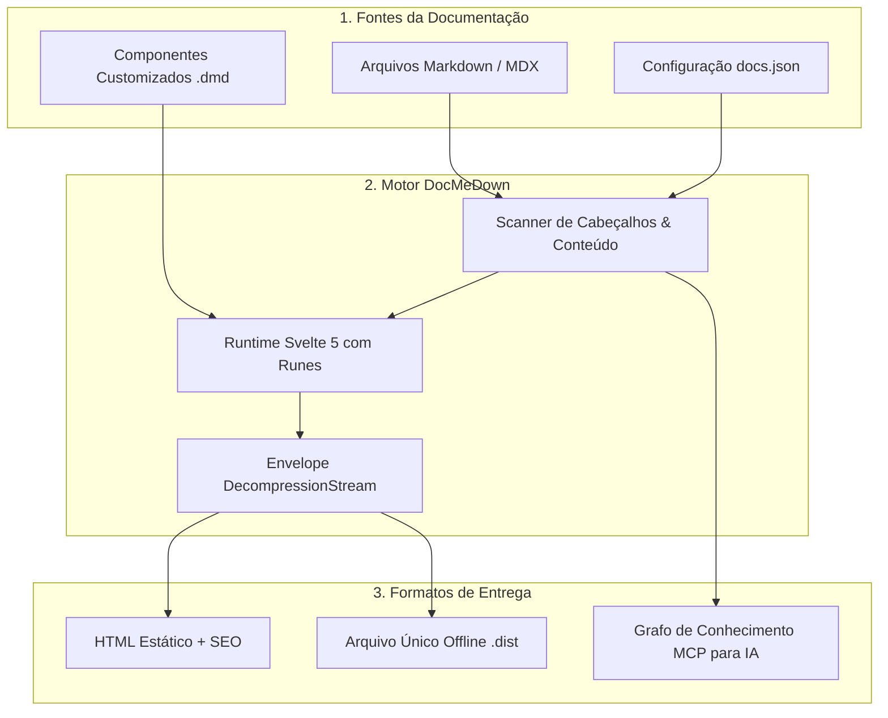
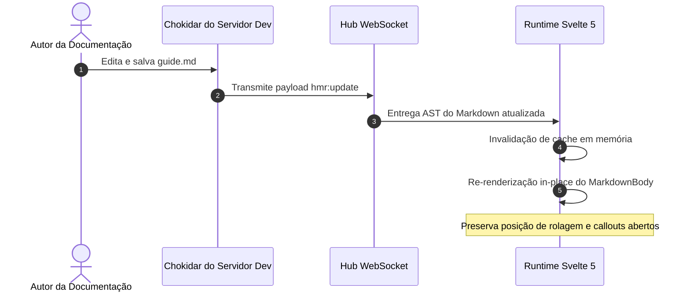
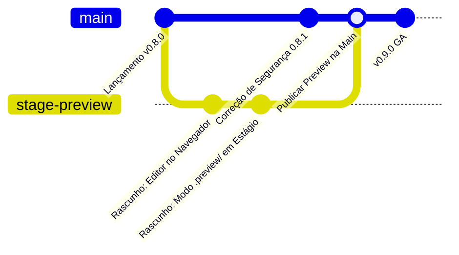
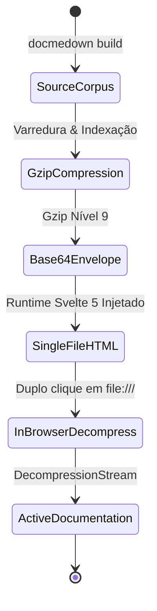

# Diagramas Mermaid Interativos 📊

O DocMeDown inclui um motor de diagramação **Mermaid** profundamente integrado. Em vez de gerar imagens estáticas em PNG ou SVG que destoam do tema da sua documentação, o DocMeDown compila os diagramas Mermaid diretamente no navegador, estilizando-os dinamicamente conforme a família de tema e o modo de cor ativos.

---

## ⚡ 1. Controles Interativos ao Vivo

Todo diagrama Mermaid renderizado no DocMeDown traz controles interativos de câmera nativos:

- **Mover & Arrastar (Pan)**: Clique e arraste na área do diagrama para navegar por topologias complexas de arquitetura.
- **Rolar para Zoom**: Use a roda do mouse ou gesto de pinça no trackpad para aproximar ou afastar.
- **Ajustar à Visualização (Fit)**: Clique no botão **Ajustar** (<Kbd>⛶</Kbd>) para enquadrar o diagrama perfeitamente dentro da janela sem cortes.
- **Modal em Tela Cheia**: Clique no ícone de expandir para abrir um visualizador imersivo em alta resolução em tela cheia.
- **Copiar Código-Fonte do Diagrama**: Clique no botão de cópia para transferir o código Mermaid portátil diretamente para a área de transferência.

---

## 🎨 2. Sincronização Automática com o Tema

O DocMeDown recalcula e injeta variáveis CSS customizadas do Mermaid automaticamente sempre que o usuário alterna entre:
- **Modos Claro & Escuro**
- **Famílias de Tema** (`atlas`, `blueprint`, `terminal`, `editorial`, `botanical`, `studio`)

Por exemplo, no tema **`terminal`**, os diagramas são renderizados com bordas monospaçadas verdes e tons em fósforo; no **`blueprint`**, adotam grades em ciano arquitetônico e cantos retos; e no **`editorial`**, utilizam paletas clássicas e aquecidas em tons de tinta sobre papel.

---

## 📐 3. Tipos de Diagramas & Exemplos ao Vivo

### 3.1 Pipeline de Arquitetura (Fluxograma)

````markdown

````


---

### 3.2 Diagrama de Sequência (Hot Module Replacement)

````markdown

````


---

### 3.3 Grafo Git (Branch de Recurso & Previews em Estágio)

````markdown

````


---

### 3.4 Diagrama de Estados (Ciclo de Vida de um Documento Offline)

````markdown

````


---

## 🛠️ Dicas para Escrever Ótimos Diagramas

> [!TIP]
> **Use Subgrafos para Agrupamento**: Agrupe componentes relacionados usando `subgraph Nome ["Rótulo"]` para criar hierarquia visual e evitar fiações emaranhadas.

> [!NOTE]
> **Suporte Completo a Unicode & Emojis**: O DocMeDown suporta integralmente caracteres Unicode e emojis dentro dos rótulos de nós (ex.: `A["🚀 Nós de Borda Ultrarrápidos"]`).

---

## 🗺️ Próximos Passos

Continue a jornada linear de documentação:

<CardGrid cols={2}>
  <Card
    title="Primitivas de UI Nativas"
    description="Explore os 20 elementos nativos: CardGrid, Tabs, Badges, Callouts, Media e muito mais."
    href="#/guides/built-in-components"
    badge="A Seguir"
    badgeType="info"
  />
  <Card
    title="Markdown, Sintaxe & Matemática"
    description="Revise callouts do GitHub, realce de código e fórmulas KaTeX."
    href="#/guides/markdown-features"
    badge="Anterior"
    badgeType="success"
  />
</CardGrid>
