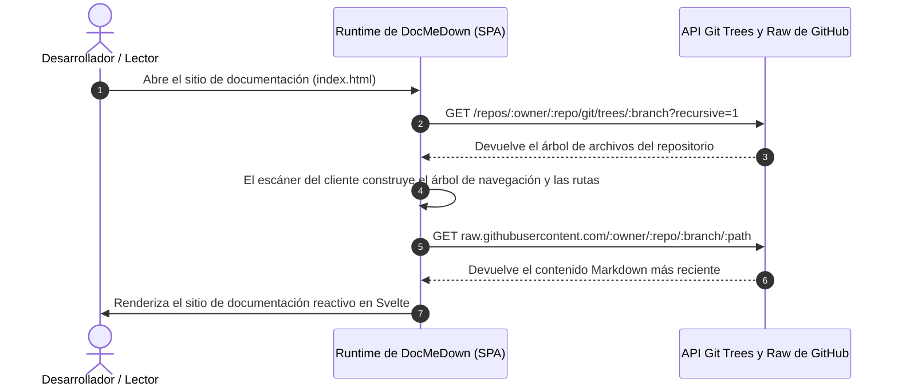

# Documentación Dinámica Remota con Git 🌐

El **Modo de Fuente Remota Dinámica** de DocMeDown elimina por completo la fricción del alojamiento de documentación.

En lugar de clonar archivos Markdown en un repositorio dedicado, ejecutar compilaciones de sitios estáticos en pipelines de CI/CD o mantener flujos de despliegue complejos, ¡puede apuntar DocMeDown directamente a cualquier repositorio de GitHub o GitLab!

---

## 🎯 Cómo Funciona el Modo Remoto Dinámico



### La Magia de la Sincronización en Vivo:
Cada vez que los desarrolladores fusionan Pull Requests o envían confirmaciones al repositorio remoto, los visitantes que recarguen el sitio **verán de inmediato las actualizaciones más recientes** — ¡sin despliegues ni pasos de compilación adicionales!

---

## ⚙️ Configuración del Modo Remoto

Cree un archivo `docs.json` que apunte a su repositorio de destino:

### 1. Repositorio Público en GitHub
```json title="docs.json"
{
  "$schema": "https://raw.githubusercontent.com/gabrielmsilva00/docmedown/main/schemas/docs.schema.json",
  "name": "Live React Docs",
  "source": {
    "type": "github",
    "repo": "facebook/react",
    "branch": "main",
    "docsDir": "docs"
  },
  "theme": {
    "family": "blueprint",
    "density": "comfortable",
    "defaultMode": "auto"
  }
}
```

### 2. Repositorio Público en GitLab
```json title="docs.json"
{
  "$schema": "https://raw.githubusercontent.com/gabrielmsilva00/docmedown/main/schemas/docs.schema.json",
  "name": "GitLab Project Docs",
  "source": {
    "type": "gitlab",
    "repo": "gitlab-org/gitlab",
    "branch": "master",
    "docsDir": "doc"
  },
  "theme": {
    "family": "terminal",
    "density": "compact"
  }
}
```

### 3. Repositorio Privado (con Token)
Para repositorios privados o sitios de alto tráfico que requieran límites de tasa superiores en la API de GitHub, proporcione un Personal Access Token:

```json title="docs.json"
{
  "name": "Internal Engineering Docs",
  "source": {
    "type": "github",
    "repo": "my-company/internal-api",
    "branch": "main",
    "docsDir": "docs",
    "token": "ghp_suTokenAqui"
  }
}
```

> [!WARNING]
> Si su sitio de documentación es público, **no** incluya tokens de acceso personal directamente en `docs.json`. Utilice tokens con permisos exclusivos de lectura o reserve el modo remoto para intranets corporativas internas.

---

## 🚀 Cómo Alojar Documentación Remota Dinámica

Dado que DocMeDown realiza toda la indexación, el análisis y el renderizado directamente en el navegador del lector, únicamente necesita alojar **un solo archivo HTML estático**:

```html title="index.html"
<!DOCTYPE html>
<html lang="es">
<head>
  <meta charset="UTF-8" />
  <meta name="viewport" content="width=device-width, initial-scale=1.0" />
  <title>Documentación en Vivo</title>
</head>
<body>
  <div id="dmd-app"></div>
  <script src="https://cdn.jsdelivr.net/npm/docmedown@latest/dist/docmedown.iife.js"></script>
</body>
</html>
```

### Dónde Desplegar:
- **GitHub Pages**: Ubique `index.html` y `docs.json` en la rama `gh-pages`.
- **Vercel / Netlify / Cloudflare Pages**: Despliegue el directorio como archivos estáticos (cero comandos de compilación).
- **Amazon S3 / Google Cloud Storage**: Copie `index.html` y `docs.json` a un bucket S3 con alojamiento web estático habilitado.

---

## 🗺️ Próximos Pasos

Siga la ruta de documentación:

<CardGrid cols={2}>
  <Card
    title="Model Context Protocol (MCP)"
    description="Conecte Cursor, Claude Desktop y Windsurf directamente a su documentación."
    href="#/guides/mcp-server"
    badge="Siguiente"
    badgeType="info"
  />
  <Card
    title="Paquetes Monofile 100% Offline"
    description="Paquetes HTML autoextraíbles y autocontenidos para entornos aislados sin fallos de CORS."
    href="#/guides/offline-mode"
    badge="Anterior"
    badgeType="success"
  />
</CardGrid>
