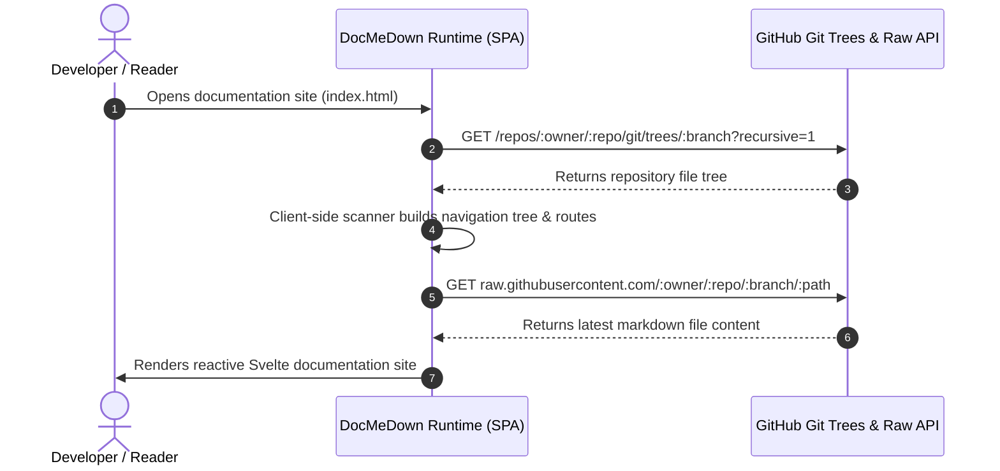

# Dynamic Remote Git Documentation 🌐

DocMeDown's **Dynamic Remote Source Mode** eliminates documentation hosting friction entirely.

Instead of cloning markdown files into a documentation repository, running CI/CD static site builds, or maintaining deployment workflows, you can point DocMeDown directly to any GitHub or GitLab repository!

---

## 🎯 How Dynamic Remote Mode Works



### The Magic of Live Sync:
Whenever developers merge Pull Requests or push commits to the remote repository, visitors reloading your documentation site **immediately see the latest updates** — with zero redeployments or build steps!

---

## ⚙️ Setting Up Remote Mode

Create a `docs.json` file pointing to your target repository:

### 1. Public GitHub Repository
```json title="docs.json"
{
  "$schema": "https://raw.githubusercontent.com/gabrielmsilva00/docmedown/main/schemas/docs.schema.json",
  "name": "Live React Docs",
  "source": {
    "type": "github",
    "repo": "facebook/react",
    "branch": "main",
    "docsDir": "docs"
  },
  "theme": {
    "family": "blueprint",
    "density": "comfortable",
    "defaultMode": "auto"
  }
}
```

### 2. Public GitLab Repository
```json title="docs.json"
{
  "$schema": "https://raw.githubusercontent.com/gabrielmsilva00/docmedown/main/schemas/docs.schema.json",
  "name": "GitLab Project Docs",
  "source": {
    "type": "gitlab",
    "repo": "gitlab-org/gitlab",
    "branch": "master",
    "docsDir": "doc"
  },
  "theme": {
    "family": "terminal",
    "density": "compact"
  }
}
```

### 3. Private Repository (with Token)
For private repositories or high-traffic sites needing higher GitHub API rate limits, provide a Personal Access Token:

```json title="docs.json"
{
  "name": "Internal Engineering Docs",
  "source": {
    "type": "github",
    "repo": "my-company/internal-api",
    "branch": "main",
    "docsDir": "docs",
    "token": "ghp_yourTokenHere"
  }
}
```

> [!WARNING]
> If your documentation site is public, do **not** commit personal access tokens directly into `docs.json`. Use read-only repository tokens or restrict remote mode to internal company intranets.

---

## 🚀 How to Host Dynamic Remote Docs

Because DocMeDown performs all tree indexing, parsing, and rendering inside the reader's browser, you only need to host **one static HTML file**:

```html title="index.html"
<!DOCTYPE html>
<html lang="en">
<head>
  <meta charset="UTF-8" />
  <meta name="viewport" content="width=device-width, initial-scale=1.0" />
  <title>Live Documentation</title>
</head>
<body>
  <div id="dmd-app"></div>
  <script src="https://cdn.jsdelivr.net/npm/docmedown@latest/dist/docmedown.iife.js"></script>
</body>
</html>
```

### Deploy to:
- **GitHub Pages**: Place `index.html` and `docs.json` on the `gh-pages` branch.
- **Vercel / Netlify / Cloudflare Pages**: Deploy the folder as static files (zero build command).
- **Amazon S3 / Google Cloud Storage**: Copy `index.html` and `docs.json` to an S3 bucket with public website hosting enabled.

---

## 🗺️ Next Steps

Continue along the linear documentation journey:

<CardGrid cols={2}>
  <Card
    title="Model Context Protocol (MCP)"
    description="Connect Cursor, Claude Desktop, and Windsurf directly to your documentation."
    href="#/guides/mcp-server"
    badge="Next Up"
    badgeType="info"
  />
  <Card
    title="100% Offline Single-File Bundles"
    description="Air-gapped self-extracting single-file HTML bundles with zero CORS errors."
    href="#/guides/offline-mode"
    badge="Previous"
    badgeType="success"
  />
</CardGrid>

