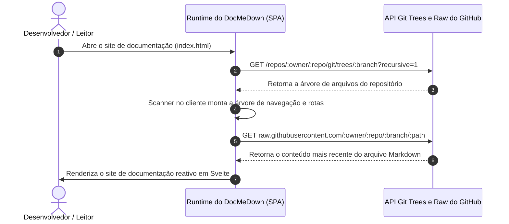

# Documentação Dinâmica Remota com Git 🌐

O **Modo de Fonte Remota Dinâmica** do DocMeDown elimina integralmente o atrito de hospedagem de documentação.

Em vez de clonar arquivos Markdown em um repositório dedicado de documentação, executar builds de sites estáticos em CI/CD ou manter fluxos complexos de deploy, você pode apontar o DocMeDown diretamente para qualquer repositório GitHub ou GitLab!

---

## 🎯 Como Funciona o Modo Remoto Dinâmico



### A Magia da Sincronização ao Vivo:
Sempre que desenvolvedores mesclam Pull Requests ou enviam commits para o repositório remoto, os visitantes que atualizarem a página **enxergarão imediatamente as atualizações mais recentes** — com zero etapas de build ou reimplantação!

---

## ⚙️ Configurando o Modo Remoto

Crie um arquivo `docs.json` apontando para o seu repositório de destino:

### 1. Repositório Público no GitHub
```json title="docs.json"
{
  "$schema": "https://raw.githubusercontent.com/gabrielmsilva00/docmedown/main/schemas/docs.schema.json",
  "name": "Live React Docs",
  "source": {
    "type": "github",
    "repo": "facebook/react",
    "branch": "main",
    "docsDir": "docs"
  },
  "theme": {
    "family": "blueprint",
    "density": "comfortable",
    "defaultMode": "auto"
  }
}
```

### 2. Repositório Público no GitLab
```json title="docs.json"
{
  "$schema": "https://raw.githubusercontent.com/gabrielmsilva00/docmedown/main/schemas/docs.schema.json",
  "name": "GitLab Project Docs",
  "source": {
    "type": "gitlab",
    "repo": "gitlab-org/gitlab",
    "branch": "master",
    "docsDir": "doc"
  },
  "theme": {
    "family": "terminal",
    "density": "compact"
  }
}
```

### 3. Repositório Privado (com Token)
Para repositórios privados ou sites de alto tráfego que exigem limites de requisições maiores da API do GitHub, forneça um Personal Access Token:

```json title="docs.json"
{
  "name": "Internal Engineering Docs",
  "source": {
    "type": "github",
    "repo": "my-company/internal-api",
    "branch": "main",
    "docsDir": "docs",
    "token": "ghp_seuTokenAqui"
  }
}
```

> [!WARNING]
> Se o seu site de documentação for público, **não** faça commit de tokens pessoais de acesso diretamente no `docs.json`. Use tokens de repositório apenas para leitura ou restrinja o modo remoto a redes corporativas internas.

---

## 🚀 Como Hospedar Documentação Remota Dinâmica

Como o DocMeDown executa toda a indexação da árvore, o parsing e a renderização diretamente no navegador do leitor, você só precisa hospedar **um único arquivo HTML estático**:

```html title="index.html"
<!DOCTYPE html>
<html lang="pt-BR">
<head>
  <meta charset="UTF-8" />
  <meta name="viewport" content="width=device-width, initial-scale=1.0" />
  <title>Documentação ao Vivo</title>
</head>
<body>
  <div id="dmd-app"></div>
  <script src="https://cdn.jsdelivr.net/npm/docmedown@latest/dist/docmedown.iife.js"></script>
</body>
</html>
```

### Onde Implantar:
- **GitHub Pages**: Coloque `index.html` e `docs.json` no branch `gh-pages`.
- **Vercel / Netlify / Cloudflare Pages**: Implante a pasta como arquivos estáticos (zero comandos de build necessários).
- **Amazon S3 / Google Cloud Storage**: Copie `index.html` e `docs.json` para um bucket S3 com hospedagem de site estático habilitada.

---

## 🗺️ Próximos Passos

Continue a jornada linear da documentação:

<CardGrid cols={2}>
  <Card
    title="Model Context Protocol (MCP)"
    description="Conecte Cursor, Claude Desktop e Windsurf diretamente à sua documentação."
    href="#/guides/mcp-server"
    badge="A Seguir"
    badgeType="info"
  />
  <Card
    title="Pacotes de Arquivo Único 100% Offline"
    description="Pacotes HTML autocontidos e autoextraíveis para ambientes isolados sem erros de CORS."
    href="#/guides/offline-mode"
    badge="Anterior"
    badgeType="success"
  />
</CardGrid>
