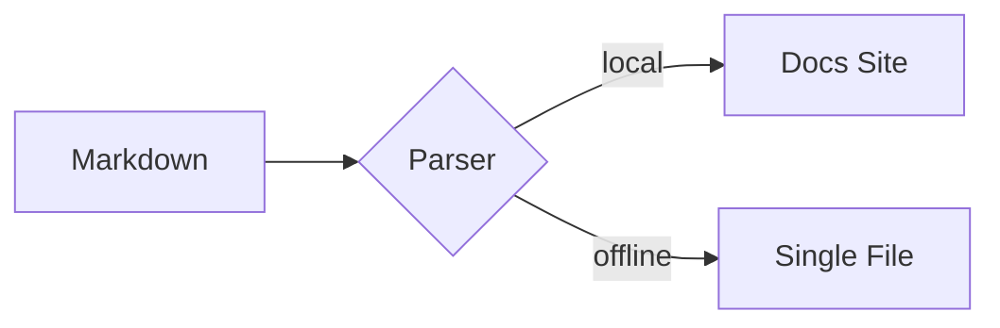

# Muestra de Sintaxis Markdown y Componentes 🎛️

Esta página es la referencia viva de DocMeDown: **cada característica estándar de Markdown** y **cada componente integrado**, cada uno con su código fuente listo para copiar y pegar seguido inmediatamente por el componente en funcionamiento.

---

## Parte 1 — Sintaxis Markdown Estándar

### Encabezados y Texto

````markdown
# Encabezado H1
## Encabezado H2
### Encabezado H3

**Negrita**, *cursiva*, ~~tachado~~, `código inline`, y [enlaces](https://github.com).
````

# Encabezado H1
## Encabezado H2
### Encabezado H3

**Negrita**, *cursiva*, ~~tachado~~, `código inline`, y [enlaces](https://github.com).

### Listas y Listas de Tareas

````markdown
- Elemento no ordenado
- Otro elemento
  1. Ordenado anidado
  2. Anidado nuevamente

- [x] Publicar la documentación
- [ ] Escribir más documentación
````

- Elemento no ordenado
- Otro elemento
  1. Ordenado anidado
  2. Anidado nuevamente

- [x] Publicar la documentación
- [ ] Escribir más documentación

### Tablas

````markdown
| Característica | Estado | Notas                         |
| :------------- | :----: | :---------------------------- |
| Auto-índice    |   ✅   | Barra lateral sin configuración |
| Búsqueda       |   ✅   | Paleta difusa `⌘K`            |
| Offline        |   ✅   | Compilación monofile `.dist`  |
````

| Característica | Estado | Notas                         |
| :------------- | :----: | :---------------------------- |
| Auto-índice    |   ✅   | Barra lateral sin configuración |
| Búsqueda       |   ✅   | Paleta difusa `⌘K`            |
| Offline        |   ✅   | Compilación monofile `.dist`  |

### Cita en Bloque (Blockquote)

````markdown
> Las citas en bloque se renderizan con estilos de acento adaptados a la familia visual.
````

> Las citas en bloque se renderizan con estilos de acento adaptados a la familia visual.

### Alertas de GitHub

````markdown
> [!NOTE]
> Notas, consejos, advertencias y precauciones — las cinco variantes soportadas.
````

> [!NOTE]
> Notas, consejos, advertencias y precauciones — las cinco variantes soportadas.

### Fórmulas Matemáticas (KaTeX)

La matemática inline utiliza signos de dólar simples, como $E = mc^2$, y la matemática en bloque usa signos dobles:

$$
\int_{-\infty}^{\infty} e^{-x^2}\,dx = \sqrt{\pi}
$$

La sintaxis matemática nunca se evalúa dentro de bloques o fragmentos de código — `` `$E = mc^2$` `` se conserva como código literal.

### Bloques de Código con Título y Resaltado

Los bloques delimitados cuentan con resaltado para más de 30 lenguajes listos para usar, con alias (`ts`, `py`, `sh`, `rb`, `yml`, …) y títulos opcionales:

````markdown
```python title="deploy.py"
def promote(changelog: str, version: str) -> str:
    """Promote Unreleased notes into a dated section."""
    return changelog.replace("## Unreleased", f"## {version}")
```
````

```python title="deploy.py"
def promote(changelog: str, version: str) -> str:
    """Promote Unreleased notes into a dated section."""
    return changelog.replace("## Unreleased", f"## {version}")
```

````md
```rust title="main.rs" {2,3}
fn main() {
    let docs = vec!["fast", "offline", "beautiful"];
    for d in &docs { println!("{}", d); }
}
```
````

```rust title="main.rs" {2,3}
fn main() {
    let docs = vec!["fast", "offline", "beautiful"];
    for d in &docs { println!("{}", d); }
}
```

````md
```css title="tokens.css"
:root {
  --dmd-accent: #315cf5;
  --dmd-radius-md: 10px;
}
```
````

```css title="tokens.css"
:root {
  --dmd-accent: #315cf5;
  --dmd-radius-md: 10px;
}
```

Los lenguajes desconocidos o faltantes degradan limpiamente a texto plano sin resaltados incorrectos.

### Diagramas Mermaid

````markdown

````


---

## Parte 2 — Componentes Integrados (12+)

Cada componente a continuación se registra de forma automática — sin importaciones ni configuraciones. Úselos directamente en cualquier archivo `.md`.

### 1. `<Tabs>` + `<Tab>` — cuatro tratamientos, grupos sincronizados y solo icono

Las pestañas admiten navegación por teclado (flechas / Inicio / Fin), `defaultIndex`, sincronización mediante `groupId` y una propiedad `type` con cuatro apariencias visuales: `recessed` (predeterminada — hueco rehundido con chip elevado), `underline` (microrótulos editoriales sin marco con barra deslizante), `pills` (control segmentado flotante centrado) y `postit` (pestañas inclinadas en tono ámbar acopladas al panel). `label` es opcional — una pestaña puede contener únicamente un icono, y el elemento universal `<Item>` se resuelve como un `<Tab>` dentro de `<Tabs>`.

#### Recessed — la bandeja predeterminada

```html
<Tabs type="recessed">
  <Tab label="npm">npm install docmedown</Tab>
  <Tab label="yarn">yarn add docmedown</Tab>
  <Tab label="pnpm">pnpm add docmedown</Tab>
</Tabs>
```

<Tabs type="recessed">
  <Tab label="npm">npm install docmedown</Tab>
  <Tab label="yarn">yarn add docmedown</Tab>
  <Tab label="pnpm">pnpm add docmedown</Tab>
</Tabs>

#### Underline — microrótulos editoriales sin marco

```html
<Tabs type="underline" defaultIndex={1}>
  <Tab label="Visión General">Una pantalla. Cero build. Introduce Markdown y obtén documentación.</Tab>
  <Tab label="Offline">Cada página se entrega en un único archivo HTML autocontenido.</Tab>
  <Tab label="Nativo para IA">llms.txt, SKILL.md y un servidor MCP listos para usar.</Tab>
</Tabs>
```

<Tabs type="underline" defaultIndex={1}>
  <Tab label="Visión General">Una pantalla. Cero build. Introduce Markdown y obtén documentación.</Tab>
  <Tab label="Offline">Cada página se entrega en un único archivo HTML autocontenido.</Tab>
  <Tab label="Nativo para IA">llms.txt, SKILL.md y un servidor MCP listos para usar.</Tab>
</Tabs>

#### Pills — control segmentado flotante centrado

```html
<Tabs type="pills">
  <Tab label="API" icon="🔌">Endpoints REST y GraphQL.</Tab>
  <Tab label="CLI" icon="💻">Comandos sin configuración.</Tab>
  <Tab label="MCP" icon="🤖">Consultable por agentes de IA.</Tab>
</Tabs>
```

<Tabs type="pills">
  <Tab label="API" icon="🔌">Endpoints REST y GraphQL.</Tab>
  <Tab label="CLI" icon="💻">Comandos sin configuración.</Tab>
  <Tab label="MCP" icon="🤖">Consultable por agentes de IA.</Tab>
</Tabs>

#### Post-it — pestañas cálidas de archivador acopladas al panel

```html
<Tabs type="postit">
  <Tab label="API" icon="🔌">REST + GraphQL</Tab>
  <Tab label="CLI" icon="💻">Comandos zero-config.</Tab>
  <Tab icon="⚙️">Solo icono, sin etiqueta.</Tab>
</Tabs>
```

<Tabs type="postit">
  <Tab label="API" icon="🔌">REST + GraphQL</Tab>
  <Tab label="CLI" icon="💻">Comandos zero-config.</Tab>
  <Tab icon="⚙️">Solo icono, sin etiqueta.</Tab>
</Tabs>

#### Grupos sincronizados — una sola selección en todas partes

Las pestañas que comparten el mismo `groupId` cambian juntas (y recuerdan su estado en `localStorage`):

```html
<Tabs groupId="pkg">
  <Item label="npm">npm install docmedown</Item>
  <Item label="yarn">yarn add docmedown</Item>
  <Item label="pnpm">pnpm add docmedown</Item>
</Tabs>

<Tabs groupId="pkg">
  <Item label="npm">Ejecuta en Node 20.19+.</Item>
  <Item label="yarn">Compatible con Yarn Berry.</Item>
  <Item label="pnpm">Más rápido con pnpm 9+.</Item>
</Tabs>
```

<Tabs groupId="pkg">
  <Item label="npm">npm install docmedown</Item>
  <Item label="yarn">yarn add docmedown</Item>
  <Item label="pnpm">pnpm add docmedown</Item>
</Tabs>

<Tabs groupId="pkg">
  <Item label="npm">Ejecuta en Node 20.19+.</Item>
  <Item label="yarn">Compatible con Yarn Berry.</Item>
  <Item label="pnpm">Más rápido con pnpm 9+.</Item>
</Tabs>


### 2. `<CardGrid>` + `<Card>` (iconos, medios, insignias, pies de tarjeta, cuerpo libre, carrusel)

Las tarjetas funcionan de dos maneras: controladas totalmente por props (`title` + `description`), o como un contenedor cuyo cuerpo aloja Markdown o HTML libre — encabezados, listas, tablas, bloques de código y componentes anidados como `<Badge>` se renderizan dentro de la tarjeta. `title` es opcional; `color` acepta una variante con nombre (`blue`, `green`, `violet`, `amber`, `red`, `neutral`) o cualquier color CSS (`#ff6600`, `var(--dmd-accent)`, …) aplicado como acento; y `shadow={false}` desactiva la sombra predeterminada. `description` renderiza un subtítulo suavizado debajo del título; el cuerpo de la tarjeta proviene exclusivamente de sus elementos hijos. El pie de tarjeta siempre se alinea en la parte inferior, incluso si otras tarjetas de la fila son más altas. Un cuerpo encabezado por títulos también puede nombrar la tarjeta: sin props, el primer encabezado superior a `###` se convierte en el título, el siguiente en el subtítulo y una cita final actúa como pie de tarjeta.

````html
<CardGrid cols={2}>
  <Card
    title="Cero Fricción de Build"
    description="Coloca un index.html y navega al instante."
    badge="Rápido"
    badgeType="success"
    icon="⚡"
    footer="Hot-reload incluido."
  />
  <Card color="blue" badge="Nuevo" badgeType="new">
    ## Tarjeta estilo contenedor
    #### El cuerpo admite **Markdown simple**:
    - Encabezados, listas, tablas
    - Bloques de código y matemáticas
    ```sh
    npx docmedown init
    ```
    > **Info**: ¡Esta cita en bloque funciona como un pie de tarjeta!
  </Card>
</CardGrid>
````

<CardGrid cols={2}>
  <Card
    title="Cero Fricción de Build"
    description="Coloca un index.html y navega al instante."
    badge="Rápido"
    badgeType="success"
    icon="⚡"
    footer="Hot-reload incluido."
  />
  <Card color="blue" badge="Nuevo" badgeType="new">
    ## Tarjeta estilo contenedor
    #### El cuerpo admite **Markdown simple**:
    - Encabezados, listas, tablas
    - Bloques de código y matemáticas
    ```sh
    npx docmedown init
    ```
    > **Info**: ¡Esta cita en bloque funciona como un pie de tarjeta!
  </Card>
</CardGrid>

Tarjeta con la propiedad `content` (Markdown directo, HTML o fuentes `.md` locales o remotas):

```html
<CardGrid cols={2}>
  <Card
    title="Propiedad Markdown Directa"
    badge="Prop"
    content="¡El cuerpo de esta tarjeta se proporcionó mediante la prop **content** como Markdown sin procesar!"
  />
  <Card
    title="Propiedad HTML Directa"
    badge="HTML"
    badgetype="success"
    content="<p>Esta tarjeta se renderizó a partir de <strong>contenido HTML</strong> mediante la propiedad <code>content</code>.</p>"
  />
</CardGrid>
```

<CardGrid cols={2}>
  <Card
    title="Propiedad Markdown Directa"
    badge="Prop"
    content="¡El cuerpo de esta tarjeta se proporcionó mediante la prop **content** como Markdown sin procesar!"
  />
  <Card
    title="Propiedad HTML Directa"
    badge="HTML"
    badgetype="success"
    content="<p>Esta tarjeta se renderizó a partir de <strong>contenido HTML</strong> mediante la propiedad <code>content</code>.</p>"
  />
</CardGrid>

Una sola tarjeta con color de acento, sin requerir título:

```html
<Card color="#8b5cf6">
  Cualquier **color CSS** funciona como acento — hexadecimal, rgb o variables de tema.
</Card>
```

<Card color="#8b5cf6">
  Cualquier **color CSS** funciona como acento — hexadecimal, rgb o variables de tema.
</Card>

Una tarjeta plana (sin sombra) para interfaces densas:

```html
<Card title="Tarjeta plana" shadow={false}>
  `shadow={false}` quita la sombra proyectada — útil en barras laterales y cuadrículas compactas.
</Card>
```

<Card title="Tarjeta plana" shadow={false}>
  `shadow={false}` quita la sombra proyectada — útil en barras laterales y cuadrículas compactas.
</Card>

**Modo carrusel:** cuando una cuadrícula contiene **más tarjetas que columnas**, se convierte en un carrusel nativo con ajuste por desplazamiento (scroll-snap). Deslice en pantallas táctiles o use las flechas y puntos de control. La vista se desplaza una tarjeta a la vez y **recorre todas las tarjetas en bucle continuo**. `carouselCols` limita cuántas tarjetas están visibles de forma simultánea (por defecto coincide con `cols`) y se adapta dinámicamente en pantallas estrechas.

```html
<CardGrid cols={2} carouselCols={2}>
  <Card color="blue" title="Uno" icon="1️⃣">Deslice con los controles inferiores.</Card>
  <Card color="green" title="Dos" icon="2️⃣">Arrastre o utilice las flechas.</Card>
  <Card color="amber" title="Tres" icon="3️⃣">Los puntos saltan directamente a una tarjeta.</Card>
  <Card color="violet" title="Cuatro" icon="4️⃣">Del final al inicio de forma fluida.</Card>
  <Card color="red" title="Cinco" icon="5️⃣">Pantallas pequeñas muestran una por vez.</Card>
</CardGrid>
```

<CardGrid cols={2} carouselCols={2}>
  <Card color="blue" title="Uno" icon="1️⃣">Deslice con los controles inferiores.</Card>
  <Card color="green" title="Dos" icon="2️⃣">Arrastre o utilice las flechas.</Card>
  <Card color="amber" title="Tres" icon="3️⃣">Los puntos saltan directamente a una tarjeta.</Card>
  <Card color="violet" title="Cuatro" icon="4️⃣">Del final al inicio de forma fluida.</Card>
  <Card color="red" title="Cinco" icon="5️⃣">Pantallas pequeñas muestran una por vez.</Card>
</CardGrid>

### 3. `<Steps>` + `<Step>`

Los números manuales en `step` son opcionales — el componente `<Steps>` numera de forma correlativa cada paso automáticamente:

```html
<Steps>
  <Step title="Inicializar">Ejecute <code>npx docmedown ./docs</code></Step>
  <Step title="Redactar">Escriba Markdown y obtenga navegación y búsqueda gratuitas.</Step>
  <Step title="Desplegar">Hospedaje estático o paquete offline de un solo archivo.</Step>
</Steps>
```

<Steps>
  <Step title="Inicializar">Ejecute <code>npx docmedown ./docs</code></Step>
  <Step title="Redactar">Escriba Markdown y obtenga navegación y búsqueda gratuitas.</Step>
  <Step title="Desplegar">Hospedaje estático o paquete offline de un solo archivo.</Step>
</Steps>

### 4. `<Badge>` (seis tipos, formato píldora, punto activo e icono)

Seis tipos semánticos (`info`, `success`, `warning`, `danger`, `new`, `neutral`) se renderizan como etiquetas tintadas con un brillo a juego. Agregue `pill` para un formato de **píldora con borde marcado**, `dot` para un indicador de estado intermitente, o `icon` para un glifo representativo:

```html
<Badge type="info">INFO</Badge>
<Badge type="success">ESTABLE</Badge>
<Badge type="warning">BETA</Badge>
<Badge type="danger">CRÍTICO</Badge>
<Badge type="new">v1.0</Badge>
<Badge type="neutral" pill>PÍLDORA NEUTRA</Badge>
<Badge type="success" dot>Activo</Badge>
```

<Badge type="info">INFO</Badge> <Badge type="success">ESTABLE</Badge> <Badge type="warning">BETA</Badge> <Badge type="danger">CRÍTICO</Badge> <Badge type="new">v1.0</Badge> <Badge type="neutral" pill>PÍLDORA NEUTRA</Badge> <Badge type="success" dot>Activo</Badge>

### 5. `<Alert>` (+ alias `<Callout>`)

Ocho tipos semánticos (`note`, `tip`, `important`, `warning`, `caution`, `info`, `success`, `danger`). Cada alerta renderiza un icono distintivo y un encabezado sobre una tarjeta iluminada en el tono del tipo seleccionado. Se aplica el mismo diseño visual a los avisos de GitHub `> [!NOTE]`.

```html
<Alert type="tip" title="Consejo profesional">Las alertas admiten ocho tipos: note, tip, important, warning, caution, info, success, danger.</Alert>
<Alert type="danger" title="Cambio incompatible">Reconstruya siempre las copias offline después de actualizar el motor en tiempo de ejecución.</Alert>
```

<Alert type="tip" title="Consejo profesional">Las alertas admiten ocho tipos: note, tip, important, warning, caution, info, success, danger.</Alert>

<Alert type="danger" title="Cambio incompatible">Reconstruya siempre las copias offline después de actualizar el motor en tiempo de ejecución.</Alert>

### 6. `<Button>` (variantes, tamaños, danger, estado de carga e iconos)

```html
<Button href="#/getting-started">Empezar</Button>
<Button variant="outline" href="#/configuration">Configuración</Button>
<Button variant="secondary" size="sm">Secundario</Button>
<Button variant="ghost" size="sm">Fantasma</Button>
<Button variant="danger" size="sm">Eliminar</Button>
<Button variant="primary" loading>Desplegando…</Button>
<Button variant="primary" size="lg" href="https://github.com/gabrielmsilva00/docmedown" external>GitHub ↗</Button>
```

<Button href="#/getting-started">Empezar</Button> <Button variant="outline" href="#/configuration">Configuración</Button> <Button variant="secondary" size="sm">Secundario</Button> <Button variant="ghost" size="sm">Fantasma</Button> <Button variant="danger" size="sm">Eliminar</Button> <Button variant="primary" loading>Desplegando…</Button> <Button variant="primary" size="lg" href="https://github.com/gabrielmsilva00/docmedown" external>GitHub ↗</Button>

### 7. `<Kbd>` (teclas individuales y combinaciones de atajos)

```html
Presione <Kbd>Ctrl</Kbd> + <Kbd>K</Kbd> en cualquier lugar para abrir la paleta de búsqueda.
Atajo completo: <Kbd keys="Ctrl + K" />
```

Presione <Kbd>Ctrl</Kbd> + <Kbd>K</Kbd> en cualquier lugar para abrir la paleta de búsqueda.
Atajo completo: <Kbd keys="Ctrl + K" />

### 8. `<Details>`

```html
<Details summary="¿Cómo funciona el paquete offline?">
  El proceso comprime con gzip todo su contenido, componentes y entorno de ejecución en un sobre
  base64 único que se autoextrae mediante la API nativa DecompressionStream del navegador.
</Details>
```

<Details summary="¿Cómo funciona el paquete offline?">
  El proceso comprime con gzip todo su contenido, componentes y entorno de ejecución en un sobre
  base64 único que se autoextrae mediante la API nativa DecompressionStream del navegador.
</Details>

### 9. `<Accordion>` + `<AccordionItem>`

```html
<Accordion>
  <AccordionItem title="¿Es DocMeDown gratuito?">Sí — bajo licencia MIT para siempre.</AccordionItem>
  <AccordionItem title="¿Funciona sin conexión?" defaultOpen={true}>Completamente. Un solo archivo HTML, cero llamadas de red.</AccordionItem>
  <AccordionItem title="¿Puedo añadir mis propios componentes?">Sí, mediante .dmd/components.js o DocMeDown.registerComponent.</AccordionItem>
</Accordion>
```

<Accordion>
  <AccordionItem title="¿Es DocMeDown gratuito?">Sí — bajo licencia MIT para siempre.</AccordionItem>
  <AccordionItem title="¿Funciona sin conexión?" defaultOpen={true}>Completamente. Un solo archivo HTML, cero llamadas de red.</AccordionItem>
  <AccordionItem title="¿Puedo añadir mis propios componentes?">Sí, mediante .dmd/components.js o DocMeDown.registerComponent.</AccordionItem>
</Accordion>

### 10. `<Columns>` + `<Column>`

`type` define el acabado visual de la columna: `normal` (predeterminado, sin bordes), `card` (panel elevado), `recessed` (bandeja rehundida) o `neon` (borde de acento con brillo suave). Las columnas se adaptan con fluidez al ancho del dispositivo.

```html
<Columns cols={3}>
  <Column>**Escriba** en Markdown limpio.</Column>
  <Column>**Personalice** con cuatro familias visuales completas.</Column>
  <Column>**Distribuya** en cualquier sitio — estático u offline.</Column>
</Columns>

<Columns cols={3} type="card">
  <Column>Formato card — panel elevado con borde y sombra.</Column>
  <Column>Formato card — panel elevado con borde y sombra.</Column>
  <Column>Formato card — panel elevado con borde y sombra.</Column>
</Columns>

<Columns cols={3} type="recessed">
  <Column>Rehundido — bandeja situada por debajo de la superficie.</Column>
  <Column>Rehundido — bandeja situada por debajo de la superficie.</Column>
  <Column>Rehundido — bandeja situada por debajo de la superficie.</Column>
</Columns>

<Columns cols={3} type="neon">
  <Column>Neón — contorno de acento con brillo suave.</Column>
  <Column>Neón — contorno de acento con brillo suave.</Column>
  <Column>Neón — contorno de acento con brillo suave.</Column>
</Columns>
```

<Columns cols={3}>
  <Column>**Escriba** en Markdown limpio.</Column>
  <Column>**Personalice** con cuatro familias visuales completas.</Column>
  <Column>**Distribuya** en cualquier sitio — estático u offline.</Column>
</Columns>

<Columns cols={3} type="card">
  <Column>Formato card — panel elevado con borde y sombra.</Column>
  <Column>Formato card — panel elevado con borde y sombra.</Column>
  <Column>Formato card — panel elevado con borde y sombra.</Column>
</Columns>

<Columns cols={3} type="recessed">
  <Column>Rehundido — bandeja situada por debajo de la superficie.</Column>
  <Column>Rehundido — bandeja situada por debajo de la superficie.</Column>
  <Column>Rehundido — bandeja situada por debajo de la superficie.</Column>
</Columns>

<Columns cols={3} type="neon">
  <Column>Neón — contorno de acento con brillo suave.</Column>
  <Column>Neón — contorno de acento con brillo suave.</Column>
  <Column>Neón — contorno de acento con brillo suave.</Column>
</Columns>

### 11. `<Timeline>` + `<TimelineItem>`

```html
<Timeline>
  <TimelineItem title="0.1.7 — Autosuficiencia offline" subtitle="2026-08-30">
    Los sitios anidados se integran en el paquete de archivo único; los enlaces externos inaccesibles se atenúan.
  </TimelineItem>
  <TimelineItem title="0.1.6 — Barra de navegación en línea única" subtitle="2026-08-30">
    Todos los elementos de la barra se conservan en una fila con truncamiento elíptico.
  </TimelineItem>
  <TimelineItem title="0.1.0 — Primer lanzamiento" subtitle="2026-08-27">
    Markdown de entrada, documentación impecable de salida.
  </TimelineItem>
</Timeline>
```

<Timeline>
  <TimelineItem title="0.1.7 — Autosuficiencia offline" subtitle="2026-08-30">
    Los sitios anidados se integran en el paquete de archivo único; los enlaces externos inaccesibles se atenúan.
  </TimelineItem>
  <TimelineItem title="0.1.6 — Barra de navegación en línea única" subtitle="2026-08-30">
    Todos los elementos de la barra se conservan en una fila con truncamiento elíptico.
  </TimelineItem>
  <TimelineItem title="0.1.0 — Primer lanzamiento" subtitle="2026-08-27">
    Markdown de entrada, documentación impecable de salida.
  </TimelineItem>
</Timeline>

### 12. El Universal `<Item>`

`<Item>` opera como hijo de cualquier contenedor emparejado — se vincula al contenedor **más cercano** superior y adopta todo el comportamiento y propiedades de este. Sin contenedor se convierte en un `<li>` estándar:

```html
<Timeline>
  <Item title="0.1.7 — Autosuficiencia offline" subtitle="2026-08-30">
    Los sitios anidados se integran en el paquete de archivo único.
  </Item>
  <Item title="0.1.6 — Barra de navegación en línea única" subtitle="2026-08-30">
    Todos los elementos de la barra se conservan en una sola línea.
  </Item>
</Timeline>

<Steps>
  <Item>Ejecute <code>npx docmedown ./docs</code></Item>
  <Item>Escriba Markdown y obtenga navegación y búsqueda de inmediato.</Item>
  <Item>Despliegue en cualquier lugar.</Item>
</Steps>

<Accordion>
  <Item title="¿Es DocMeDown gratuito?" defaultOpen>Sí — bajo licencia MIT para siempre.</Item>
  <Item title="¿Funciona sin conexión?">Completamente. Un solo archivo HTML, cero llamadas de red.</Item>
</Accordion>
```

<Timeline>
  <Item title="0.1.7 — Autosuficiencia offline" subtitle="2026-08-30">
    Los sitios anidados se integran en el paquete de archivo único.
  </Item>
  <Item title="0.1.6 — Barra de navegación en línea única" subtitle="2026-08-30">
    Todos los elementos de la barra se conservan en una sola línea.
  </Item>
</Timeline>

<Steps>
  <Item>Ejecute <code>npx docmedown ./docs</code></Item>
  <Item>Escriba Markdown y obtenga navegación y búsqueda de inmediato.</Item>
  <Item>Despliegue en cualquier lugar.</Item>
</Steps>

<Accordion>
  <Item title="¿Es DocMeDown gratuito?" defaultOpen>Sí — bajo licencia MIT para siempre.</Item>
  <Item title="¿Funciona sin conexión?">Completamente. Un solo archivo HTML, cero llamadas de red.</Item>
</Accordion>

### 13. Componente `<Media>`

La primitiva `<Media>` proporciona control detallado sobre imágenes de mapa de bits, gráficos vectoriales, reproductores de vídeo y de audio, con recuperación inteligente ante fallos e **incrustación offline sin pérdidas**.

#### 13.1 Imagen Estilizada con Pie de Foto y Sombra
```html
<Media
  src="./favicon.svg"
  alt="Logotipo de DocMeDown"
  width="120px"
  rounded="lg"
  shadow="md"
  align="center"
  caption="Marca distintiva de DocMeDown (Redondeada + Sombra + Centrada)"
/>
```

<Media
  src="./favicon.svg"
  alt="Logotipo de DocMeDown"
  width="120px"
  rounded="lg"
  shadow="md"
  align="center"
  caption="Marca distintiva de DocMeDown (Redondeada + Sombra + Centrada)"
/>

#### 13.2 SVG Vectorial Inline (`embed="inline"`)
Incrusta SVG vectorial directamente en el árbol DOM para heredar `currentColor` vía CSS y escalar de forma nítida:

```html
<Media
  src="./favicon.svg"
  format="svg"
  embed="inline"
  width="64px"
  align="center"
  caption="Elemento SVG inline renderizado directamente en el DOM"
/>
```

<Media
  src="./favicon.svg"
  format="svg"
  embed="inline"
  width="64px"
  align="center"
  caption="Elemento SVG inline renderizado directamente en el DOM"
/>

#### 13.3 Reproductor de Vídeo HTML5
```html
<Media
  src="https://commondatastorage.googleapis.com/gtv-videos-bucket/sample/ForBiggerBlazes.mp4"
  type="video/mp4"
  poster="./favicon.svg"
  controls={true}
  width="100%"
  maxWidth="640px"
  aspectRatio="16/9"
  rounded="md"
  shadow="md"
  caption="Reproductor de vídeo HTML5 con controles, formato 16:9 y póster personalizado"
/>
```

<Media
  src="https://commondatastorage.googleapis.com/gtv-videos-bucket/sample/ForBiggerBlazes.mp4"
  type="video/mp4"
  poster="./favicon.svg"
  controls={true}
  width="100%"
  maxWidth="640px"
  aspectRatio="16/9"
  rounded="md"
  shadow="md"
  caption="Reproductor de vídeo HTML5 con controles, formato 16:9 y póster personalizado"
/>

#### 13.4 Reproductor de Audio HTML5
```html
<Media
  src="https://www.soundhelix.com/examples/mp3/SoundHelix-Song-1.mp3"
  format="audio/mpeg"
  controls={true}
  maxWidth="540px"
  caption="Reproductor de audio HTML5 con controles"
  fallback="La reproducción de audio no es compatible con este navegador."
/>
```

<Media
  src="https://www.soundhelix.com/examples/mp3/SoundHelix-Song-1.mp3"
  format="audio/mpeg"
  controls={true}
  maxWidth="540px"
  caption="Reproductor de audio HTML5 con controles"
  fallback="La reproducción de audio no es compatible con este navegador."
/>

#### 13.5 Interfaz Resiliente de Fallback
Cuando un recurso multimedia no se puede cargar, `<Media>` muestra automáticamente un indicador claro adaptado a su categoría:

```html
<Media
  src="https://example.com/unreachable-sample-video.mp4"
  type="video/mp4"
  maxWidth="540px"
  fallbackText="El vídeo de prueba no está accesible actualmente. Verifique su conexión de red."
/>
```

<Media
  src="https://example.com/unreachable-sample-video.mp4"
  type="video/mp4"
  maxWidth="540px"
  fallbackText="El vídeo de prueba no está accesible actualmente. Verifique su conexión de red."
/>

---

## Parte 3 — Sus Propios Componentes (`.dmd/.components/`)

Desarrolle componentes Svelte 5 de primer nivel como archivos `.svelte` en `.dmd/.components/` — compilados por adelantado durante el build para distribución estática sin sobrecarga, y compilados en tiempo de ejecución durante el desarrollo. Estos dos widgets activos se incluyen en este mismo sitio:

```svelte title=".dmd/.components/CounterWidget.svelte"
<svelte:options customElement={{ tag: "dmd-counter-widget" }} />

<script>
  let { title = "Counter" } = $props();
  let count = $state(0);
</script>

<div class="dmd-custom-panel">
  <strong>{title}</strong>
  <p class="dmd-custom-desc">
    A component-local reactive state value using Svelte 5 runes.
  </p>
  <button type="button" class="dmd-custom-btn" onclick={() => count++}>
    Count: {count}
  </button>
</div>
```

<InteractiveThemeDemo />

<CounterWidget title="Live state widget" />

### Lenguajes Personalizados con Resaltado de Sintaxis

Registre una gramática Prism personalizada en build y runtime para lenguajes no incluidos de serie mediante `.dmd/.components/setup.js`:

```js title=".dmd/.components/setup.js"
window.DocMeDown.registerLanguage("mylang", {
  comment: /#.*/,
  string: /"(?:[^"\\]|\\.)*"/,
  keyword: /\b(?:pipeline|draw|plot|render|at|transform|scale|rotate)\b/,
  boolean: /\b(?:true|false)\b/,
  number: /-?\b\d+(?:\.\d+)?\b/,
  operator: /[+\-*/=<>!:]+/,
  punctuation: /[{}[\];(),.]/,
}, "#06b6d4");
```

Utilícelo con bloques de código delimitados `mylang` en cualquier sección de sus documentos:

````md
```mylang title="pipeline.mylang" {1-3,6}
# Custom graphics pipeline in mylang
pipeline "RaymarchRenderer" {
  draw "Sphere" at (0.0, 1.5, -3.0)
  transform scale: 1.25, rotate: 45
  plot 120.5
  render "VectorField"
}
```

````

```mylang title="pipeline.mylang" {1-3,6}
# Custom graphics pipeline in mylang
pipeline "RaymarchRenderer" {
  draw "Sphere" at (0.0, 1.5, -3.0)
  transform scale: 1.25, rotate: 45
  plot 120.5
  render "VectorField"
}
```


---

## Parte 4 — Componentes Personalizados Multi-Framework (`.dmd/`)

DocMeDown actúa como un host universal y capa de traducción de componentes. Puede integrar **Svelte 5**, **React TSX** y **Web Elements (Lit)** de manera fluida y simultánea:

### Svelte 5 Nativo (`.dmd/CounterWidget.svelte`)

````markdown
<CounterWidget title="Reactive Runes Counter" />
````

<CounterWidget title="Reactive Runes Counter" />

### Componente React TSX (`.dmd/ReactMetricCard.tsx`)

````markdown
<ReactMetricCard label="Latency Benchmark" initial={42} unit="ms" />
````

<ReactMetricCard label="Latency Benchmark" initial={42} unit="ms" />

### Web Element / Lit (`.dmd/LitStatusBadge.ts`)

````markdown
<LitStatusBadge label="Database Cluster" status="operational" />
````

<LitStatusBadge label="Database Cluster" status="operational" />

---

> [!TIP]
> Copie cualquier bloque de código anterior en su propia documentación — todos los componentes y funciones de sintaxis operan de forma idéntica en sitios web y paquetes offline.

---

## 🗺️ Próximos Pasos

Siga la ruta de documentación:

<CardGrid cols={2}>
  <Card
    title="Ejemplos de Referencia Ejecutables"
    description="Explore tres sitios de documentación de referencia completos incluidos en DocMeDown."
    href="#/examples"
    badge="Siguiente"
    badgeType="info"
  />
  <Card
    title="Primitivas de UI Integradas"
    description="Referencia de los 20 elementos: CardGrid, Tabs, Badges, Callouts, Media y Buttons."
    href="#/guides/built-in-components"
    badge="Anterior"
    badgeType="success"
  />
</CardGrid>
