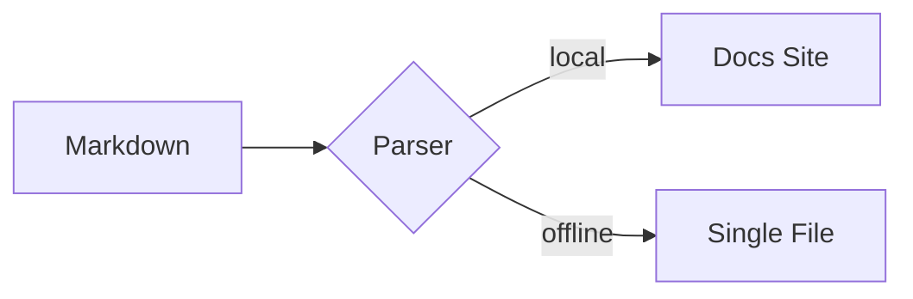

# Vitrine de Sintaxe Markdown e Componentes 🎛️

Esta página é a referência viva do DocMeDown: **cada recurso padrão de Markdown** e **cada componente nativo**, cada um com o código-fonte pronto para copiar e colar imediatamente seguido pelo componente em ação.

---

## Parte 1 — Sintaxe Markdown Padrão

### Cabeçalhos e Texto

````markdown
# Título H1
## Título H2
### Título H3

**Negrito**, *itálico*, ~~tachado~~, `código inline`, e [links](https://github.com).
````

# Título H1
## Título H2
### Título H3

**Negrito**, *itálico*, ~~tachado~~, `código inline`, e [links](https://github.com).

### Listas e Listas de Tarefas

````markdown
- Item não ordenado
- Outro item
  1. Ordenado aninhado
  2. Aninhado novamente

- [x] Publicar a documentação
- [ ] Escrever mais documentação
````

- Item não ordenado
- Outro item
  1. Ordenado aninhado
  2. Aninhado novamente

- [x] Publicar a documentação
- [ ] Escrever mais documentação

### Tabelas

````markdown
| Recurso     | Status | Notas                       |
| :---------- | :----: | :-------------------------- |
| Auto-índice |   ✅   | Barra lateral zero-config   |
| Busca       |   ✅   | Paleta fuzzy `⌘K`           |
| Offline     |   ✅   | Build de arquivo único `.dist` |
````

| Recurso    | Status | Notas                       |
| :--------- | :----: | :-------------------------- |
| Auto-índice |   ✅   | Barra lateral zero-config   |
| Busca      |   ✅   | Paleta fuzzy `⌘K`           |
| Offline    |   ✅   | Build de arquivo único `.dist` |

### Citação em Bloco (Blockquote)

````markdown
> Citações em bloco são renderizadas com estilos de destaque sensíveis à família visual.
````

> Citações em bloco são renderizadas com estilos de destaque sensíveis à família visual.

### Alertas do GitHub

````markdown
> [!NOTE]
> Notas, dicas, avisos e alertas de cuidado — todas as cinco variantes suportadas.
````

> [!NOTE]
> Notas, dicas, avisos e alertas de cuidado — todas as cinco variantes suportadas.

### Fórmulas Matemáticas (KaTeX)

Matemática inline utiliza cifrões simples, como $E = mc^2$, e matemática em bloco utiliza cifrões duplos:

$$
\int_{-\infty}^{\infty} e^{-x^2}\,dx = \sqrt{\pi}
$$

A sintaxe matemática nunca é interpretada dentro de spans de código ou blocos cercados — `` `$E = mc^2$` `` permanece código literal.

### Blocos de Código com Títulos e Destaque de Sintaxe

Blocos cercados contam com realce de sintaxe em mais de 30 linguagens prontas para uso, com apelidos (`ts`, `py`, `sh`, `rb`, `yml`, …) e títulos opcionais:

````markdown
```python title="deploy.py"
def promote(changelog: str, version: str) -> str:
    """Promote Unreleased notes into a dated section."""
    return changelog.replace("## Unreleased", f"## {version}")
```
````

```python title="deploy.py"
def promote(changelog: str, version: str) -> str:
    """Promote Unreleased notes into a dated section."""
    return changelog.replace("## Unreleased", f"## {version}")
```

````md
```rust title="main.rs" {2,3}
fn main() {
    let docs = vec!["fast", "offline", "beautiful"];
    for d in &docs { println!("{}", d); }
}
```
````

```rust title="main.rs" {2,3}
fn main() {
    let docs = vec!["fast", "offline", "beautiful"];
    for d in &docs { println!("{}", d); }
}
```

````md
```css title="tokens.css"
:root {
  --dmd-accent: #315cf5;
  --dmd-radius-md: 10px;
}
```
````

```css title="tokens.css"
:root {
  --dmd-accent: #315cf5;
  --dmd-radius-md: 10px;
}
```

Linguagens desconhecidas ou ausentes degradam suavemente para texto escapado simples em vez de realce incorreto.

### Diagramas Mermaid

````markdown

````


---

## Parte 2 — Componentes Nativos (12+)

Cada componente abaixo é registrado automaticamente — sem importações, sem configuração. Use-os diretamente em qualquer arquivo `.md`.

### 1. `<Tabs>` + `<Tab>` — quatro tratamentos, grupos sincronizados e somente ícone

Abas suportam navegação por teclado (setas / Home / End), `defaultIndex`, sincronização via `groupId`, e uma propriedade `type` com quatro visuais distintos: `recessed` (padrão — uma cavidade rebaixada com chip elevado), `underline` (microrrótulos editoriais sem borda com barra deslizante), `pills` (controle segmentado flutuante centralizado) e `postit` (abas inclinadas em tom âmbar que se encaixam no painel). `label` é opcional — uma aba pode ter apenas ícone, e o componente universal `<Item>` é resolvido como um `<Tab>` dentro de `<Tabs>`.

#### Recessed — a bandeja padrão

```html
<Tabs type="recessed">
  <Tab label="npm">npm install docmedown</Tab>
  <Tab label="yarn">yarn add docmedown</Tab>
  <Tab label="pnpm">pnpm add docmedown</Tab>
</Tabs>
```

<Tabs type="recessed">
  <Tab label="npm">npm install docmedown</Tab>
  <Tab label="yarn">yarn add docmedown</Tab>
  <Tab label="pnpm">pnpm add docmedown</Tab>
</Tabs>

#### Underline — microrrótulos editoriais sem borda

```html
<Tabs type="underline" defaultIndex={1}>
  <Tab label="Visão Geral">Uma tela. Zero build. Insira Markdown e obtenha documentação.</Tab>
  <Tab label="Offline">Cada página é distribuída em um único arquivo HTML autocontido.</Tab>
  <Tab label="Nativo para IA">llms.txt, SKILL.md e um servidor MCP prontos para uso.</Tab>
</Tabs>
```

<Tabs type="underline" defaultIndex={1}>
  <Tab label="Visão Geral">Uma tela. Zero build. Insira Markdown e obtenha documentação.</Tab>
  <Tab label="Offline">Cada página é distribuída em um único arquivo HTML autocontido.</Tab>
  <Tab label="Nativo para IA">llms.txt, SKILL.md e um servidor MCP prontos para uso.</Tab>
</Tabs>

#### Pills — controle segmentado flutuante centralizado

```html
<Tabs type="pills">
  <Tab label="API" icon="🔌">Endpoints REST e GraphQL.</Tab>
  <Tab label="CLI" icon="💻">Comandos sem configuração prévia.</Tab>
  <Tab label="MCP" icon="🤖">Pesquisável diretamente por agentes de IA.</Tab>
</Tabs>
```

<Tabs type="pills">
  <Tab label="API" icon="🔌">Endpoints REST e GraphQL.</Tab>
  <Tab label="CLI" icon="💻">Comandos sem configuração prévia.</Tab>
  <Tab label="MCP" icon="🤖">Pesquisável diretamente por agentes de IA.</Tab>
</Tabs>

#### Post-it — abas quentes de fichário que se encaixam no painel

```html
<Tabs type="postit">
  <Tab label="API" icon="🔌">REST + GraphQL</Tab>
  <Tab label="CLI" icon="💻">Comandos zero-config.</Tab>
  <Tab icon="⚙️">Apenas ícone, sem texto.</Tab>
</Tabs>
```

<Tabs type="postit">
  <Tab label="API" icon="🔌">REST + GraphQL</Tab>
  <Tab label="CLI" icon="💻">Comandos zero-config.</Tab>
  <Tab icon="⚙️">Apenas ícone, sem texto.</Tab>
</Tabs>

#### Grupos sincronizados — uma seleção refletida em todo lugar

Abas que compartilham o mesmo `groupId` alternam juntas (e memorizam a escolha em `localStorage`) — ideal para manter variantes de instalação sincronizadas:

```html
<Tabs groupId="pkg">
  <Item label="npm">npm install docmedown</Item>
  <Item label="yarn">yarn add docmedown</Item>
  <Item label="pnpm">pnpm add docmedown</Item>
</Tabs>

<Tabs groupId="pkg">
  <Item label="npm">Executa no Node 20.19+.</Item>
  <Item label="yarn">Compatível com Yarn Berry.</Item>
  <Item label="pnpm">Mais veloz com pnpm 9+.</Item>
</Tabs>
```

<Tabs groupId="pkg">
  <Item label="npm">npm install docmedown</Item>
  <Item label="yarn">yarn add docmedown</Item>
  <Item label="pnpm">pnpm add docmedown</Item>
</Tabs>

<Tabs groupId="pkg">
  <Item label="npm">Executa no Node 20.19+.</Item>
  <Item label="yarn">Compatível com Yarn Berry.</Item>
  <Item label="pnpm">Mais veloz com pnpm 9+.</Item>
</Tabs>


### 2. `<CardGrid>` + `<Card>` (ícones, mídia, badges, rodapés, corpo livre, carrossel)

Cards funcionam de duas maneiras: totalmente orientados a props (`title` + `description`), ou como um contêiner cujo corpo aceita Markdown ou HTML arbitrário — títulos, listas, tabelas, blocos de código e componentes aninhados como `<Badge>` são renderizados dentro do card. `title` é opcional; `color` aceita uma variante nomeada (`blue`, `green`, `violet`, `amber`, `red`, `neutral`) ou qualquer cor CSS (`#ff6600`, `var(--dmd-accent)`, …) aplicada como destaque; e `shadow={false}` desativa a sombra projetada padrão. `description` renderiza um subtítulo suavizado logo abaixo do título; o corpo do card se origina exclusivamente dos elementos filhos. O rodapé do card é sempre alinhado na borda inferior, mesmo que cards vizinhos na mesma linha sejam mais altos. Um corpo iniciado por cabeçalho também pode titular o próprio card: sem props, o primeiro título acima de `###` torna-se o título, o título seguinte vira o subtítulo e uma citação final atua como rodapé — uma prop explícita sempre tem prioridade sobre sua respectiva posição.

````html
<CardGrid cols={2}>
  <Card
    title="Zero Atrito de Build"
    description="Insira um index.html e navegue instantaneamente."
    badge="Rápido"
    badgeType="success"
    icon="⚡"
    footer="Hot-reload incluído."
  />
  <Card color="blue" badge="Novo" badgeType="new">
    ## Card estilo contêiner
    #### O corpo aceita **Markdown simples**:
    - Títulos, listas, tabelas
    - Blocos cercados e equações matemáticas
    ```sh
    npx docmedown init
    ```
    > **Info**: Esta citação em bloco funciona como um rodapé!
  </Card>
</CardGrid>
````

<CardGrid cols={2}>
  <Card
    title="Zero Atrito de Build"
    description="Insira um index.html e navegue instantaneamente."
    badge="Rápido"
    badgeType="success"
    icon="⚡"
    footer="Hot-reload incluído."
  />
  <Card color="blue" badge="Novo" badgeType="new">
    ## Card estilo contêiner
    #### O corpo aceita **Markdown simples**:
    - Títulos, listas, tabelas
    - Blocos cercados e equações matemáticas
    ```sh
    npx docmedown init
    ```
    > **Info**: Esta citação em bloco funciona como um rodapé!
  </Card>
</CardGrid>

Card com a propriedade `content` (Markdown direto, HTML ou fontes `.md` locais/remotas):

```html
<CardGrid cols={2}>
  <Card
    title="Propriedade Markdown Direta"
    badge="Prop"
    content="O corpo deste card foi fornecido através da prop **content** como Markdown bruto!"
  />
  <Card
    title="Propriedade HTML Direta"
    badge="HTML"
    badgetype="success"
    content="<p>Este card foi renderizado a partir de <strong>conteúdo HTML</strong> via prop <code>content</code>.</p>"
  />
</CardGrid>
```

<CardGrid cols={2}>
  <Card
    title="Propriedade Markdown Direta"
    badge="Prop"
    content="O corpo deste card foi fornecido através da prop **content** como Markdown bruto!"
  />
  <Card
    title="Propriedade HTML Direta"
    badge="HTML"
    badgetype="success"
    content="<p>Este card foi renderizado a partir de <strong>conteúdo HTML</strong> via prop <code>content</code>.</p>"
  />
</CardGrid>

Um card único com cor de destaque, sem necessidade de título:

```html
<Card color="#8b5cf6">
  Qualquer **cor CSS** funciona como destaque — hexadecimal, rgb ou tokens de tema.
</Card>
```

<Card color="#8b5cf6">
  Qualquer **cor CSS** funciona como destaque — hexadecimal, rgb ou tokens de tema.
</Card>

Um card plano (sem sombra) para layouts densos:

```html
<Card title="Card plano" shadow={false}>
  `shadow={false}` remove a sombra projetada — útil em barras laterais e grades compactas.
</Card>
```

<Card title="Card plano" shadow={false}>
  `shadow={false}` remove a sombra projetada — útil em barras laterais e grades compactas.
</Card>

**Modo carrossel:** quando uma grade contém **mais cards do que o número de colunas**, ela se transforma em um carrossel nativo com alinhamento por rolagem (scroll-snap). Deslize em dispositivos móveis ou utilize os botões anterior/próximo e os pontos de navegação. A visualização desliza um card por vez e **percorre todos os cards em loop**: cada card assume a frente e a última posição retorna suavemente à primeira. `carouselCols` limita quantos cards ficam visíveis simultaneamente (padronizado em `cols`) e reduz automaticamente em telas menores.

```html
<CardGrid cols={2} carouselCols={2}>
  <Card color="blue" title="Um" icon="1️⃣">Deslize pelos controles abaixo.</Card>
  <Card color="green" title="Dois" icon="2️⃣">Arraste ou use as setas.</Card>
  <Card color="amber" title="Três" icon="3️⃣">Os pontos saltam direto a um card.</Card>
  <Card color="violet" title="Quatro" icon="4️⃣">Do último ao primeiro de modo contínuo.</Card>
  <Card color="red" title="Cinco" icon="5️⃣">Telas estreitas exibem um por vez.</Card>
</CardGrid>
```

<CardGrid cols={2} carouselCols={2}>
  <Card color="blue" title="Um" icon="1️⃣">Deslize pelos controles abaixo.</Card>
  <Card color="green" title="Dois" icon="2️⃣">Arraste ou use as setas.</Card>
  <Card color="amber" title="Três" icon="3️⃣">Os pontos saltam direto a um card.</Card>
  <Card color="violet" title="Quatro" icon="4️⃣">Do último ao primeiro de modo contínuo.</Card>
  <Card color="red" title="Cinco" icon="5️⃣">Telas estreitas exibem um por vez.</Card>
</CardGrid>

### 3. `<Steps>` + `<Step>`

Numerações manuais em `step` são opcionais — o componente `<Steps>` numera automaticamente cada etapa em ordem:

```html
<Steps>
  <Step title="Inicializar">Execute <code>npx docmedown ./docs</code></Step>
  <Step title="Escrever">Redija Markdown e obtenha navegação e busca sem esforço.</Step>
  <Step title="Publicar">Hospede estaticamente ou gere um pacote offline único.</Step>
</Steps>
```

<Steps>
  <Step title="Inicializar">Execute <code>npx docmedown ./docs</code></Step>
  <Step title="Escrever">Redija Markdown e obtenha navegação e busca sem esforço.</Step>
  <Step title="Publicar">Hospede estaticamente ou gere um pacote offline único.</Step>
</Steps>

### 4. `<Badge>` (seis tipos, formato pílula, indicador pulsante e ícone)

Seis tipos semânticos (`info`, `success`, `warning`, `danger`, `new`, `neutral`) renderizam como rótulos com coloração suave e brilho correspondente. Adicione `pill` para um formato de **pílula com contorno**, `dot` para um indicador pulsante de status, ou `icon` para um glifo inicial:

```html
<Badge type="info">INFO</Badge>
<Badge type="success">ESTÁVEL</Badge>
<Badge type="warning">BETA</Badge>
<Badge type="danger">CRÍTICO</Badge>
<Badge type="new">v1.0</Badge>
<Badge type="neutral" pill>PÍLULA NEUTRA</Badge>
<Badge type="success" dot>Ativo</Badge>
```

<Badge type="info">INFO</Badge> <Badge type="success">ESTÁVEL</Badge> <Badge type="warning">BETA</Badge> <Badge type="danger">CRÍTICO</Badge> <Badge type="new">v1.0</Badge> <Badge type="neutral" pill>PÍLULA NEUTRA</Badge> <Badge type="success" dot>Ativo</Badge>

### 5. `<Alert>` (+ apelido `<Callout>`)

Oito tipos semânticos (`note`, `tip`, `important`, `warning`, `caution`, `info`, `success`, `danger`). Cada alerta renderiza um ícone colorido com cabeçalho de título sobre um card suavemente iluminado no tom do tipo. O mesmo estilo se aplica às notas de destaque no formato GitHub `> [!NOTE]`.

```html
<Alert type="tip" title="Dica profissional">Alertas aceitam oito tipos: note, tip, important, warning, caution, info, success, danger.</Alert>
<Alert type="danger" title="Mudança com quebra de compatibilidade">Sempre recompile as cópias offline após atualizar o runtime.</Alert>
```

<Alert type="tip" title="Dica profissional">Alertas aceitam oito tipos: note, tip, important, warning, caution, info, success, danger.</Alert>

<Alert type="danger" title="Mudança com quebra de compatibilidade">Sempre recompile as cópias offline após atualizar o runtime.</Alert>

### 6. `<Button>` (variantes, tamanhos, danger, estado de carregamento e ícones)

```html
<Button href="#/getting-started">Começar</Button>
<Button variant="outline" href="#/configuration">Configuração</Button>
<Button variant="secondary" size="sm">Secundário</Button>
<Button variant="ghost" size="sm">Fantasma</Button>
<Button variant="danger" size="sm">Excluir</Button>
<Button variant="primary" loading>Implantando…</Button>
<Button variant="primary" size="lg" href="https://github.com/gabrielmsilva00/docmedown" external>GitHub ↗</Button>
```

<Button href="#/getting-started">Começar</Button> <Button variant="outline" href="#/configuration">Configuração</Button> <Button variant="secondary" size="sm">Secundário</Button> <Button variant="ghost" size="sm">Fantasma</Button> <Button variant="danger" size="sm">Excluir</Button> <Button variant="primary" loading>Implantando…</Button> <Button variant="primary" size="lg" href="https://github.com/gabrielmsilva00/docmedown" external>GitHub ↗</Button>

### 7. `<Kbd>` (teclas individuais e atalhos completos)

```html
Pressione <Kbd>Ctrl</Kbd> + <Kbd>K</Kbd> em qualquer lugar para abrir a paleta de busca.
Atalho completo: <Kbd keys="Ctrl + K" />
```

Pressione <Kbd>Ctrl</Kbd> + <Kbd>K</Kbd> em qualquer lugar para abrir a paleta de busca.
Atalho completo: <Kbd keys="Ctrl + K" />

### 8. `<Details>`

```html
<Details summary="Como funciona o pacote offline?">
  O build comprime via gzip todo o seu acervo, componentes e runtime em um único envelope
  base64 que se autoextrai com a API nativa DecompressionStream do navegador.
</Details>
```

<Details summary="Como funciona o pacote offline?">
  O build comprime via gzip todo o seu acervo, componentes e runtime em um único envelope
  base64 que se autoextrai com a API nativa DecompressionStream do navegador.
</Details>

### 9. `<Accordion>` + `<AccordionItem>`

```html
<Accordion>
  <AccordionItem title="O DocMeDown é gratuito?">Sim — licenciado sob MIT, para sempre.</AccordionItem>
  <AccordionItem title="Ele funciona sem internet?" defaultOpen={true}>Completamente. Um único arquivo HTML, zero requisições de rede.</AccordionItem>
  <AccordionItem title="Posso adicionar meus próprios componentes?">Sim, via .dmd/components.js ou DocMeDown.registerComponent.</AccordionItem>
</Accordion>
```

<Accordion>
  <AccordionItem title="O DocMeDown é gratuito?">Sim — licenciado sob MIT, para sempre.</AccordionItem>
  <AccordionItem title="Ele funciona sem internet?" defaultOpen={true}>Completamente. Um único arquivo HTML, zero requisições de rede.</AccordionItem>
  <AccordionItem title="Posso adicionar meus próprios componentes?">Sim, via .dmd/components.js ou DocMeDown.registerComponent.</AccordionItem>
</Accordion>

### 10. `<Columns>` + `<Column>`

`type` define a apresentação da coluna: `normal` (padrão, sem borda/alinhado), `card` (painel elevado), `recessed` (bandeja rebaixada) ou `neon` (contorno de destaque com brilho). As colunas mantêm responsividade total, colapsando para menos colunas conforme a largura da tela diminui.

```html
<Columns cols={3}>
  <Column>**Escreva** em Markdown puro.</Column>
  <Column>**Personalize** com quatro famílias visuais completas.</Column>
  <Column>**Distribua** em qualquer lugar — estático ou offline.</Column>
</Columns>

<Columns cols={3} type="card">
  <Column>Estilo card — painel elevado com borda e sombra.</Column>
  <Column>Estilo card — painel elevado com borda e sombra.</Column>
  <Column>Estilo card — painel elevado com borda e sombra.</Column>
</Columns>

<Columns cols={3} type="recessed">
  <Column>Rebaixado — bandeja inserida abaixo da superfície.</Column>
  <Column>Rebaixado — bandeja inserida abaixo da superfície.</Column>
  <Column>Rebaixado — bandeja inserida abaixo da superfície.</Column>
</Columns>

<Columns cols={3} type="neon">
  <Column>Neon — contorno de destaque com brilho suave.</Column>
  <Column>Neon — contorno de destaque com brilho suave.</Column>
  <Column>Neon — contorno de destaque com brilho suave.</Column>
</Columns>
```

<Columns cols={3}>
  <Column>**Escreva** em Markdown puro.</Column>
  <Column>**Personalize** com quatro famílias visuais completas.</Column>
  <Column>**Distribua** em qualquer lugar — estático ou offline.</Column>
</Columns>

<Columns cols={3} type="card">
  <Column>Estilo card — painel elevado com borda e sombra.</Column>
  <Column>Estilo card — painel elevado com borda e sombra.</Column>
  <Column>Estilo card — painel elevado com borda e sombra.</Column>
</Columns>

<Columns cols={3} type="recessed">
  <Column>Rebaixado — bandeja inserida abaixo da superfície.</Column>
  <Column>Rebaixado — bandeja inserida abaixo da superfície.</Column>
  <Column>Rebaixado — bandeja inserida abaixo da superfície.</Column>
</Columns>

<Columns cols={3} type="neon">
  <Column>Neon — contorno de destaque com brilho suave.</Column>
  <Column>Neon — contorno de destaque com brilho suave.</Column>
  <Column>Neon — contorno de destaque com brilho suave.</Column>
</Columns>

### 11. `<Timeline>` + `<TimelineItem>`

```html
<Timeline>
  <TimelineItem title="0.1.7 — Autossuficiência offline" subtitle="2026-08-30">
    Sites aninhados são incorporados no pacote de arquivo único; links bloqueados tornam-se esmaecidos.
  </TimelineItem>
  <TimelineItem title="0.1.6 — Barra de navegação em linha única" subtitle="2026-08-30">
    Todos os elementos da barra permanecem em uma única linha com truncamento por reticências.
  </TimelineItem>
  <TimelineItem title="0.1.0 — Primeiro lançamento" subtitle="2026-08-27">
    Markdown de entrada, documentação deslumbrante de saída.
  </TimelineItem>
</Timeline>
```

<Timeline>
  <TimelineItem title="0.1.7 — Autossuficiência offline" subtitle="2026-08-30">
    Sites aninhados são incorporados no pacote de arquivo único; links bloqueados tornam-se esmaecidos.
  </TimelineItem>
  <TimelineItem title="0.1.6 — Barra de navegação em linha única" subtitle="2026-08-30">
    Todos os elementos da barra permanecem em uma única linha com truncamento por reticências.
  </TimelineItem>
  <TimelineItem title="0.1.0 — Primeiro lançamento" subtitle="2026-08-27">
    Markdown de entrada, documentação deslumbrante de saída.
  </TimelineItem>
</Timeline>

### 12. O Universal `<Item>`

`<Item>` opera como filho de qualquer contêiner pareado — ele se conecta ao contêiner **mais próximo** acima dele e herda todo o comportamento e propriedades desse elemento. Sem um contêiner pai, ele se torna um `<li>` comum. Veja-o alimentando um `Timeline`, um `Steps` e um `Accordion`:

```html
<Timeline>
  <Item title="0.1.7 — Autossuficiência offline" subtitle="2026-08-30">
    Sites aninhados são incorporados no pacote de arquivo único.
  </Item>
  <Item title="0.1.6 — Barra de navegação em linha única" subtitle="2026-08-30">
    Todos os elementos da barra permanecem em uma única linha.
  </Item>
</Timeline>

<Steps>
  <Item>Execute <code>npx docmedown ./docs</code></Item>
  <Item>Redija Markdown e obtenha navegação e busca sem esforço.</Item>
  <Item>Distribua em qualquer lugar.</Item>
</Steps>

<Accordion>
  <Item title="O DocMeDown é gratuito?" defaultOpen>Sim — licenciado sob MIT, para sempre.</Item>
  <Item title="Ele funciona sem internet?">Completamente. Um único arquivo HTML, zero requisições de rede.</Item>
</Accordion>
```

<Timeline>
  <Item title="0.1.7 — Autossuficiência offline" subtitle="2026-08-30">
    Sites aninhados são incorporados no pacote de arquivo único.
  </Item>
  <Item title="0.1.6 — Barra de navegação em linha única" subtitle="2026-08-30">
    Todos os elementos da barra permanecem em uma única linha.
  </Item>
</Timeline>

<Steps>
  <Item>Execute <code>npx docmedown ./docs</code></Item>
  <Item>Redija Markdown e obtenha navegação e busca sem esforço.</Item>
  <Item>Distribua em qualquer lugar.</Item>
</Steps>

<Accordion>
  <Item title="O DocMeDown é gratuito?" defaultOpen>Sim — licenciado sob MIT, para sempre.</Item>
  <Item title="Ele funciona sem internet?">Completamente. Um único arquivo HTML, zero requisições de rede.</Item>
</Accordion>

### 13. Componente `<Media>`

A primitiva `<Media>` fornece controle granular sobre imagens rasterizadas, gráficos vetoriais, reprodutores de vídeo e reprodutores de áudio, com recuperação inteligente de falhas e **incorporação offline sem perdas**.

#### 13.1 Imagem Estilizada com Legenda e Sombra
```html
<Media
  src="./favicon.svg"
  alt="Logotipo do DocMeDown"
  width="120px"
  rounded="lg"
  shadow="md"
  align="center"
  caption="Marca do DocMeDown (Arredondada + Sombra + Centralizada)"
/>
```

<Media
  src="./favicon.svg"
  alt="Logotipo do DocMeDown"
  width="120px"
  rounded="lg"
  shadow="md"
  align="center"
  caption="Marca do DocMeDown (Arredondada + Sombra + Centralizada)"
/>

#### 13.2 SVG Vetorial Inline (`embed="inline"`)
Incorpora SVG vetorial limpo diretamente na árvore DOM para herança de `currentColor` via CSS e escalabilidade perfeita:

```html
<Media
  src="./favicon.svg"
  format="svg"
  embed="inline"
  width="64px"
  align="center"
  caption="Elemento SVG inline renderizado diretamente no DOM"
/>
```

<Media
  src="./favicon.svg"
  format="svg"
  embed="inline"
  width="64px"
  align="center"
  caption="Elemento SVG inline renderizado diretamente no DOM"
/>

#### 13.3 Reprodutor de Vídeo HTML5
```html
<Media
  src="https://commondatastorage.googleapis.com/gtv-videos-bucket/sample/ForBiggerBlazes.mp4"
  type="video/mp4"
  poster="./favicon.svg"
  controls={true}
  width="100%"
  maxWidth="640px"
  aspectRatio="16/9"
  rounded="md"
  shadow="md"
  caption="Reprodutor de vídeo HTML5 com controles, proporção 16:9 e pôster personalizado"
/>
```

<Media
  src="https://commondatastorage.googleapis.com/gtv-videos-bucket/sample/ForBiggerBlazes.mp4"
  type="video/mp4"
  poster="./favicon.svg"
  controls={true}
  width="100%"
  maxWidth="640px"
  aspectRatio="16/9"
  rounded="md"
  shadow="md"
  caption="Reprodutor de vídeo HTML5 com controles, proporção 16:9 e pôster personalizado"
/>

#### 13.4 Reprodutor de Áudio HTML5
```html
<Media
  src="https://www.soundhelix.com/examples/mp3/SoundHelix-Song-1.mp3"
  format="audio/mpeg"
  controls={true}
  maxWidth="540px"
  caption="Reprodutor de áudio HTML5 com controles"
  fallback="A reprodução de áudio não é suportada neste navegador."
/>
```

<Media
  src="https://www.soundhelix.com/examples/mp3/SoundHelix-Song-1.mp3"
  format="audio/mpeg"
  controls={true}
  maxWidth="540px"
  caption="Reprodutor de áudio HTML5 com controles"
  fallback="A reprodução de áudio não é suportada neste navegador."
/>

#### 13.5 Interface Resiliente de Fallback
Quando um recurso de mídia não pode ser carregado, `<Media>` exibe automaticamente um indicador claro de fallback correspondente à categoria:

```html
<Media
  src="https://example.com/unreachable-sample-video.mp4"
  type="video/mp4"
  maxWidth="540px"
  fallbackText="O stream de vídeo de exemplo está inacessível no momento. Verifique sua conexão de rede."
/>
```

<Media
  src="https://example.com/unreachable-sample-video.mp4"
  type="video/mp4"
  maxWidth="540px"
  fallbackText="O stream de vídeo de exemplo está inacessível no momento. Verifique sua conexão de rede."
/>

---

## Parte 3 — Seus Próprios Componentes (`.dmd/.components/`)

Crie componentes Svelte 5 de primeira classe como arquivos `.svelte` sob `.dmd/.components/` — compilados antecipadamente durante a build para distribuição estática sem sobrecarga, e compilados dinamicamente em runtime durante o desenvolvimento. Estes dois widgets ao vivo acompanham este próprio site:

```svelte title=".dmd/.components/CounterWidget.svelte"
<svelte:options customElement={{ tag: "dmd-counter-widget" }} />

<script>
  let { title = "Counter" } = $props();
  let count = $state(0);
</script>

<div class="dmd-custom-panel">
  <strong>{title}</strong>
  <p class="dmd-custom-desc">
    A component-local reactive state value using Svelte 5 runes.
  </p>
  <button type="button" class="dmd-custom-btn" onclick={() => count++}>
    Count: {count}
  </button>
</div>
```

<InteractiveThemeDemo />

<CounterWidget title="Live state widget" />

### Linguagens Personalizadas com Realce de Sintaxe

Registre uma gramática Prism personalizada no build e no runtime para linguagens que não vêm incluídas por padrão usando `.dmd/.components/setup.js`:

```js title=".dmd/.components/setup.js"
window.DocMeDown.registerLanguage("mylang", {
  comment: /#.*/,
  string: /"(?:[^"\\]|\\.)*"/,
  keyword: /\b(?:pipeline|draw|plot|render|at|transform|scale|rotate)\b/,
  boolean: /\b(?:true|false)\b/,
  number: /-?\b\d+(?:\.\d+)?\b/,
  operator: /[+\-*/=<>!:]+/,
  punctuation: /[{}[\];(),.]/,
}, "#06b6d4");
```

Use-a com blocos de código cercados `mylang` em qualquer lugar da sua documentação. O DocMeDown aplica automaticamente a cor no indicador de linguagem e destaca cada token:

````md
```mylang title="pipeline.mylang" {1-3,6}
# Custom graphics pipeline in mylang
pipeline "RaymarchRenderer" {
  draw "Sphere" at (0.0, 1.5, -3.0)
  transform scale: 1.25, rotate: 45
  plot 120.5
  render "VectorField"
}
```

````

```mylang title="pipeline.mylang" {1-3,6}
# Custom graphics pipeline in mylang
pipeline "RaymarchRenderer" {
  draw "Sphere" at (0.0, 1.5, -3.0)
  transform scale: 1.25, rotate: 45
  plot 120.5
  render "VectorField"
}
```


---

## Parte 4 — Componentes Personalizados Multi-Framework (`.dmd/`)

O DocMeDown serve como um host universal e camada de tradução de componentes. Você pode incorporar **Svelte 5**, **React TSX** e **Web Elements (Lit)** lado a lado com total fluidez:

### Svelte 5 Nativo (`.dmd/CounterWidget.svelte`)

````markdown
<CounterWidget title="Reactive Runes Counter" />
````

<CounterWidget title="Reactive Runes Counter" />

### Componente React TSX (`.dmd/ReactMetricCard.tsx`)

````markdown
<ReactMetricCard label="Latency Benchmark" initial={42} unit="ms" />
````

<ReactMetricCard label="Latency Benchmark" initial={42} unit="ms" />

### Web Element / Lit (`.dmd/LitStatusBadge.ts`)

````markdown
<LitStatusBadge label="Database Cluster" status="operational" />
````

<LitStatusBadge label="Database Cluster" status="operational" />

---

> [!TIP]
> Copie qualquer bloco de código acima diretamente para sua própria documentação — todos os componentes e recursos de sintaxe desta página funcionam de maneira idêntica em sites distribuídos e pacotes offline de arquivo único.

---

## 🗺️ Próximos Passos

Continue a jornada linear da documentação:

<CardGrid cols={2}>
  <Card
    title="Exemplos de Referência Executáveis"
    description="Explore três sites de documentação de referência completos aninhados dentro do DocMeDown."
    href="#/examples"
    badge="A Seguir"
    badgeType="info"
  />
  <Card
    title="Primitivas de UI Nativas"
    description="Referência de todos os 20 elementos: CardGrid, Tabs, Badges, Callouts, Media e Buttons."
    href="#/guides/built-in-components"
    badge="Anterior"
    badgeType="success"
  />
</CardGrid>
